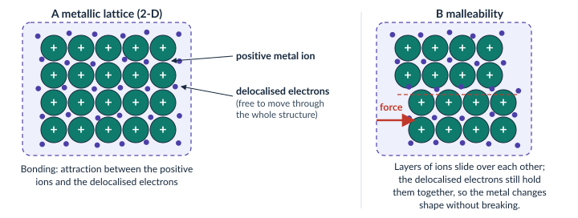

# Metallic bonding

## Specification coverage

| Point | Section |
| --- | --- |
| 1.52C | §1 |
| 1.53C | §1 |
| 1.54C | §2 |

## 1. The metallic lattice and metallic bonding — Paper 2 only

*Figure 1. To draw the lattice: regular rows of positive ions, with electrons between them, labelled.*

A metal is a **giant lattice** of **positive metal ions** arranged in regular layers. Each atom
has lost its outer electrons; these **delocalised electrons** are free to move through the whole
structure.

::: definition
**Metallic bonding** — the strong **electrostatic attraction** between the **positive metal ions**
and the **delocalised electrons**.
:::

## 2. Explaining the properties of metals — Paper 2 only

- **Good electrical conductors** — the delocalised electrons can **move through the structure**,
  carrying charge when a voltage is applied.
- **Malleable** (can be hammered into shape) — the ions are in **layers** that can **slide over
  each other** when a force is applied; the delocalised electrons still attract the ions in their
  new positions, so the bonding is not broken (Figure 1B).
- **High melting and boiling points** — many strong attractions between the ions and the
  delocalised electrons need a lot of energy to overcome.

## Common misunderstandings

| Wrong | Right |
| --- | --- |
| Metals conduct because ions move. | **Delocalised electrons** move; the ions stay in the lattice. |
| Metallic bonding is between neighbouring atoms sharing electrons. | It is attraction between positive **ions** and a sea of **delocalised electrons**. |
| Drawing neutral atoms in the lattice. | Draw and label **positive ions** (+) and **electrons** (e⁻). |
