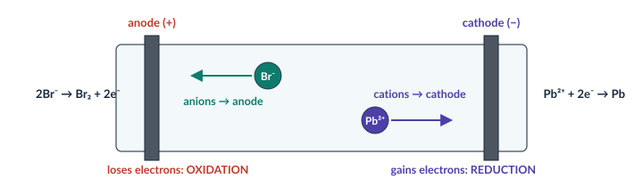
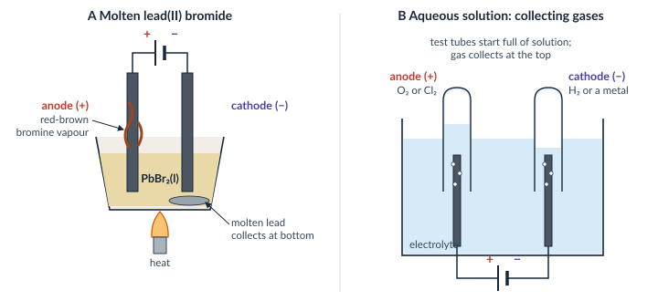

# Electrolysis

## Specification coverage

| Point | Section |
| --- | --- |
| 1.55C | §1 |
| 1.56C | §1 |
| 1.57C | §2 |
| 1.58C | §3, §4 |
| 1.59C | §2, §4 |
| 1.60C | §5 |

## 1. What conducts, and why — Paper 2 only

An electric current is a flow of **charged particles** that are **free to move**.

- **Covalent compounds** do not conduct: they are made of molecules, which have **no overall
  charge**, so there are no ions or free electrons to carry the current.
- **Ionic compounds** conduct only when **molten** or **in aqueous solution**: then the ions are
  free to move. In the solid the ions are held in fixed positions in the lattice.

## 2. Electrolysis, ions and half-equations — Paper 2 only

::: definition
**Electrolysis** — the breakdown of an ionic compound, molten or in aqueous solution, by passing
an electric current (d.c.) through it. The liquid is the **electrolyte**.

**Cation** — a positive ion; it moves to the **cathode** (negative electrode).

**Anion** — a negative ion; it moves to the **anode** (positive electrode).
:::

**Inert electrodes** (graphite or platinum) carry the current but do not react.

*Figure 1. Ions discharge by gaining or losing electrons at the electrodes.*

::: definition
**Oxidation** — loss of electrons. **Reduction** — gain of electrons ("OIL RIG").
:::

- At the **cathode**, cations **gain** electrons → **reduction**.
- At the **anode**, anions **lose** electrons → **oxidation**.

**Writing a half-equation:** write the ion and the element it forms, balance the atoms, then add
electrons so the **charges** balance. Electrons appear on the **left** at the cathode and on the
**right** at the anode.

## 3. Apparatus — Paper 2 only

*Figure 2. Graphite electrodes connected to a d.c. supply. Molten lead(II) bromide is electrolysed
in a fume cupboard: bromine vapour is toxic.*

## 4. Predicting the products — Paper 2 only

A **molten** compound gives the **metal** at the cathode and the **non-metal** at the anode.

An **aqueous solution** also contains **H⁺** and **OH⁻** ions from water, so two ions compete at
each electrode:

:::: grid
::: card | Cathode (−)
The **metal** forms if it is **less reactive than hydrogen** (e.g. copper, silver).
Otherwise **hydrogen** forms.
:::
::: card | Anode (+)
A **halogen** forms if **halide ions** (Cl⁻, Br⁻, I⁻) are present.
Otherwise (e.g. sulfate, nitrate) **oxygen** forms.
:::
::::

| Electrolyte | Cathode (−) | Anode (+) |
| --- | --- | --- |
| **molten lead(II) bromide** | lead: Pb²⁺ + 2e⁻ → Pb | bromine (red-brown vapour): 2Br⁻ → Br₂ + 2e⁻ |
| **sodium chloride solution** | hydrogen: 2H⁺ + 2e⁻ → H₂ | chlorine: 2Cl⁻ → Cl₂ + 2e⁻ |
| **dilute sulfuric acid** | hydrogen: 2H⁺ + 2e⁻ → H₂ | oxygen: 4OH⁻ → O₂ + 2H₂O + 4e⁻ |
| **copper(II) sulfate solution** | copper (pink-brown coating): Cu²⁺ + 2e⁻ → Cu | oxygen: 4OH⁻ → O₂ + 2H₂O + 4e⁻ |

- Sodium chloride solution: the solution left becomes sodium hydroxide (alkaline).
- Dilute sulfuric acid: the volume of hydrogen is **twice** the volume of oxygen.
- Copper(II) sulfate solution: the blue colour **fades** as Cu²⁺ ions are removed.

## 5. Practical: electrolysis of aqueous solutions — Paper 2 only

1. Fill the cell with the solution. Fill two small test tubes with the same solution and invert
   them over the graphite electrodes (Figure 2B).
2. Connect a low-voltage d.c. supply and switch on. Observe each electrode: bubbles of gas, or a
   solid coating.
3. When a tube has collected gas, test it:

| Gas | Test | Result |
| --- | --- | --- |
| hydrogen | lighted splint | burns with a squeaky pop |
| oxygen | glowing splint | relights |
| chlorine | damp blue litmus paper | turns red, then bleached white |

Repeat with other solutions and compare the products with the §4 rules. Chlorine is toxic: use low
concentrations, a short run and good ventilation.

## Common misunderstandings

| Wrong | Right |
| --- | --- |
| Sodium forms at the cathode in sodium chloride solution. | Sodium is more reactive than hydrogen, so **hydrogen** forms. |
| Anions go to the cathode. | **An**ions go to the **an**ode (+); cations to the cathode (−). |
| 2Cl⁻ + 2e⁻ → Cl₂ | The anode half-equation **loses** electrons: 2Cl⁻ → Cl₂ + 2e⁻. |
| Reduction happens at the anode. | Reduction (gain of electrons) at the **cathode**; oxidation at the **anode**. |
