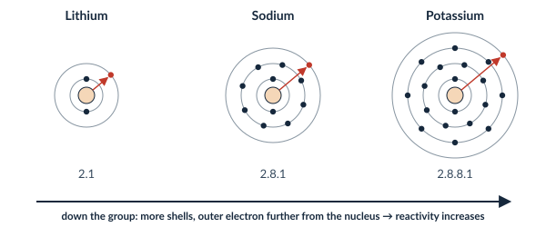

# Group 1 (alkali metals) – lithium, sodium and potassium

## Specification coverage

| Point | Section |
| --- | --- |
| 2.1 | §1 |
| 2.2 | §1 |
| 2.3 | §2 |
| 2.4C | §3 |

## 1. Reactions with water and air

Every alkali metal reacts with water in the **same way**, giving the **same kind of products**:

::: note | General equation
alkali metal + water → metal hydroxide + hydrogen

2M(s) + 2H₂O(l) → 2MOH(aq) + H₂(g)  e.g. 2Na + 2H₂O → 2NaOH + H₂
:::

In each case the metal **floats**, **fizzes** (hydrogen), **moves** about on the surface and
**disappears**, and the solution left is **alkaline** (universal indicator turns blue/purple).
The same reaction and the same type of product are the evidence that lithium, sodium and potassium
are a **family** of elements (they have the same number of outer electrons — Topic 1(d)).

The **differences** are in how vigorously they react:

| | Lithium | Sodium | Potassium |
| --- | --- | --- | --- |
| **With water** | fizzes steadily; moves slowly | melts into a ball; fizzes rapidly; moves quickly | melts; fizzes violently; hydrogen ignites with a **lilac** flame |
| **In air** (freshly cut surface) | tarnishes slowly | tarnishes quickly | tarnishes very quickly |

Sodium and potassium melt because the reaction releases heat and their melting points are low.
In air, a freshly cut surface tarnishes (goes dull) as an **oxide** forms: 4Na + O₂ → 2Na₂O, so
the metals are stored under **oil**.

Faster tarnishing and more vigorous reactions with water show that **reactivity increases down
Group 1: lithium < sodium < potassium**.

## 2. Predicting other alkali metals

Down the group: **reactivity increases**, **melting point decreases**, the metals get **softer**.
So rubidium and caesium (below potassium):

- react **even more violently** with water (explosively) and tarnish almost instantly in air;
- form the same types of compound: 2Rb + 2H₂O → 2RbOH + H₂, oxide Rb₂O, ion Rb⁺;
- have **lower melting points** than potassium.

::: note | Worked example
Melting points: Li 181 °C, Na 98 °C, K 63 °C. The trend predicts rubidium is lower again —
about 40 °C (actual value 39 °C).
:::

## 3. Why reactivity increases down the group — Paper 2 only

*Figure 1. Each atom has one outer electron (red); down the group it is in a shell further from
the nucleus.*

1. An alkali metal reacts by **losing its one outer electron** to form a **1+ ion** (e.g. Na⁺).
2. Down the group the atoms have **more shells**, so the outer electron is **further from the
   nucleus** and **more shielded** by the inner shells.
3. The **attraction** between the nucleus and the outer electron is therefore **weaker**.
4. The outer electron is **lost more easily**, so the metal is **more reactive**.

## Common misunderstandings

| Wrong | Right |
| --- | --- |
| Sodium and water form sodium oxide. | They form sodium **hydroxide** (alkaline solution) and **hydrogen**. |
| Potassium is more reactive because it has more electrons to lose. | Each loses **one** outer electron; potassium loses it **more easily**. |
| Down the group the nucleus has more protons, so it holds the outer electron more strongly. | The extra **shells** (greater distance and shielding) make the attraction **weaker**. |
