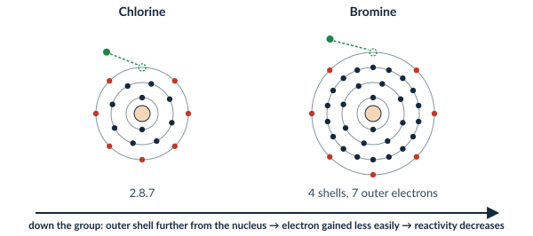

# Group 7 (halogens) – chlorine, bromine and iodine

## Specification coverage

| Point | Section |
| --- | --- |
| 2.5 | §1 |
| 2.6 | §2 |
| 2.7 | §3 |
| 2.8C | §4 |

## 1. Colours, states and physical trends

The halogens exist as **diatomic molecules**: Cl₂, Br₂, I₂.

| Halogen | State at room temperature | Colour | Colour in aqueous solution |
| --- | --- | --- | --- |
| **Chlorine** | gas | pale yellow-green | very pale green (almost colourless) |
| **Bromine** | liquid | red-brown (orange-brown vapour) | orange |
| **Iodine** | solid | grey-black (purple vapour) | brown |

Down the group:

- the colour gets **darker**;
- **melting and boiling points increase** (gas → liquid → solid): the molecules get bigger, so the
  **intermolecular forces** get stronger and more energy is needed to separate the molecules
  (Topic 1(g)).

## 2. Predicting other halogens

Continue the trends. **Fluorine** (above chlorine) is a very pale yellow gas with a lower boiling
point and is **more reactive**. **Astatine** (below iodine) is a **black solid** with a higher
melting point, and is **less reactive** — it would not displace iodine (§3).

## 3. Displacement reactions: the reactivity trend

::: definition
**Displacement** — a **more reactive halogen** displaces a **less reactive halogen** from a
solution of its halide (e.g. chlorine displaces bromine from potassium bromide solution).
:::

Add each halogen solution to each potassium halide solution and look for a **colour change**:

| Halogen added ↓ / solution → | potassium chloride | potassium bromide | potassium iodide |
| --- | --- | --- | --- |
| **chlorine water** | — | turns **orange** (Br₂ formed) | turns **brown** (I₂ formed) |
| **bromine water** | no reaction | — | turns **brown** (I₂ formed) |
| **iodine solution** | no reaction | no reaction | — |

Chlorine displaces two halogens, bromine one, iodine none, so **reactivity decreases down the
group: chlorine > bromine > iodine**.

::: note | Equations
Cl₂(aq) + 2KBr(aq) → 2KCl(aq) + Br₂(aq)  ionic: **Cl₂ + 2Br⁻ → 2Cl⁻ + Br₂**

Br₂(aq) + 2KI(aq) → 2KBr(aq) + I₂(aq)  ionic: **Br₂ + 2I⁻ → 2Br⁻ + I₂**
:::

K⁺ ions do not change, so they are left out of the ionic equation. These are **redox** reactions
(Topic 2(d)): the halogen **gains** electrons (is reduced); the halide ion **loses** electrons (is
oxidised).

## 4. Why reactivity decreases down the group — Paper 2 only

*Figure 1. Each atom needs one more electron (green) to fill its outer shell; in bromine the outer
shell is further from the nucleus.*

1. A halogen reacts by **gaining one electron** to complete its outer shell, forming a **1− ion**
   (e.g. Cl⁻).
2. Down the group the atoms have **more shells**, so the outer shell is **further from the
   nucleus** and **more shielded** by the inner shells.
3. The **attraction** between the nucleus and an incoming electron is therefore **weaker**.
4. An electron is **gained less easily**, so the halogen is **less reactive**.

## Common misunderstandings

| Wrong | Right |
| --- | --- |
| Iodine is purple. | Solid iodine is **grey-black**; its **vapour** is purple; its solution is **brown**. |
| Chlorine and chloride are the same thing. | **Chlorine**, Cl₂, is the element; **chloride**, Cl⁻, is the ion in compounds such as KCl. |
| Bromine water displaces chlorine from potassium chloride. | A **less** reactive halogen cannot displace a more reactive one: no reaction. |
| Reactivity decreases because bromine has more outer electrons. | Both have **7** outer electrons; bromine's outer shell is **further** from the nucleus. |
