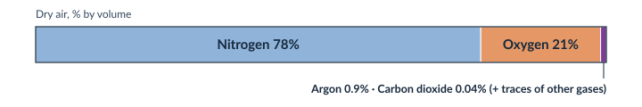
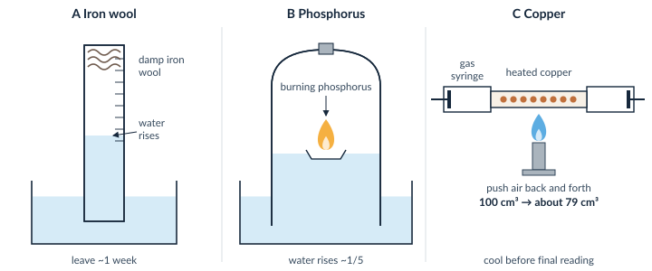
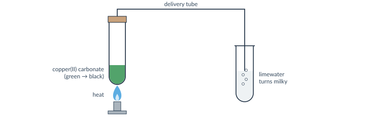

# Gases in the atmosphere

## Specification coverage

| Point | Section |
| --- | --- |
| 2.9 | §1 |
| 2.10 | §2 |
| 2.14 | §2 |
| 2.11 | §3 |
| 2.12 | §4 |
| 2.13 | §5 |

## 1. Composition of dry air

*Figure 1. The four most abundant gases in dry air, by volume.*

## 2. Practical: the percentage of oxygen in air

**Principle.** Trap a known volume of air with a substance that **reacts with the oxygen** and
removes it. The **decrease in gas volume = volume of oxygen**.

*Figure 2. Metal (iron, copper) and non-metal (phosphorus) methods. In A and B water rises to
replace the oxygen used up; in C the total syringe volume falls.*

- **A — iron (metal).** Push **damp** iron wool (rusting needs water) into the top of a measuring
  cylinder, invert it in water and record the volume of air. Leave for about a **week**, until the
  water level **stops rising**, then read the final volume.
- **B — phosphorus (non-metal).** Burning phosphorus uses up the oxygen: 4P + 5O₂ → P₄O₁₀; the
  oxide dissolves in the water.
- **C — copper (metal).** Pass the air back and forth over **heated copper** until the volume
  **stops changing**; the copper turns black (2Cu + O₂ → 2CuO). **Let the apparatus cool** to room
  temperature before the final reading, because hot gas has a larger volume.

::: note | Calculation
percentage of oxygen = (starting volume − final volume) ÷ starting volume × 100

Syringe C: 100 cm³ → 79 cm³, so (100 − 79) ÷ 100 × 100 = **21%**.
:::

A result **below 21%** means not all the oxygen reacted (not left long enough, too little iron or
copper) or the final volume was read while the gas was still warm.

## 3. Combustion of elements in oxygen

Elements burn more brightly in pure oxygen than in air, forming **oxides**.

| Element | What you see | Product | Equation |
| --- | --- | --- | --- |
| **Magnesium** | very bright **white flame**; white powder left | magnesium oxide (**basic**) | 2Mg + O₂ → 2MgO |
| **Hydrogen** | burns with a pale blue flame (pops if mixed with air first) | **water** | 2H₂ + O₂ → 2H₂O |
| **Sulfur** | **blue flame**; colourless, choking gas | sulfur dioxide (**acidic**) | S + O₂ → SO₂ |

## 4. Thermal decomposition of metal carbonates

::: note | General equation
metal carbonate → metal oxide + carbon dioxide  e.g. **CuCO₃(s) → CuO(s) + CO₂(g)**
:::

*Figure 3. Green copper(II) carbonate turns into black copper(II) oxide; the carbon dioxide turns
limewater milky.*

Take the delivery tube **out of the limewater before you stop heating**, or cold limewater is
sucked back into the hot tube (suck-back).

## 5. Carbon dioxide and climate change

- Carbon dioxide is a **greenhouse gas**: it absorbs heat (infrared radiation) given off by the
  Earth's surface, keeping the atmosphere warm.
- Burning fossil fuels is **increasing** the amount of carbon dioxide in the atmosphere. More heat
  is trapped, which **may contribute to climate change**.

## Common misunderstandings

| Wrong | Right |
| --- | --- |
| Carbon dioxide is the third most abundant gas in air. | **Argon** (0.9%) is third; carbon dioxide is only 0.04%. |
| The water rises because oxygen dissolves in the water. | The oxygen is **used up** by reacting with the iron, copper or phosphorus. |
| Heating copper(II) carbonate gives copper and carbon dioxide. | It gives copper(II) **oxide** and carbon dioxide. |
