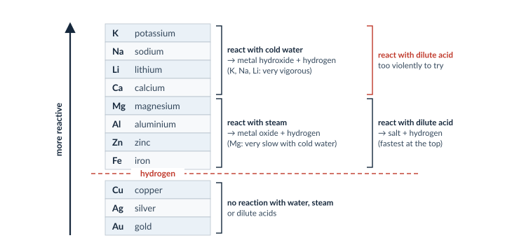
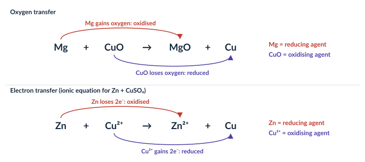
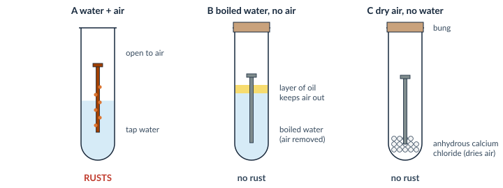

# Reactivity series

## Specification coverage

| Point | Section |
| --- | --- |
| 2.15 | §1 |
| 2.17 | §1 |
| 2.21 | §2 |
| 2.16 | §3 |
| 2.20 | §4 |
| 2.18 | §5 |
| 2.19 | §5 |

## 1. The order, and reactions with water and dilute acids

*Figure 1. The reactivity series. The more vigorous the reaction with water or acid, the higher the
metal.*

::: note | Equations
cold water: **metal + water → metal hydroxide + hydrogen**  Ca + 2H₂O → Ca(OH)₂ + H₂

steam: **metal + steam → metal oxide + hydrogen**  Mg + H₂O(g) → MgO + H₂

dilute acid: **metal + acid → salt + hydrogen**  Zn + H₂SO₄ → ZnSO₄ + H₂
:::

Aluminium reacts less than its position suggests because a thin, tough layer of **aluminium
oxide** on its surface protects it.

## 2. Practical: metals with dilute acids

1. Put the **same volume** of the **same acid**, at the **same concentration and temperature**, into
   each of three test tubes.
2. Add **equal-sized** pieces (same mass and surface area) of magnesium, zinc and iron.
3. Compare the **rate of bubbling** and measure the **temperature rise** with a thermometer.
4. Test the gas with a **lighted splint**: a squeaky pop shows **hydrogen**.
5. Repeat with the other acid (hydrochloric or sulfuric).

| | Magnesium | Zinc | Iron |
| --- | --- | --- | --- |
| **Observation** | vigorous fizzing; large temperature rise | steady fizzing | slow bubbling |
| **With hydrochloric acid** | Mg + 2HCl → MgCl₂ + H₂ | Zn + 2HCl → ZnCl₂ + H₂ | Fe + 2HCl → FeCl₂ + H₂ |
| **With sulfuric acid** | Mg + H₂SO₄ → MgSO₄ + H₂ | Zn + H₂SO₄ → ZnSO₄ + H₂ | Fe + H₂SO₄ → FeSO₄ + H₂ |

Order: **magnesium > zinc > iron**. Copper gives no reaction. Wear eye protection.

## 3. Displacement reactions

::: definition
**Displacement** — a **more reactive metal** displaces a **less reactive metal** from its
compounds.
:::

**Metal + metal oxide** (heated together): the more reactive metal takes the oxygen.

- Mg + CuO → MgO + Cu  (black powder → pink-brown copper)
- 2Al + Fe₂O₃ → Al₂O₃ + 2Fe  (thermite: very exothermic, molten iron forms)

**Metal + solution of a metal salt:** Zn(s) + CuSO₄(aq) → ZnSO₄(aq) + Cu(s) — the blue colour
fades, pink-brown copper coats the zinc, the temperature rises. If the added metal is **less**
reactive, nothing happens.

To place metals in order, count how many other metals each one displaces (✓ = reaction):

| Metal added ↓ / solution → | magnesium sulfate | zinc sulfate | iron(II) sulfate | copper(II) sulfate |
| --- | --- | --- | --- | --- |
| **magnesium** | — | ✓ | ✓ | ✓ |
| **zinc** | ✗ | — | ✓ | ✓ |
| **iron** | ✗ | ✗ | — | ✓ |
| **copper** | ✗ | ✗ | ✗ | — |

Three, two, one, none: **Mg > Zn > Fe > Cu**.

## 4. Oxidation, reduction and redox

::: definition
**Oxidation** — gain of oxygen, or **loss of electrons**.

**Reduction** — loss of oxygen, or **gain of electrons**.

**Redox reaction** — a reaction in which oxidation and reduction happen at the same time.

**Oxidising agent** — a substance that oxidises another substance; it is itself **reduced** (it
gains electrons or gives away oxygen).

**Reducing agent** — a substance that reduces another substance; it is itself **oxidised** (it
loses electrons or takes oxygen).
:::

*Figure 2. Every displacement reaction is redox. The more reactive metal loses electrons more
readily, so it is the reducing agent.*

## 5. Rusting and its prevention

**Rust** is hydrated iron(III) oxide. Iron rusts only when **both water and oxygen** are present.
Rusting is an oxidation: iron gains oxygen (Fe atoms lose electrons to form Fe³⁺).

*Figure 3. Only the nail with both water and air rusts.*

| Method | What is done | How it prevents rusting |
| --- | --- | --- |
| **Barrier** | paint, oil or grease, plastic coating | keeps **water and oxygen** away from the iron; fails if scratched |
| **Galvanising** | coat the iron with a layer of **zinc** | zinc is a barrier; if it is scratched, the zinc still corrodes **instead of** the iron |
| **Sacrificial protection** | attach blocks of a **more reactive metal** (zinc or magnesium), e.g. to ship hulls | the more reactive metal **loses electrons more readily**, so it is oxidised instead of the iron; the blocks are replaced |

## Common misunderstandings

| Wrong | Right |
| --- | --- |
| Copper reacts slowly with dilute acid. | Copper is **below hydrogen**: no reaction. |
| In Zn + CuSO₄, zinc is reduced. | Zinc **loses** electrons: it is **oxidised** (the reducing agent); Cu²⁺ is reduced. |
| An oxidising agent is oxidised. | An oxidising agent is itself **reduced**. |
| Iron rusts in water alone. | Rusting needs **both water and oxygen**. |
| Galvanising only works as a barrier. | Zinc also protects **sacrificially** once scratched. |
