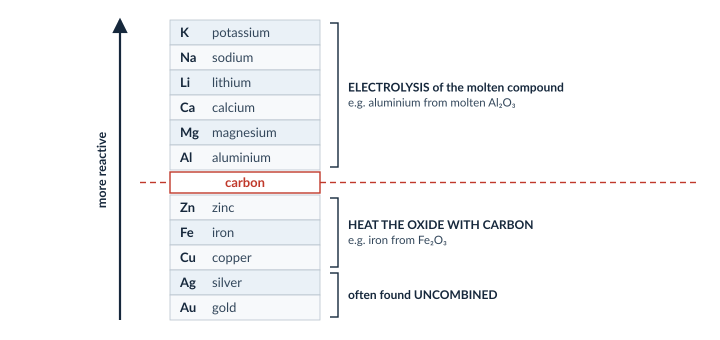
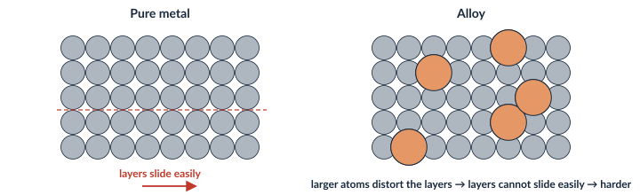

# Extraction and uses of metals

## Specification coverage

| Point | Section |
| --- | --- |
| 2.22C | §1 |
| 2.23C | §2 |
| 2.24C | §3 |
| 2.26C | §4 |
| 2.27C | §4 |
| 2.25C | §5 |

## 1. Ores and native metals — Paper 2 only

- Most metals are found in the **Earth's crust** as **compounds** (often oxides) in **ores**: rocks
  containing enough of a metal compound to make extraction worthwhile. Iron ore contains
  iron(III) oxide, Fe₂O₃; aluminium ore contains aluminium oxide, Al₂O₃.
- **Unreactive metals** such as gold (and some silver) are often found as the **uncombined
  element**, because they do not react with oxygen or water.

Extracting a metal from its oxide is **reduction**: the oxide loses oxygen and the metal ions gain
electrons.

## 2. The method depends on reactivity — Paper 2 only

*Figure 1. Carbon can remove oxygen only from the oxides of metals below it in the reactivity
series.*

- Metals **more reactive than carbon** hold on to oxygen too strongly for carbon to remove it, so
  they are extracted by **electrolysis** of the **molten** compound. This uses a lot of electricity,
  so it is **expensive**.
- Metals **less reactive than carbon** are extracted more cheaply by **heating the oxide with
  carbon**.

:::: grid
::: card | Iron — reduction with carbon
Iron(III) oxide is heated with carbon (coke) in a blast furnace. Carbon is the **reducing agent**:

2Fe₂O₃ + 3C → 4Fe + 3CO₂

In the furnace, most of the reduction is by carbon monoxide made from the coke:
Fe₂O₃ + 3CO → 2Fe + 3CO₂
:::
::: card | Aluminium — electrolysis
Aluminium is **more reactive than carbon**, so molten aluminium oxide is electrolysed:

cathode (−): Al³⁺ + 3e⁻ → Al

anode (+): 2O²⁻ → O₂ + 4e⁻

High temperatures and a large current make aluminium expensive to extract.
:::
::::

## 3. Commenting on an extraction process — Paper 2 only

You are not expected to know any process in detail; use the information given. Comment on:

- whether the **method** fits the metal's **position** in the reactivity series;
- **energy cost**: high temperatures and electricity cost more than heating with carbon;
- **raw materials**: how much metal the ore contains, how cheap and available the reactants are;
- **environmental effects**: carbon dioxide released (climate change), mining, waste;
- **recycling**, which saves energy and ore.

## 4. Alloys — Paper 2 only

::: definition
**Alloy** — a **mixture** of a metal with one or more other elements, usually other metals or
carbon.
:::

*Figure 2. Why alloys are harder than pure metals.*

In a pure metal all the atoms are the **same size**, arranged in **regular layers** that slide
over each other easily when a force is applied. In an alloy, atoms of a **different size**
**distort the layers**, so the layers **cannot slide** over each other as easily: the alloy is
**harder**.

## 5. Uses and properties — Paper 2 only

| Metal | Property | Use |
| --- | --- | --- |
| **Aluminium** | **low density**; resists corrosion (protective oxide layer) | aircraft bodies, drinks cans |
| | good electrical conductor with low density | overhead power cables |
| **Copper** | very good **electrical conductor**; ductile (can be drawn into wires) | electrical wiring |
| | **unreactive** (does not corrode in water); easily bent | water pipes |
| **Iron** | pure iron is **soft** and rusts easily | mostly converted into steel |
| **Low-carbon (mild) steel** | strong and **malleable** (easily shaped) | car bodies, ships, wire |
| **High-carbon steel** | **harder** and stronger, but more **brittle** | cutting tools, hammers |
| **Stainless steel** (with chromium and nickel) | **resists corrosion** (does not rust) | cutlery, sinks, surgical instruments |

Steel is an alloy of iron with carbon (and sometimes other metals); more carbon makes it harder
but more brittle.

## Common misunderstandings

| Wrong | Right |
| --- | --- |
| An alloy is a compound. | An alloy is a **mixture**. |
| Aluminium is extracted with carbon because that is cheaper. | Aluminium is **more reactive than carbon**, so carbon cannot reduce its oxide. |
| Alloys are harder because their atoms are bonded more strongly. | Different-sized atoms **distort the layers**, so the layers cannot slide easily. |
| Aluminium resists corrosion because it is unreactive. | It is fairly reactive; a thin **oxide layer** protects it. |
