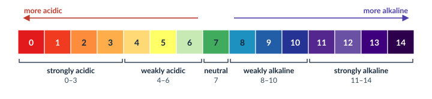
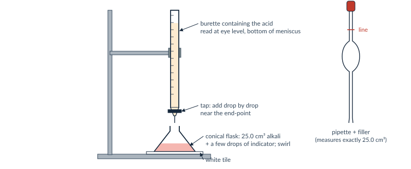

# Acids, alkalis and titrations

## Specification coverage

| Point | Section |
| --- | --- |
| 2.28 | §1 |
| 2.29 | §2 |
| 2.30 | §2 |
| 2.31 | §3 |
| 2.32 | §3 |
| 2.33C | §4 |

## 1. Indicators: acid or alkali?

Add a few drops of indicator to the solution (or dip in litmus paper). The colour shows whether the
solution is acidic or alkaline — not how strongly.

| Indicator | In acid | In alkali |
| --- | --- | --- |
| **Litmus** | red | blue |
| **Phenolphthalein** | colourless | pink |
| **Methyl orange** | red | yellow |

## 2. The pH scale and universal indicator

*Figure 1. Classifying solutions by pH, with the universal indicator colour for each value.*

**Measuring pH with universal indicator:** add a few drops of universal indicator solution to the
solution (or put a drop of the solution on universal indicator paper), then **compare the colour
with the pH colour chart** and read off the pH. The value is only **approximate** (a whole number)
because the colour is judged by eye.

## 3. Hydrogen ions, hydroxide ions and neutralisation

::: definition
**Acid** — in aqueous solution, a source of **hydrogen ions, H⁺(aq)**. e.g. HCl(aq) → H⁺(aq) + Cl⁻(aq)

**Alkali** — in aqueous solution, a source of **hydroxide ions, OH⁻(aq)**. e.g. NaOH(aq) → Na⁺(aq) + OH⁻(aq)
:::

Alkalis **neutralise** acids, forming a salt and water; the pH moves towards 7:

::: note | Neutralisation
acid + alkali → salt + water  e.g. HCl(aq) + NaOH(aq) → NaCl(aq) + H₂O(l)

ionic equation for every acid–alkali neutralisation: **H⁺(aq) + OH⁻(aq) → H₂O(l)**
:::

## 4. How to carry out an acid–alkali titration — Paper 2 only

A titration finds the exact volume of acid that neutralises a known volume of alkali.

1. Using a **pipette** and pipette filler, transfer **25.0 cm³** of the alkali into a **conical
   flask**.
2. Add a few drops of **indicator** — phenolphthalein or methyl orange, **not** universal
   indicator (its colour changes gradually, so there is no sharp end-point). Stand the flask on a
   **white tile** so the colour change is easy to see.
3. Fill the **burette** with the acid and record the **initial reading** (read the bottom of the
   meniscus at eye level).
4. Add the acid while **swirling** the flask, **drop by drop** near the end-point, until the
   indicator **just changes colour permanently** (phenolphthalein: pink → colourless; methyl
   orange: yellow → orange).
5. Record the **final reading**. **Titre = final reading − initial reading.**
6. **Repeat** until you have **concordant** titres (within 0.10 cm³ of each other); use their
   **mean**.

*Figure 2. Titration apparatus.*

The first titration is usually a quick, rough one to find the approximate end-point. Titration
calculations: Topic 1(e).

## Common misunderstandings

| Wrong | Right |
| --- | --- |
| Phenolphthalein is pink in acid. | Phenolphthalein is **colourless** in acid, **pink** in alkali. |
| pH 8–10 is strongly alkaline. | 8–10 is **weakly** alkaline; 11–14 is strongly alkaline. |
| Universal indicator is fine for a titration. | It has no sharp colour change; use **phenolphthalein** or **methyl orange**. |
| Titre = final reading. | Titre = **final − initial** reading. |
