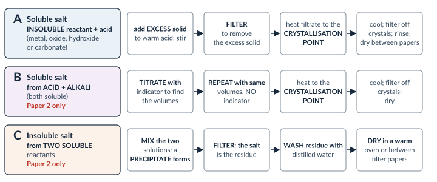

# Acids, bases and salt preparations

## Specification coverage

| Point | Section |
| --- | --- |
| 2.34 | §1 |
| 2.35 | §2 |
| 2.36 | §2 |
| 2.38 | §2 |
| 2.37 | §3 |
| 2.39 | §4, §5 |
| 2.42 | §5 |
| 2.40C | §6 |
| 2.41C | §7 |
| 2.43C | §7 |

## 1. Solubility rules

| Compounds | Soluble | Insoluble |
| --- | --- | --- |
| **Sodium, potassium, ammonium** | all common ones | — |
| **Nitrates** | all | — |
| **Chlorides** | most | silver chloride, lead(II) chloride |
| **Sulfates** | most | barium sulfate, calcium sulfate, lead(II) sulfate |
| **Carbonates** | sodium, potassium, ammonium carbonates | all other common carbonates |
| **Hydroxides** | sodium, potassium hydroxides (calcium hydroxide slightly) | all other common hydroxides |

## 2. Acids, bases and alkalis

::: definition
**Acid** — a **proton donor**. **Base** — a **proton acceptor**. (A proton is a hydrogen ion, H⁺.)
:::

In every acid–base reaction a **proton is transferred** from the acid to the base:

- HCl + NH₃ → NH₄⁺ + Cl⁻  (HCl donates H⁺; NH₃ accepts it)
- H⁺ + OH⁻ → H₂O  (OH⁻ accepts H⁺)
- 2H⁺ + O²⁻ → H₂O  (the oxide ion accepts H⁺)

**Bases** include **metal oxides**, **metal hydroxides** and **ammonia**. An **alkali** is a base
that is **soluble in water** (e.g. sodium hydroxide, potassium hydroxide, ammonia solution).
Copper(II) oxide is a base but not an alkali, because it is insoluble.

## 3. Reactions of acids that make salts

A **salt** forms when the hydrogen of an acid is replaced by a metal (or ammonium) ion.
**Hydrochloric acid** makes **chlorides**, **sulfuric acid** makes **sulfates**, **nitric acid**
makes **nitrates**.

| Acid + | Products | Examples | What you see |
| --- | --- | --- | --- |
| **metal** (not nitric acid) | salt + hydrogen | Zn + 2HCl → ZnCl₂ + H₂; Mg + H₂SO₄ → MgSO₄ + H₂ | fizzing; metal disappears |
| **base** (metal oxide or hydroxide) | salt + water | CuO + H₂SO₄ → CuSO₄ + H₂O; NaOH + HNO₃ → NaNO₃ + H₂O | black CuO dissolves → blue solution |
| **metal carbonate** | salt + water + carbon dioxide | CaCO₃ + 2HCl → CaCl₂ + H₂O + CO₂; CuCO₃ + 2HNO₃ → Cu(NO₃)₂ + H₂O + CO₂ | fizzing; gas turns limewater milky |
| **ammonia** | ammonium salt | NH₃ + HNO₃ → NH₄NO₃ | — |

## 4. Choosing the preparation method

Decide first whether the salt is **soluble** (§1), then whether the reactants are soluble.

*Figure 1. Three routes to a pure, dry salt.*

## 5. Practical: hydrated copper(II) sulfate from copper(II) oxide

CuO(s) + H₂SO₄(aq) → CuSO₄(aq) + H₂O(l)  Crystals: **CuSO₄·5H₂O** (blue).

The method is route A in Figure 1 (the black solid dissolves and the solution turns **blue**).
The reasons earn the marks:

- **Warm the acid** (do not boil) — speeds up the reaction.
- **Add CuO until some is left unreacted** (excess) — all the acid is used up, so the salt is not
  contaminated with acid.
- **Filter** — removes the excess copper(II) oxide.
- **Heat to the crystallisation point** (crystals form on a cold glass rod dipped in) — the
  solution is now saturated. Evaporating to dryness would drive off the **water of
  crystallisation**.
- **Cool** — the salt is less soluble when cold, so crystals form.
- **Rinse with a little cold distilled water, dry between filter papers** — removes the remaining
  solution; gentle drying keeps the water of crystallisation.

## 6. Soluble salt from an acid and an alkali — Paper 2 only

e.g. NaOH(aq) + HCl(aq) → NaCl(aq) + H₂O(l)

Route B in Figure 1. Both reactants are **soluble**, so an excess cannot be filtered off: the
**exact** volumes are found by **titration** with an indicator (Topic 2(f)). The titration is then
**repeated without indicator**, so the salt is not contaminated, and the solution is crystallised
as in §5.

## 7. Insoluble salt from two soluble reactants — Paper 2 only

Mix a solution containing the salt's **cation** with a solution containing its **anion** —
use soluble compounds such as nitrates and sodium salts. The insoluble salt forms as a
**precipitate**.

::: note | Practical: lead(II) sulfate
Pb(NO₃)₂(aq) + Na₂SO₄(aq) → PbSO₄(s) + 2NaNO₃(aq)  ionic: **Pb²⁺(aq) + SO₄²⁻(aq) → PbSO₄(s)**

(Dilute sulfuric acid can supply the sulfate ions instead.)
:::

Route C in Figure 1: a **white precipitate** forms; it is the **residue** after filtering. Washing
with distilled water removes the soluble sodium nitrate. Lead compounds are toxic: wear gloves.

## Common misunderstandings

| Wrong | Right |
| --- | --- |
| All bases are alkalis. | Only **soluble** bases are alkalis. |
| Add excess acid to make sure the reaction is complete. | Add excess of the **insoluble solid**, which can then be **filtered off**. |
| Evaporate the copper(II) sulfate solution to dryness. | Heat to the **crystallisation point**, then **cool**. |
| In a precipitation, keep the filtrate. | The insoluble salt is the **residue** in the filter paper. |
| All sulfates are soluble. | Barium, calcium and lead(II) sulfates are **insoluble**. |
