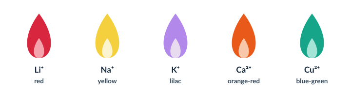

# Chemical tests

## Specification coverage

| Point | Section |
| --- | --- |
| 2.44 | §1 |
| 2.45 | §2 |
| 2.46 | §2 |
| 2.47 | §3 |
| 2.48 | §4 |
| 2.49 | §5 |
| 2.50 | §5 |

## 1. Tests for gases

| Gas | Test | Positive result |
| --- | --- | --- |
| **Hydrogen** | hold a **lighted splint** at the mouth of the tube | burns with a **squeaky pop** |
| **Oxygen** | put a **glowing splint** into the gas | the splint **relights** |
| **Carbon dioxide** | bubble the gas through **limewater** | limewater turns **milky** (cloudy) |
| **Ammonia** | hold **damp red litmus paper** in the gas | turns **blue** |
| **Chlorine** | hold **damp blue litmus paper** in the gas | turns red, then is **bleached** white |

## 2. Flame tests

1. Clean a **nichrome** (or platinum) wire loop: dip it in **concentrated hydrochloric acid** and
   hold it in a hot, **blue Bunsen flame** until it gives no colour.
2. Dip the clean loop in the acid, then into the **solid** sample.
3. Hold the loop in the **edge of the blue flame** and observe the colour.

*Figure 1. Flame test colours.*

## 3. Tests for cations with sodium hydroxide solution

Add a few drops of **sodium hydroxide solution** to a solution of the compound. Cu²⁺, Fe²⁺ and
Fe³⁺ form **coloured precipitates** of the metal hydroxide (Figure 2), e.g.

Cu²⁺(aq) + 2OH⁻(aq) → Cu(OH)₂(s)  Fe³⁺(aq) + 3OH⁻(aq) → Fe(OH)₃(s)

**Ammonium, NH₄⁺:** add sodium hydroxide solution and **warm**. **Ammonia** gas is given off:
it turns **damp red litmus paper blue**. NH₄⁺ + OH⁻ → NH₃ + H₂O

*Figure 2. Precipitate colours for the cation and anion tests.*

## 4. Tests for anions

- **Halides (Cl⁻, Br⁻, I⁻):** add **dilute nitric acid**, then **silver nitrate solution**.
  Precipitate: chloride **white**, bromide **cream**, iodide **yellow**. e.g. Ag⁺ + Cl⁻ → AgCl
- **Sulfate (SO₄²⁻):** add **dilute hydrochloric acid**, then **barium chloride solution**.
  **White** precipitate of barium sulfate: Ba²⁺ + SO₄²⁻ → BaSO₄
- **Carbonate (CO₃²⁻):** add **dilute hydrochloric acid**. **Effervescence** (fizzing); the gas turns
  **limewater milky** (carbon dioxide). CO₃²⁻ + 2H⁺ → CO₂ + H₂O

**Why acidify first?** The acid removes **carbonate ions**, which would also give a precipitate.
Use **nitric** acid for halides (hydrochloric acid would add chloride ions) and **hydrochloric**
acid for sulfate (sulfuric acid would add sulfate ions).

## 5. Water: is it there, and is it pure?

- **Test for water:** add the liquid to **anhydrous copper(II) sulfate** — it turns from **white
  to blue**. This shows water is present, not that the water is pure.
- **Test for pure water (physical test):** pure water **boils at exactly 100 °C** (and melts at
  exactly 0 °C). Impurities make water boil above 100 °C, over a range of temperatures (Topic 1(b)).

## Common misunderstandings

| Wrong | Right |
| --- | --- |
| Carbon dioxide puts out a lighted splint, so that is its test. | Many gases do that; the test is **limewater turning milky**. |
| Acidify with hydrochloric acid before adding silver nitrate. | Use **nitric** acid — hydrochloric acid adds Cl⁻ ions. |
| Iron(II) gives an orange-brown precipitate. | Iron(**II**) → **green**; iron(**III**) → **orange-brown**. |
| Anhydrous copper(II) sulfate turning blue shows the water is pure. | It shows water is **present**; purity needs the **boiling point** (100 °C). |
