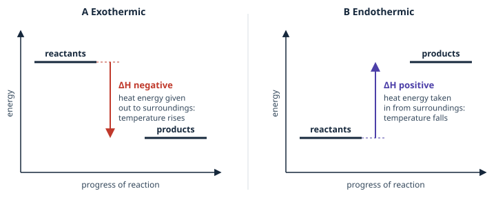
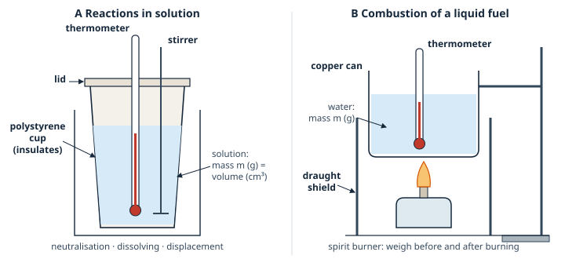
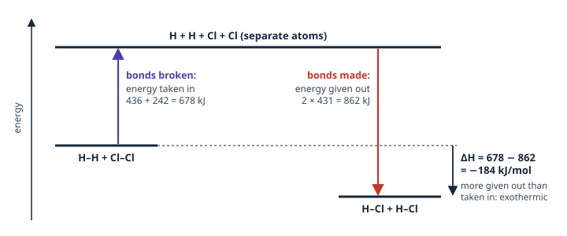

# Energetics

## Specification coverage

| Point | Section |
| --- | --- |
| 3.1 | §1 |
| 3.2 | §3 |
| 3.3 | §4 |
| 3.4 | §4 |
| 3.5C | §2 |
| 3.6C | §5 |
| 3.7C | §5 |
| 3.8 | §3 |

## 1. Exothermic and endothermic reactions

::: definition
**Exothermic** — a reaction in which heat energy is **given out** (to the surroundings).

**Endothermic** — a reaction in which heat energy is **taken in** (from the surroundings).

**Enthalpy change, ΔH** — the heat energy change of a reaction, in kJ/mol. **Negative** for
exothermic, **positive** for endothermic.
:::

You detect it with a thermometer in the mixture: the **temperature rises** in an exothermic
reaction and **falls** in an endothermic one.

## 2. Energy level diagrams — Paper 2 only



*Figure 1. Draw the reactants and products as horizontal levels, label both, and draw the ΔH
arrow from the reactants to the products.*

- **Exothermic:** the products have **less** energy than the reactants; the difference is given
  out as heat, so ΔH is negative.
- **Endothermic:** the products have **more** energy than the reactants; the difference is taken
  in as heat, so ΔH is positive.

## 3. Calorimetry experiments (practical)

A **calorimetry** experiment measures the temperature change a reaction causes in a known mass of
water or solution.



*Figure 2. A: reactions in solution. B: combustion — the flame heats the water in the can.*

**Reactions in solution** (Figure 2A) — for example:

| Type of change | Example | Result |
| --- | --- | --- |
| salt dissolving | ammonium nitrate in water | temperature falls: endothermic |
| neutralisation | hydrochloric acid + sodium hydroxide solution | temperature rises: exothermic |
| displacement | zinc powder + copper(II) sulfate solution | temperature rises: exothermic |

1. Measure a known volume of the solution (or water) into a polystyrene cup; record its starting
   temperature.
2. Add the second reactant (measured volume of solution, or weighed solid / powder), put on the
   lid and stir.
3. Record the **highest** temperature reached (or the **lowest** for an endothermic change).
   ΔT = difference from the starting temperature.

**Combustion** (Figure 2B):

1. Weigh the spirit burner containing the fuel. Put a measured mass of water in the copper can
   and record its temperature.
2. Light the burner and stir the water until its temperature has risen by about 20 °C, then put
   out the flame.
3. Record the final temperature and reweigh the burner: mass of fuel burned = difference.

**Why the measured value is too small (errors):** the main error is **heat lost to the
surroundings** (air, cup, can), so ΔT is smaller than it should be. In combustion there is also
**incomplete combustion** (soot on the can) and evaporation of fuel from the wick.
Reduce heat loss with an insulated cup and a **lid**, and in combustion a **draught shield** and
the flame close to the can.

## 4. Calculations: Q = mcΔT and ΔH

```
Q = m × c × ΔT
Q   heat energy change (J)
m   mass of the water or solution heated (g)     1 cm³ of solution = 1 g
c   specific heat capacity = 4.2 J/g/°C
ΔT  temperature change (°C)

ΔH = − Q ÷ n        (Q in kJ, n in mol → ΔH in kJ/mol)
```

- **m** is the mass of what is **heated** — the solution, or the water in the can — **never** the
  mass of the fuel or solid added.
- **n** is the number of moles of the reactant the question names (the one fully used up):
  n = mass ÷ Mr, or n = concentration × volume (dm³).
- The **minus sign** is yours to add: temperature rise → ΔH **negative**; temperature fall →
  ΔH **positive**.

::: note | Worked example — neutralisation
25.0 cm³ of 2.00 mol/dm³ HCl is added to 25.0 cm³ of 2.00 mol/dm³ NaOH. The temperature rises
from 20.0 °C to 33.5 °C. Calculate ΔH per mole of HCl.

Q = 50.0 × 4.2 × 13.5 = 2835 J = 2.835 kJ   (m = 25.0 + 25.0 cm³ of solution = 50.0 g)

n(HCl) = 2.00 × 25.0 ÷ 1000 = 0.0500 mol

ΔH = −2.835 ÷ 0.0500 = **−56.7 kJ/mol** (negative: the temperature rose)
:::

::: note | Worked example — combustion
Burning 0.46 g of ethanol (Mr = 46) raises the temperature of 100 g of water by 20.0 °C.

Q = 100 × 4.2 × 20.0 = 8400 J = 8.40 kJ;  n = 0.46 ÷ 46 = 0.0100 mol

ΔH = −8.40 ÷ 0.0100 = **−840 kJ/mol** — less exothermic than the data-book value, because of
heat loss and incomplete combustion.
:::

## 5. Bond energies — Paper 2 only

- **Bond breaking** is **endothermic** — energy is taken in to separate the atoms.
- **Bond making** is **exothermic** — energy is given out when new bonds form.

```
ΔH = (total energy of bonds broken) − (total energy of bonds made)
```

If more energy is given out making the product bonds than is taken in breaking the reactant
bonds, ΔH is negative (exothermic); if less, ΔH is positive (endothermic).



*Figure 3. H₂ + Cl₂ → 2HCl, bond energies (kJ/mol): H–H 436, Cl–Cl 242, H–Cl 431.*

::: note | Worked example — count every bond from the displayed formulae
CH₄ + 2O₂ → CO₂ + 2H₂O. Bond energies (kJ/mol): C–H 413, O=O 498, C=O 805, O–H 464.

Broken: 4 C–H + 2 O=O = 4(413) + 2(498) = 2648 kJ

Made: 2 C=O + 4 O–H = 2(805) + 4(464) = 3466 kJ

ΔH = 2648 − 3466 = **−818 kJ/mol**
:::

Multiply each bond by how many times it appears **and** by the number in front of the formula
(2O₂ = two O=O bonds; 2H₂O = four O–H bonds). Use the bond energies given in the question.

## Common misunderstandings

| Wrong | Right |
| --- | --- |
| m in Q = mcΔT is the mass of fuel burned. | m is the mass of **water** heated; the fuel mass is used for **n**. |
| Exothermic, so ΔH is positive. | Heat given out → ΔH **negative**. |
| ΔH = bonds made − bonds broken. | ΔH = bonds **broken** − bonds **made**. |
| Breaking bonds releases energy. | Breaking bonds **takes in** energy; making bonds releases it. |
