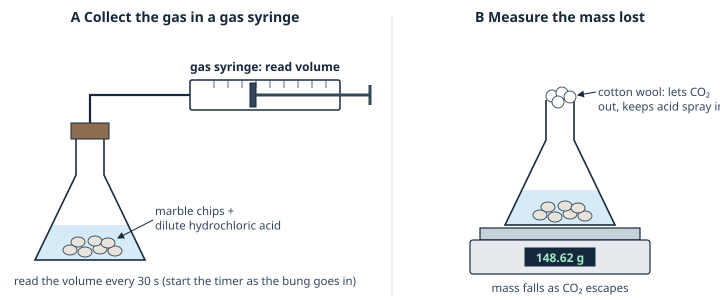
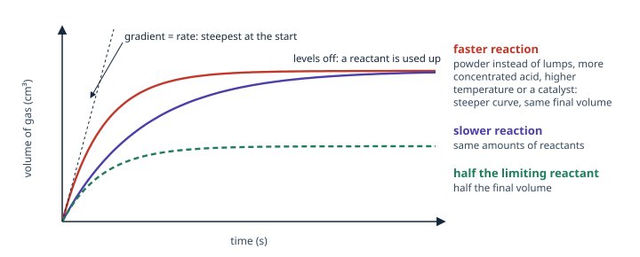
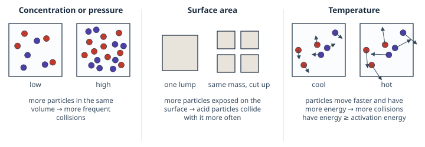
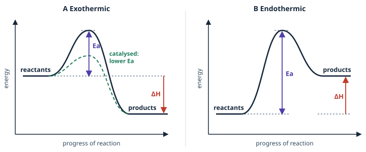

# Rates of reaction

## Specification coverage

| Point | Section |
| --- | --- |
| 3.9 | §1, §2, §6, §7 |
| 3.10 | §2 |
| 3.11 | §3 |
| 3.12 | §4 |
| 3.13 | §4, §5 |
| 3.14C | §5 |
| 3.15 | §6 |
| 3.16 | §7 |

## 1. Measuring the rate of a reaction

The **rate** of a reaction is how fast a reactant is used up or a product is formed. When a gas is
made, follow the reaction by measuring the gas **volume** or the **mass lost** at regular time
intervals.

*Figure 1. Two ways to follow a reaction that gives off a gas.*

*Figure 2. Reading a rate graph. Compare rates by comparing the gradients at the start.*

The gradient falls as the reactants are used up. The **final volume** depends only on the
**amount** of limiting reactant, not on how fast the reaction goes.

## 2. What changes the rate

**Increasing** each of these **increases** the rate:

| Factor | How to change it in an experiment |
| --- | --- |
| surface area of a solid | same mass of solid as large lumps → small pieces → powder |
| concentration of a solution | same volume of acid at different concentrations |
| pressure of a gas | (reactions between gases only) |
| temperature | warm the acid in a water bath to different temperatures before adding it |
| catalyst | add a small mass of catalyst; compare with no catalyst |

In each experiment, change **one** factor only and keep the others the same (same mass of solid,
same volume and concentration of solution, same temperature). Measure the gas given off over time
(Figure 1) and compare the initial gradients. The two required experiments are §6 and §7.

## 3. Collision theory

Particles can react only when they **collide** with enough energy.

::: definition
**Activation energy (Ea)** — the minimum energy that colliding particles must have for them to
react.
:::

A collision with at least the activation energy is a **successful** collision. The rate depends on
the **frequency of successful collisions**.

*Figure 3. How each factor changes the collisions.*

- **Concentration (solution) / pressure (gas):** more particles in the same volume → collisions
  are **more frequent**.
- **Surface area:** smaller pieces have more particles exposed on the surface → **more frequent**
  collisions with the other reactant.
- **Temperature:** particles have **more kinetic energy** and move faster → a **greater
  proportion of collisions have energy ≥ activation energy**, and collisions are also more
  frequent. The energy effect is the main reason.

## 4. Catalysts

::: definition
**Catalyst** — a substance that increases the rate of a reaction but is chemically unchanged at
the end of the reaction.
:::

A catalyst provides an **alternative pathway** (reaction route) with a **lower activation energy**,
so a greater proportion of collisions are successful.

## 5. Reaction profile diagrams — Paper 2 only

*Figure 4. A catalyst lowers the peak but not ΔH.*

Draw an energy axis, labelled reactants and products levels and a curve rising over a peak
between them. Both arrows start at the **reactants** level: **Ea** up to the top of the peak;
**ΔH** to the products (down for exothermic, up for endothermic).

## 6. Practical: marble chips and hydrochloric acid

CaCO₃(s) + 2HCl(aq) → CaCl₂(aq) + H₂O(l) + CO₂(g)

1. Put a measured volume of dilute hydrochloric acid in a conical flask.
2. Add a weighed mass of marble chips, insert the bung connected to a gas syringe and start the
   timer (or use a balance and cotton wool plug — Figure 1).
3. Record the volume of CO₂ (or the mass) every 30 s until it stops changing.
4. Plot volume against time; compare the gradients at the start.

| | Surface area experiment | Concentration experiment |
| --- | --- | --- |
| **Change** | size of chips (large, small, powder) | concentration of acid |
| **Keep the same** | mass of chips; volume, concentration and temperature of acid | size and mass of chips; volume and temperature of acid |
| **Result** | smaller chips → faster | more concentrated acid → faster |

Main error: gas escapes before the bung is in. Repeat each run and take a mean.

## 7. Practical: catalysts for hydrogen peroxide decomposition

2H₂O₂(aq) → 2H₂O(l) + O₂(g)

1. Put the same volume and concentration of hydrogen peroxide solution in a conical flask
   connected to a gas syringe (Figure 1A, without the marble).
2. Add the same mass of a powdered solid (e.g. manganese(IV) oxide, copper(II) oxide), bung
   quickly and start the timer.
3. Record the volume of oxygen every 30 s (or the volume after a fixed time). Repeat with each
   solid, and once with no solid.

The solid giving oxygen fastest is the best catalyst. To show it is a catalyst, filter it off at
the end, wash, dry and weigh it: the **mass is unchanged**.

## Common misunderstandings

| Wrong | Right |
| --- | --- |
| Higher temperature gives more product. | It gives the same amount of product **faster**. |
| Particles collide more, so the rate increases (temperature). | Mainly: **more collisions have energy ≥ Ea**. |
| More collisions (concentration). | More **frequent** collisions — more collisions **per second**. |
| A catalyst gives the particles more energy. | It gives a pathway with a **lower** activation energy. |
| A catalyst changes ΔH. | ΔH is unchanged; only Ea is lowered. |
