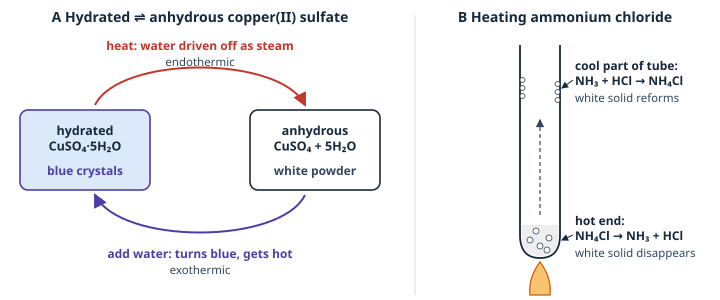
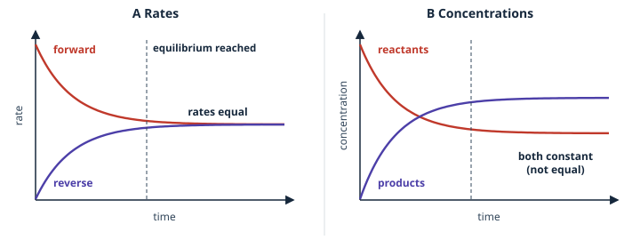

# Reversible reactions and equilibria

## Specification coverage

| Point | Section |
| --- | --- |
| 3.17 | §1 |
| 3.18 | §1 |
| 3.19C | §2 |
| 3.20C | §2 |
| 3.21C | §3 |
| 3.22C | §4 |

## 1. Reversible reactions

A **reversible reaction** can go in both directions: the products can react to re-form the
reactants. The symbol **⇌** shows this.



*Figure 1. The two reversible reactions to describe.*

```
CuSO₄·5H₂O(s)  ⇌  CuSO₄(s) + 5H₂O(l)
hydrated (blue)    anhydrous (white)

NH₄Cl(s)  ⇌  NH₃(g) + HCl(g)
```

- **Copper(II) sulfate:** heating blue hydrated crystals drives off the water of
  crystallisation (steam) and leaves white anhydrous powder. Adding water turns it **blue** again
  and the mixture **gets hot**.
- **Ammonium chloride:** heating the white solid decomposes it into ammonia and hydrogen chloride
  gases. At the **cooler** top of the tube they react to re-form white solid ammonium chloride.

If a reaction is **endothermic** in one direction, it is **exothermic** in the other, by the
**same** amount of energy (dehydrating copper(II) sulfate takes in heat; rehydrating it gives the
heat out).

## 2. Dynamic equilibrium — Paper 2 only

In a **sealed container** (nothing can get in or out), a reversible reaction reaches **dynamic
equilibrium**.



*Figure 2. At first only the forward reaction happens; as products build up the reverse reaction
speeds up until the two rates are equal.*

::: definition
**Dynamic equilibrium** — the state in which:

- the forward and reverse reactions occur at the **same rate**
- the **concentrations** of reactants and products remain **constant**.
:::

**Dynamic** means both reactions are still happening; the concentrations stay constant (but are
usually **not** equal) because each substance is made as fast as it is used up.

The **position of equilibrium** describes the relative amounts of reactants and products.
"Shifts to the **right**" = more products; "to the **left**" = more reactants.

## 3. A catalyst does not change the position — Paper 2 only

A catalyst lowers the activation energy of the forward **and** the reverse reaction, so it
**increases both rates equally**. Equilibrium is reached **faster**, but the position of
equilibrium — the amounts of reactants and products — is **unchanged**.

## 4. Changing temperature or pressure — Paper 2 only

::: definition
**Temperature:** an increase shifts the position of equilibrium in the direction of the
**endothermic** reaction; a decrease shifts it in the direction of the **exothermic** reaction.

**Pressure:** an increase shifts the position of equilibrium in the direction that produces
**fewer moles of gas**; a decrease shifts it towards **more** moles of gas.
:::

ΔH given with an equation is for the **forward** reaction. Count only **gas** moles (g).

::: note | Worked example
N₂(g) + 3H₂(g) ⇌ 2NH₃(g)   ΔH = −92 kJ/mol

Forward reaction exothermic; left side 1 + 3 = **4** mol gas, right side **2** mol gas.

| Change | Position of equilibrium | Yield of NH₃ |
| --- | --- | --- |
| increase temperature | left (endothermic direction) | decreases |
| decrease temperature | right (exothermic direction) | increases |
| increase pressure | right (fewer moles of gas) | increases |
| decrease pressure | left (more moles of gas) | decreases |
| add a catalyst | no change | no change |
:::

If both sides have the **same** number of moles of gas (e.g. H₂(g) + I₂(g) ⇌ 2HI(g)), changing
the pressure does **not** move the position of equilibrium.

## Common misunderstandings

| Wrong | Right |
| --- | --- |
| At equilibrium the reactions stop. | Both continue, at the **same rate** (dynamic). |
| At equilibrium the concentrations are equal. | They are **constant**, not equal. |
| A catalyst gives more product at equilibrium. | Same position, reached **faster**. |
| Increasing temperature shifts towards the exothermic side. | Towards the **endothermic** side. |
| Count every mole in the equation for pressure. | Count **gas** moles only. |
