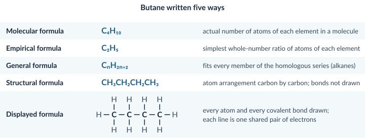
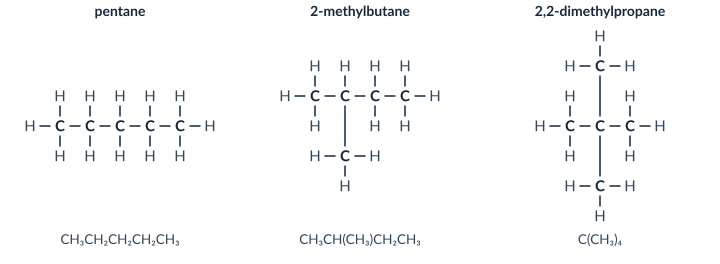

# Introduction to organic chemistry

## Specification coverage

| Point | Section |
| --- | --- |
| 4.1 | §1 |
| 4.2 | §2 |
| 4.3 | §3 |
| 4.4 | §4 |
| 4.5 | §5 |
| 4.6 | §6 |

## 1. Hydrocarbons

::: definition
**Hydrocarbon** — a compound of **hydrogen and carbon only**.
:::

Alkanes and alkenes are hydrocarbons. Alcohols, carboxylic acids and esters are **not**: they also
contain oxygen.

## 2. Five ways to write an organic molecule

*Figure 1. Each formula shows something different. Carbon forms 4 bonds, hydrogen 1, oxygen 2.*

To get an **empirical formula**, divide the molecular formula by the highest common factor:
C₄H₁₀ → C₂H₅, C₂H₄ → CH₂. If there is no common factor (CH₄, C₃H₈) the two formulae are the same.

## 3. Homologous series, functional groups and isomers

::: definition
**Homologous series** — a family of compounds with the **same general formula** and the **same
functional group**, which have **similar chemical properties** and a **gradual trend in physical
properties** (e.g. boiling point rises as the molecules get bigger). Each member differs from the
next by **CH₂**.

**Functional group** — an atom or group of atoms that determines the characteristic **chemical
reactions** of a compound.

**Isomers** — compounds with the **same molecular formula** but **different structural
(displayed) formulae**. This is called **isomerism**.
:::

## 4. Naming compounds (IUPAC)

A name is built from a **stem** (number of carbon atoms in the longest chain) and an **ending**
(the homologous series).

| Carbon atoms | 1 | 2 | 3 | 4 | 5 | 6 |
| --- | --- | --- | --- | --- | --- | --- |
| **Stem** | meth- | eth- | prop- | but- | pent- | hex- |

::: card | Endings
| Series | Functional group | Name pattern | Example |
| --- | --- | --- | --- |
| alkane | none (C–C single bonds only) | -ane | propane |
| alkene | C=C | -ene | but-1-ene |
| alcohol | –OH | -anol | propan-1-ol |
| carboxylic acid | –COOH | -anoic acid | butanoic acid |
| ester | –COO– | alkyl alkanoate | ethyl ethanoate |
:::

Rules:

1. Find the **longest carbon chain** (containing the functional group). This gives the stem. In a
   carboxylic acid the carbon of –COOH counts.
2. Number the chain from the end that gives the **functional group** (or branch) the **lowest
   number**, and put the number before the ending: **but-1-ene**, **but-2-ene**, **propan-1-ol**.
   No number is needed where only one position is possible (ethene, propene, ethanol).
3. **Branches and halogen atoms** are prefixes with their position: **methyl-**, **chloro-**,
   **bromo-**, **fluoro-**. Two or more of the same use **di-**, **tri-**, **tetra-**:
   **2-methylbutane**, **1,2-dibromoethane**, **tetrafluoroethene**.

## 5. Isomers from a molecular formula

*Figure 2. The three isomers of C₅H₁₂. C₄H₁₀ has two: butane and 2-methylpropane (methylpropane).*

Method:

1. Draw the **longest straight chain** of all the carbon atoms.
2. Shorten the chain by one carbon and attach that carbon as a **branch** to an **inner** carbon.
   Then try two branches, and so on.
3. For alkenes, also **move the C=C** to each different position (but-1-ene, but-2-ene).
4. Add hydrogens so every C has **4 bonds**, then check each drawing has the given molecular formula.
5. Discard **duplicates**: bending a chain, flipping it, or putting a branch on an **end** carbon (which
   only makes the chain longer) does not make a new isomer.

## 6. Classifying organic reactions

| Type | What happens | Example |
| --- | --- | --- |
| **Substitution** | one atom (or group) in a molecule is **replaced** by a different atom or group | alkane + halogen in UV light: CH₄ + Cl₂ → CH₃Cl + HCl |
| **Addition** | two molecules **join to form one** product; the C=C becomes C–C | alkene + bromine: C₂H₄ + Br₂ → C₂H₄Br₂ (also + steam; addition polymerisation) |
| **Combustion** | reaction with **oxygen** that releases heat | CH₄ + 2O₂ → CO₂ + 2H₂O |

Only alkenes (with C=C) do addition reactions. Substitution gives **two** products; addition gives
**one**.
