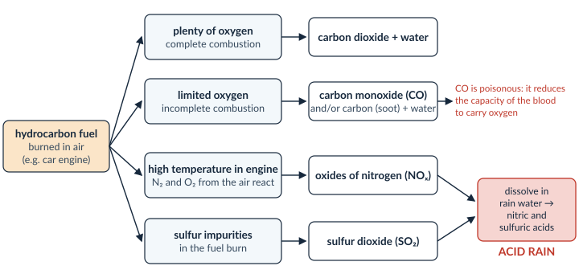
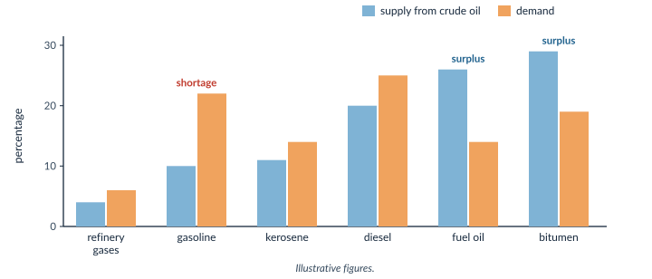

# Crude oil

## Specification coverage

| Point | Section |
| --- | --- |
| 4.7 | §1 |
| 4.8 | §1 |
| 4.9 | §1 |
| 4.10 | §1 |
| 4.11 | §2 |
| 4.12 | §2 |
| 4.13 | §3 |
| 4.14 | §3 |
| 4.15 | §3 |
| 4.16 | §3 |
| 4.17 | §4 |
| 4.18 | §4 |

## 1. Fractional distillation of crude oil

**Crude oil is a mixture of hydrocarbons** (mainly alkanes) with different chain lengths, and so
different boiling points. Fractional distillation separates it into **fractions**: mixtures of
hydrocarbons with **similar boiling points** (similar numbers of carbon atoms).

*Figure 1. The column is hot at the bottom and cool at the top.*

1. Crude oil is heated in a furnace until most of it **vaporises**.
2. The vapour enters the **bottom** of the fractionating column. The column has a **temperature
   gradient**: hottest at the bottom, coolest at the top.
3. The vapours **rise** and **cool**. Each hydrocarbon **condenses** at the level where the
   temperature is just below its boiling point, and that fraction is drawn off there.
4. Small molecules (low boiling points) stay as gases and leave at the top as **refinery gases**.
   The largest molecules do not vaporise; they are drained from the bottom as **bitumen**.

Going down the column the molecules get **longer**, so the intermolecular forces get **stronger**:
boiling point rises, and the fractions become **more viscous** and **darker**.

## 2. Fuels and combustion

::: definition
**Fuel** — a substance that, when burned, **releases heat energy**.
:::

**Complete combustion** (plenty of oxygen) → **carbon dioxide + water**:

> CH₄ + 2O₂ → CO₂ + 2H₂O

**Incomplete combustion** (limited oxygen) → **carbon monoxide** and/or **carbon** (soot) **+ water**:

> 2CH₄ + 3O₂ → 2CO + 4H₂O
>
> CH₄ + O₂ → C + 2H₂O

## 3. Pollutants from burning fuels

*Figure 2. Where each pollutant comes from.*

**Carbon monoxide is poisonous** because it **reduces the capacity of the blood to carry oxygen**,
so the body's cells receive less oxygen.

**Oxides of nitrogen.** Nitrogen is normally unreactive, but in car engines the **temperature is
high enough** for **nitrogen and oxygen from the air** to react:

> N₂ + O₂ → 2NO
>
> 2NO + O₂ → 2NO₂

**Sulfur dioxide.** Some hydrocarbon fuels contain **sulfur compounds as impurities**. When the fuel
burns, the sulfur is oxidised:

> S + O₂ → SO₂

**Acid rain.** Sulfur dioxide and oxides of nitrogen **dissolve in water droplets** in the air and
react with water and oxygen to form **sulfuric acid** and **nitric acid**. Rain containing them is
**acid rain**.

## 4. Catalytic cracking

::: definition
**Cracking** — breaking **long-chain alkanes** into **shorter-chain alkanes** and **alkenes**.
:::

The long-chain alkanes are **vaporised** and the vapour is passed over a **catalyst of silica or
alumina** at **600–700 °C**. The molecules break into smaller ones:

> C₁₀H₂₂ → C₈H₁₈ + C₂H₄    (decane → octane + ethene)

The atoms must balance. An alkane does not have enough hydrogen to make two alkanes, so at least one
product is always an **alkene**.

*Figure 3. Supply and demand for each fraction.*

**Why cracking is necessary:** fractional distillation gives **more long-chain fractions** (fuel oil,
bitumen) than are needed and **less short-chain fractions** (gasoline) than are demanded. Cracking
converts the surplus long chains into shorter, more useful molecules such as **gasoline**, and makes
**alkenes** for polymers (4(h)).

## Common misunderstandings

| Wrong | Right |
| --- | --- |
| Crude oil is separated by chemical reactions. | Fractional distillation is a **physical** separation by boiling point. |
| Oxides of nitrogen come from nitrogen in the fuel. | They come from **N₂ and O₂ in the air**, at the high engine temperature. |
