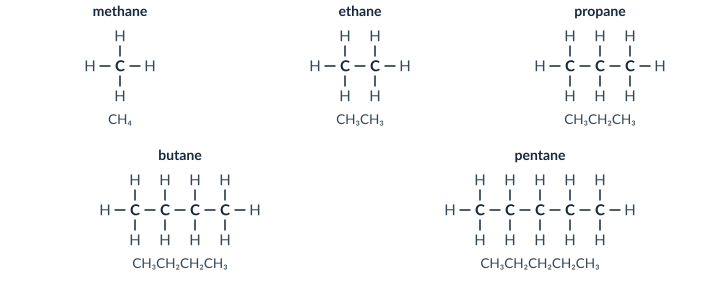
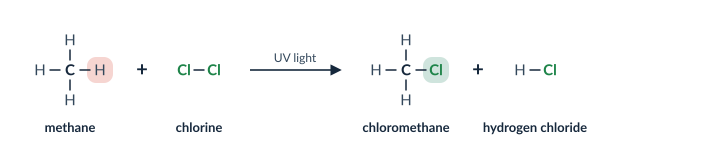

# Alkanes

## Specification coverage

| Point | Section |
| --- | --- |
| 4.19 | §1 |
| 4.20 | §1 |
| 4.21 | §2 |
| 4.22 | §3 |

## 1. General formula and saturation

**General formula of the alkanes: CₙH₂ₙ₊₂** (e.g. n = 3: C₃H₈).

::: definition
**Saturated hydrocarbon** — a hydrocarbon containing **only single carbon–carbon bonds** (no C=C
double bonds).
:::

Alkanes are **saturated**: every carbon already has four atoms bonded to it, so no more atoms can be
added to the molecule.

## 2. Formulae and names (up to five carbons)

*Figure 1. The unbranched alkanes. Each carbon has four single bonds.*

Butane and pentane also have **branched isomers** (see 4(a) Figure 2).

## 3. Substitution with halogens

In **ultraviolet (UV) light**, an alkane reacts with a halogen (e.g. chlorine or bromine). **One
hydrogen atom is replaced by one halogen atom** (mono-substitution), making a **halogenoalkane** and a
**hydrogen halide**. UV light provides the energy for the reaction; there is no reaction in the dark.

*Figure 2. One H is swapped for one Cl.*

> CH₄ + Cl₂ → CH₃Cl + HCl    (chloromethane + hydrogen chloride)
>
> C₂H₆ + Br₂ → C₂H₅Br + HBr    (bromoethane + hydrogen bromide)

In general: **CₙH₂ₙ₊₂ + X₂ → CₙH₂ₙ₊₁X + HX**. With bromine, the orange colour fades. From propane
upwards the halogen can replace an H on different carbons (1-bromopropane or 2-bromopropane); either
is a correct product.
