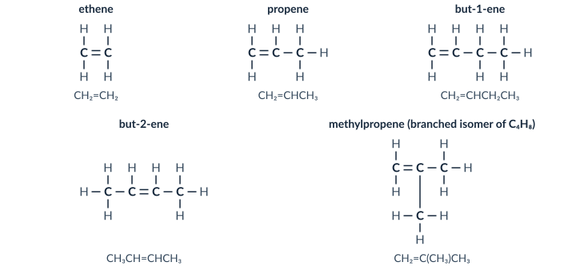
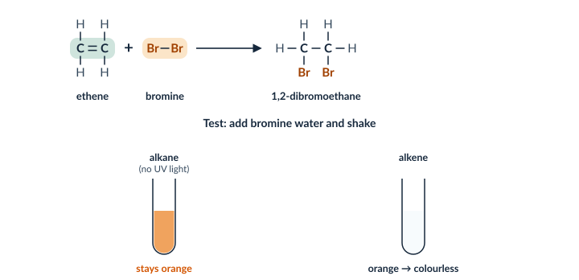

# Alkenes

## Specification coverage

| Point | Section |
| --- | --- |
| 4.23 | §1 |
| 4.24 | §1 |
| 4.25 | §1 |
| 4.26 | §2 |
| 4.27 | §3 |
| 4.28 | §4 |

## 1. Functional group, general formula and unsaturation

Alkenes contain the functional group **>C=C<**, a carbon–carbon **double bond**.

**General formula of the alkenes: CₙH₂ₙ** (e.g. n = 3: C₃H₆). The smallest alkene is ethene (n = 2).

::: definition
**Unsaturated hydrocarbon** — a hydrocarbon containing a **carbon–carbon double bond (C=C)**.
:::

Because of the C=C, more atoms can be **added** to the molecule: the double bond opens and each carbon
bonds to a new atom (an addition reaction).

## 2. Formulae and names (up to four carbons)

*Figure 1. C₄H₈ has three alkene isomers: two unbranched (named) and one branched.*

The number in the name gives the position of the C=C, counted from the nearer end: in
**but-1-ene** it is between carbons 1 and 2; in **but-2-ene** between carbons 2 and 3.

## 3. Addition of bromine

An alkene reacts with bromine at room temperature (no UV light needed). The C=C opens and **one
bromine atom adds to each carbon** of the former double bond, forming a **dibromoalkane**:

*Figure 2. Addition of bromine (top) is the basis of the bromine water test (bottom).*

> C₂H₄ + Br₂ → C₂H₄Br₂    (1,2-dibromoethane)
>
> C₃H₆ + Br₂ → C₃H₆Br₂    (1,2-dibromopropane)

## 4. Bromine water: alkane or alkene?

Add **bromine water** (orange) to each hydrocarbon and shake:

- **alkene** → bromine water turns from **orange to colourless** (bromine adds across the C=C);
- **alkane** → bromine water **stays orange** (no C=C, and no substitution without UV light).

Write **colourless**, not "clear".
