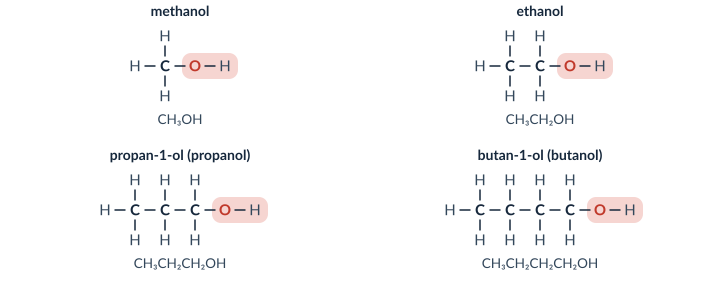

# Alcohols

## Specification coverage

| Point | Section |
| --- | --- |
| 4.29C | §1 |
| 4.30C | §1 |
| 4.31C | §2 |
| 4.32C | §2 |
| 4.33C | §3 |

## 1. The –OH group; formulae and names — Paper 2 only

Alcohols contain the functional group **–OH**, an O atom **covalently** bonded to an H atom. It is not
a hydroxide ion: alcohols are not alkalis.

*Figure 1. The –OH is on the end carbon in all four. "Propanol" and "butanol" are accepted names.*

## 2. Reactions and manufacture of ethanol — Paper 2 only

*Figure 2. The two manufacturing methods (left) and three ways ethanol is oxidised (right), with
conditions.*

Burning oxidises ethanol completely to CO₂ and water; the other two oxidations give **ethanoic acid**.

## 3. Why fermentation needs these conditions — Paper 2 only

**In the absence of air:** if oxygen gets in, microbes **oxidise the ethanol to ethanoic acid**
(and yeast respires aerobically, making carbon dioxide and water instead of ethanol).

**At an optimum temperature (about 30 °C):** the **enzymes** in yeast work fastest here. Below it,
fermentation is **too slow**; much above it, the enzymes are **denatured** and fermentation stops.
