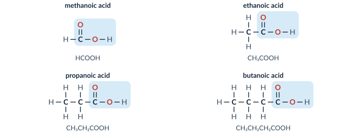

# Carboxylic acids

## Specification coverage

| Point | Section |
| --- | --- |
| 4.34C | §1 |
| 4.35C | §1 |
| 4.36C | §2 |
| 4.37C | §3 |

## 1. The –COOH group; formulae and names — Paper 2 only

Carboxylic acids contain the functional group **–COOH**: a carbon with a **double bond to one O** and
a **single bond to an –OH**.

*Figure 1. The shaded –COOH group. Its carbon counts in the name: butanoic acid has four carbons.*

## 2. Reactions with metals and metal carbonates — Paper 2 only

Aqueous carboxylic acids react like other acids, forming **salts**. The salts of ethanoic acid are
**ethanoates** (ion CH₃COO⁻); likewise methanoates, propanoates, butanoates.

**Acid + metal → salt + hydrogen.** Fizzing; the metal gets smaller.

> 2CH₃COOH + Mg → (CH₃COO)₂Mg + H₂    (magnesium ethanoate: Mg²⁺ needs two CH₃COO⁻)

**Acid + metal carbonate → salt + water + carbon dioxide.** Fizzing; the gas turns limewater milky.

> 2CH₃COOH + Na₂CO₃ → 2CH₃COONa + H₂O + CO₂    (sodium ethanoate)
>
> 2CH₃COOH + CaCO₃ → (CH₃COO)₂Ca + H₂O + CO₂    (calcium ethanoate)

## 3. Vinegar — Paper 2 only

**Vinegar is an aqueous solution containing ethanoic acid**, made by microbial oxidation of ethanol
(4(e)).
