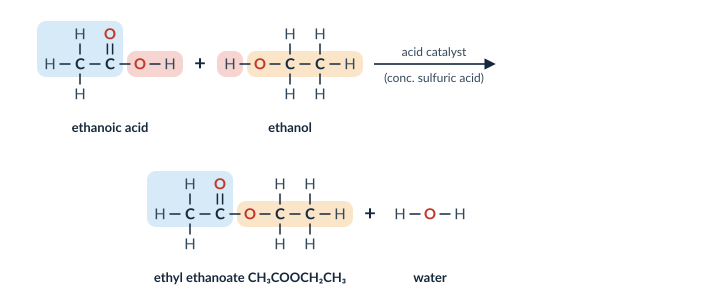
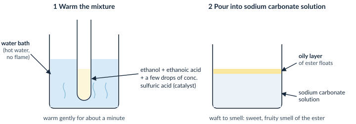

# Esters

## Specification coverage

| Point | Section |
| --- | --- |
| 4.38C | §1 |
| 4.39C | §1 |
| 4.40C | §1 |
| 4.41C | §2 |
| 4.42C | §3 |
| 4.43C | §4 |

## 1. The ester group and ethyl ethanoate — Paper 2 only

Esters contain the functional group **–COO–**: a carbon with a **double bond to one O** and a
**single bond to an O that links to another carbon**.

**Ethyl ethanoate** is the ester made when **ethanol** and **ethanoic acid** react in the presence
of an **acid catalyst** (concentrated sulfuric acid). Water is also formed.

*Figure 1. The acid loses –OH, the alcohol loses H; the two parts join through the O.*

> CH₃COOH + CH₃CH₂OH → CH₃COOCH₂CH₃ + H₂O    (ethyl ethanoate; also written CH₃COOC₂H₅)

## 2. Any ester from its acid and alcohol — Paper 2 only

- **Name:** alcohol part first, ending **-yl**; acid part second, ending **-oate**.
- **Formula:** acid part first (…COO), then the alcohol's carbon chain.
- **Displayed formula:** draw the acid with its C=O, replace the H of its –OH with the alcohol's
  carbon chain (as in Figure 1).
- **Reverse:** split the ester at the **single-bonded O**. The side with **C=O** came from the acid;
  the other carbon chain came from the alcohol.

| Alcohol | Carboxylic acid | Ester | Structural formula |
| --- | --- | --- | --- |
| methanol | propanoic acid | methyl propanoate | CH₃CH₂COOCH₃ |
| propan-1-ol | ethanoic acid | propyl ethanoate | CH₃COOCH₂CH₂CH₃ |
| ethanol | methanoic acid | ethyl methanoate | HCOOCH₂CH₃ |

## 3. Properties and uses — Paper 2 only

Esters are **volatile** (evaporate easily) and have **distinctive**, often sweet or fruity,
**smells**. They are used as **food flavourings** and in **perfumes**.

## 4. Practical: preparing an ester — Paper 2 only

*Figure 2. Preparing a small sample of ethyl ethanoate.*

1. Mix about 1 cm³ of **ethanol** and 1 cm³ of **ethanoic acid** in a test tube; add a **few drops
   of concentrated sulfuric acid** (catalyst).
2. **Warm gently in a hot water bath** for about a minute.
3. Pour the mixture into a beaker of **sodium carbonate solution**. This **neutralises the acids**
   (fizzing), so their smell does not mask the ester. The ester does not mix with water and forms an
   **oily layer on top**.
4. **Waft** the vapour towards your nose: a sweet, fruity smell shows an ester has formed.

**Safety:** ethanol is **flammable**, so heat with a water bath, **no naked flame**; concentrated
sulfuric acid is **corrosive**, so wear eye protection and gloves.
