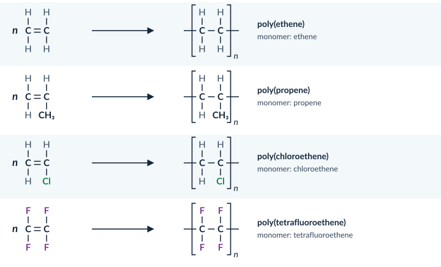
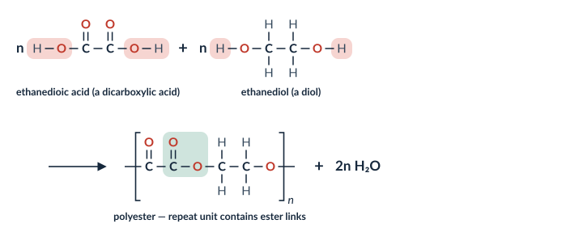

# Synthetic polymers

## Specification coverage

| Point | Section |
| --- | --- |
| 4.44 | §1 |
| 4.45 | §2 |
| 4.46 | §2 |
| 4.47 | §3 |
| 4.48C | §4 |
| 4.49C | §4 |
| 4.50C | §5 |

## 1. Addition polymerisation

::: definition
**Addition polymer** — a long molecule formed by joining up **many small molecules called
monomers**.
:::

The monomers are **alkenes**. In **addition polymerisation** the C=C of each monomer opens and the
monomers join into a long chain. The polymer is the **only product**, and it is **saturated**.

> n CH₂=CH₂ → –(CH₂–CH₂)ₙ–    (ethene → poly(ethene))

## 2. Repeat units and monomers

*Figure 1. The four named addition polymers. n is a large number.*

**Monomer → repeat unit:**

1. Draw the **two C=C carbons** with their other groups in the same places. Only these two carbons
   form the main chain; groups such as CH₃ or Cl are side groups.
2. Change **C=C to C–C**.
3. Add a **bond sticking out** from each of the two carbons, through **brackets**, and write **n**
   after the bracket.

**Repeat unit → monomer:** take the **two main-chain carbons** of the repeat unit, remove the
brackets, n and extension bonds, and put back the **C=C** between them.

Example: repeat unit –(CH(CH₃)–CH(CH₃))ₙ– → monomer CH₃CH=CHCH₃ (but-2-ene).

## 3. Problems in disposing of addition polymers

- **Inert and non-biodegradable:** the chains are held by strong C–C and C–H bonds and are
  saturated, so they are **unreactive**. Microorganisms **cannot break them down**, so they last for
  many years in **landfill** and as **litter**.
- **Burning produces toxic gases**, e.g. **carbon monoxide** (incomplete combustion) and **hydrogen
  chloride** from poly(chloroethene).

## 4. Condensation polymerisation: polyesters — Paper 2 only

::: definition
**Condensation polymerisation** — monomers join and a **small molecule (water) is lost** at each
link. A **dicarboxylic acid** (two –COOH groups) reacts with a **diol** (two –OH groups) to give a
**polyester and water**.
:::

*Figure 2. Every –COOH reacts with an –OH to form an ester link, releasing H₂O.*

> n HOOC–COOH + n HO–CH₂CH₂–OH → –(OC–COO–CH₂CH₂–O)ₙ– + 2n H₂O

To write the repeat unit from any dicarboxylic acid and diol: **remove –OH from each acid end and –H
from each alcohol end**, then join **one acid and one diol** through an ester link. For n of each
monomer, **2n H₂O** form.

| | Addition polymerisation | Condensation polymerisation |
| --- | --- | --- |
| **Monomers** | alkenes (C=C) | two different monomers, each with two functional groups |
| **Products** | polymer only | polymer **+ water** |
| **Link** | C–C | ester (–COO–) |

## 5. Biopolyesters — Paper 2 only

Some polyesters, called **biopolyesters**, are **biodegradable**: microorganisms can break them
down.
