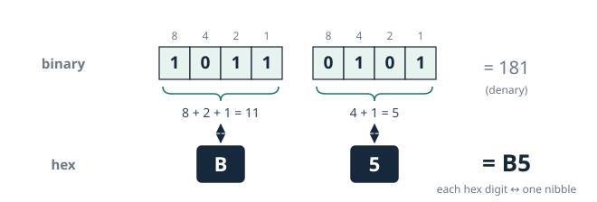
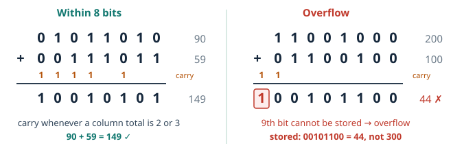
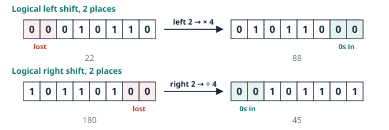
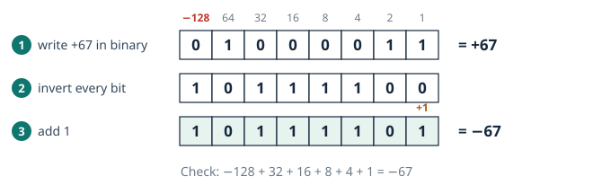

# Number systems

## Specification coverage

| Point | Section |
| --- | --- |
| 1.1.1 | §1 |
| 1.1.2 (a), (b)(i)–(iii) | §2, §3 |
| 1.1.3 | §4 |
| 1.1.4 (a), (b) | §5 |
| 1.1.5 | §6 |
| 1.1.6 | §7 |

## 1. Why computers use binary

A computer is built from millions of tiny switches (transistors) that have only **two states**,
on and off, written **1** and **0**. Data is **processed using logic gates** and **stored in
registers**, both of which work with these two states.

So **any form of data** — numbers, text, sound, images, program instructions — must be
**converted to binary** before a computer can process or store it.

## 2. Denary, binary and hexadecimal

::: definition
**Denary** — base 10: digits 0–9; each column is worth 10 × the column to its right.

**Binary** — base 2: digits 0 and 1; each column is worth 2 × the column to its right.

**Hexadecimal (hex)** — base 16: digits 0–9 then **A = 10, B = 11, C = 12, D = 13, E = 14,
F = 15**; each column is worth 16 × the column to its right.
:::

| Number system | Column values (right-most column first) |
| --- | --- |
| Binary (8-bit) | 1 · 2 · 4 · 8 · 16 · 32 · 64 · 128 |
| Binary (next 8 bits, up to 16-bit) | 256 · 512 · 1024 · 2048 · 4096 · 8192 · 16384 · 32768 |
| Hexadecimal | 1 · 16 · 256 · 4096 |

Only positive whole numbers are converted, up to **16 bits** (largest 8-bit value 255; largest
16-bit value 65 535).

## 3. Converting between the systems

### Binary → denary

Add the column values that contain a 1.

<table class="plain" style="width:auto;min-width:0"><thead><tr><th>128</th><th>64</th><th>32</th><th>16</th><th>8</th><th>4</th><th>2</th><th>1</th></tr></thead><tbody><tr><td>1</td><td>0</td><td>1</td><td>1</td><td>0</td><td>1</td><td>0</td><td>1</td></tr></tbody></table>

10110101 = 128 + 32 + 16 + 4 + 1 = **181**

### Denary → binary

Work from the largest column: if the column value fits into what is left, write 1 and subtract
it; otherwise write 0.

181: 128 fits (53 left) → 1; 64 no → 0; 32 fits (21 left) → 1; 16 fits (5 left) → 1; 8 no → 0;
4 fits (1 left) → 1; 2 no → 0; 1 fits → 1. Answer **10110101**.

### Hexadecimal ↔ binary

One hex digit is exactly **4 bits (a nibble)**. Split the binary into groups of 4 **from the
right** (pad the left group with 0s), and convert each group on its own using 8 4 2 1.

*Figure 1. Binary ↔ hexadecimal, one nibble per hex digit. For 16 bits use four groups:
2F9A = 0010 1111 1001 1010.*

### Hexadecimal ↔ denary

- **Hex → denary:** multiply each digit by its column value and add.
  3E = (3 × 16) + (14 × 1) = **62**.
- **Denary → hex:** divide by 16; the whole-number answer is the 16s digit and the remainder is
  the 1s digit. 200 ÷ 16 = 12 remainder 8 → **C8**.
  (Or convert to binary first, then group into nibbles.)

## 4. Why hexadecimal is used

Hex is **easier for humans to read, write and remember** than binary because it is a **shorter
representation of binary**: each hex digit replaces 4 bits, so there is less chance of error when
copying or typing. It converts to and from binary very easily. The computer itself still stores
and processes everything in binary.

| Where hex is used | Example |
| --- | --- |
| MAC addresses | `00-1C-B3-4F-25-FE` (48 bits as 12 hex digits) |
| IPv6 addresses | `a8fb:7a88:fff0:0fff:3d21:2085:66fb:f0fa` |
| HTML colour codes | `#FF0000` = red: two hex digits each for red, green, blue |
| Error codes | memory locations shown in hex when a program fails |

## 5. Adding binary numbers and overflow

Add column by column from the right, like denary: 0 + 0 = 0, 0 + 1 = 1, **1 + 1 = 0 carry 1**,
**1 + 1 + 1 = 1 carry 1**.

*Figure 2. Binary addition with carries (left) and an overflow (right).*

::: definition
**Overflow error** — occurs when the result of a calculation is **too large to be stored** in the
number of bits available. A device has a **predefined limit** it can represent or store (for
example 8-bit or 16-bit); overflow occurs when a value outside this limit should be returned.
:::

In an **8-bit register** the largest value is **255**, so any sum **greater than 255** causes an
overflow: a **9th bit** is generated, it cannot be stored and is lost, and the stored result is
wrong.

## 6. Logical binary shifts

A **logical shift** moves every bit in the register left or right by a given number of places.

- Bits shifted off the end of the register are **lost**.
- **Zeros** are shifted in at the opposite end.
- Each **left** shift **multiplies** the number by 2; each **right** shift **divides** it by 2.
  So a shift of *n* places multiplies or divides by 2ⁿ (2 places = × or ÷ 4; 3 places = × or ÷ 8).

*Figure 3. Logical left shift and logical right shift, two places each.*

A left shift loses the **most significant bit(s)** (left); a right shift loses the **least
significant bit(s)** (right). If a lost bit is a **1**, the result is no longer correct:

- 01100000 (96) shifted left 2 → 10000000 (128), not 384 — the answer is too big for 8 bits.
- 00010111 (23) shifted right 1 → 00001011 (11), not 11.5 — the remainder is lost.

## 7. Two's complement

Two's complement lets an 8-bit register hold **positive and negative** integers. The left-most
column is worth **−128**; all other columns are unchanged.

<table class="plain" style="width:auto;min-width:0"><thead><tr><th>−128</th><th>64</th><th>32</th><th>16</th><th>8</th><th>4</th><th>2</th><th>1</th></tr></thead><tbody><tr><td>0</td><td>1</td><td>1</td><td>0</td><td>1</td><td>1</td><td>1</td><td>0</td></tr></tbody></table>

- Left-most bit **0** → positive; **1** → negative.
- Range: **−128** (10000000) to **+127** (01111111).
- A **positive** number is written exactly as in ordinary binary, with 0 in the −128 column
  (above: 01101110 = +110).

### Two's complement → denary

Add the column values, using −128 for the left-most bit.
11100100 = −128 + 64 + 32 + 4 = **−28**.

### Negative denary → two's complement

Write the positive number in 8-bit binary, **invert** every bit (0 ↔ 1), then **add 1**.

*Figure 4. Finding −67 in 8-bit two's complement.*

The same method converts a **negative binary** value: −101101 → pad to 00101101 → invert
11010010 → add 1 → **11010011**.

## Common misunderstandings

| Wrong | Right |
| --- | --- |
| Grouping binary into nibbles from the left | Group from the **right**; pad the left group with 0s |
| Hex digits go up to 16 | Hex digits go 0–F, i.e. **0–15** |
| In a shift, empty places are filled with the bit that fell off | Empty places are always filled with **0** |
| Two's complement of −*n*: invert the bits and stop | Invert **and add 1** |
