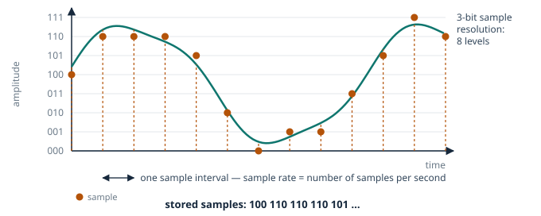
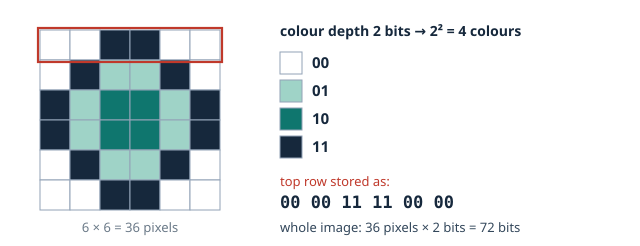

# Text, sound and images

## Specification coverage

| Point | Section |
| --- | --- |
| 1.2.1 | §1 |
| 1.2.2 | §2 |
| 1.2.3 | §3 |

## 1. Text

Text must be **converted to binary** to be processed. Each character is given a unique binary
code from a **character set**.

::: definition
**Character set** — a defined list of characters that a computer can represent, each with its own
unique binary code. The computer stores and processes the codes, not the characters.
:::

For example, in ASCII the letter **A** is 65 = **1000001**. Letters are coded in sequence, so
B is 66, C is 67; lower-case a is 97.

| | ASCII | Unicode |
| --- | --- | --- |
| Bits per character | **7 bits** (8 in extended ASCII) | **more bits** — up to 32 (4 bytes) |
| Number of characters | 128 (256 extended) | far more |
| What it covers | English letters, digits, punctuation, control codes | **characters from many different languages**, symbols and **emojis** |
| Effect on file size | smaller text files | larger text files, because each character needs more bits |

Unicode's first 128 codes are the same as ASCII's.

## 2. Sound

Sound is an **analogue** wave. To store it, the wave is **sampled**: its **amplitude** (height) is
measured at **regular time intervals**, and each measurement is stored as a **binary** number.

*Figure 1. Sampling a sound wave: 3-bit sample resolution gives 2³ = 8 amplitude levels.*

::: definition
**Sample rate** — the number of samples taken **in a second** (measured in hertz, Hz).

**Sample resolution** — the number of **bits per sample**.
:::

- **Higher sample rate** → samples are closer together in time, so changes in the wave are
  captured more often.
- **Higher sample resolution** → more amplitude levels (*n* bits give 2ⁿ levels), so each sample
  is measured more precisely.

In both cases the **accuracy of the recording increases** (closer to the original sound) **and
the file size increases** (more bits are stored).

## 3. Images

A bitmap image is a grid of **pixels** (picture elements). The colour of each pixel is stored as
a **binary** code, and the image is stored as the codes for all its pixels.

*Figure 2. A bitmap image: resolution 6 × 6 = 36 pixels, colour depth 2 bits (4 colours).*

::: definition
**Resolution** — the **number of pixels** in the image (width × height).

**Colour depth** — the **number of bits used to represent each colour** (each pixel's colour).
:::

- **Higher resolution** → more pixels, so more detail (less blocky, or "pixelated").
- **Higher colour depth** → more possible colours (*n* bits give 2ⁿ colours: 1 bit = 2, 8 bits =
  256, 24 bits ≈ 16.7 million), so colours are more realistic.

As resolution and colour depth increase, **the quality of the image and the file size both
increase**.

## Common misunderstandings

| Wrong | Right |
| --- | --- |
| Sample rate is the number of bits per sample | Sample rate = samples **per second**; sample **resolution** = bits per sample |
| Colour depth is the number of colours | Colour depth is the number of **bits** per pixel; the number of colours is 2^(colour depth) |
| Resolution is the size of the screen | Resolution is the **number of pixels** in the image |
