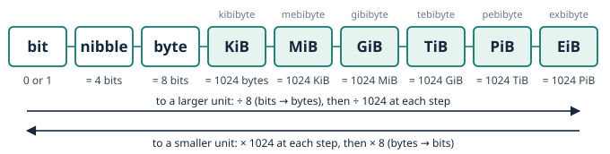
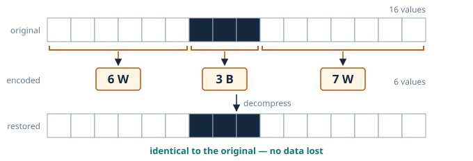

# Data storage and compression

## Specification coverage

| Point | Section |
| --- | --- |
| 1.3.1 | §1 |
| 1.3.2 | §2 |
| 1.3.3 | §3 |
| 1.3.4 | §4 |

## 1. Measuring data storage

The smallest unit is the **bit** (a single 0 or 1). Each larger unit is a fixed number of the
unit before it; from the kibibyte upwards it is always **1024**.

*Figure 1. Units of data storage. Multiply to go to a smaller unit; divide to go to a larger one.*

## 2. Calculating file sizes

::: note | Formulas
**Image file size (bits)** = resolution (width × height in pixels) × colour depth

**Sound file size (bits)** = sample rate (Hz) × sample resolution (bits) × length (seconds)
:::

Both formulas give an answer in **bits**. Convert to the **unit asked for in the question**:
÷ 8 for bytes, then ÷ 1024 for each step up. Always use **1024, not 1000**. No calculator is
allowed, so cancel powers of 2 before multiplying out.

**Image.** An image is 1024 × 512 pixels with a colour depth of 16 bits. Size in MiB?

- bits = 1024 × 512 × 16
- bytes = 1024 × 512 × 16 ÷ 8 = 1024 × 512 × 2 = 1024 × 1024
- ÷ 1024 = 1024 KiB; ÷ 1024 = **1 MiB**

**Sound.** A 64-second recording uses a sample rate of 32 000 Hz and a sample resolution of
16 bits. Size in KiB?

- bits = 32 000 × 16 × 64
- bytes = 32 000 × 16 × 64 ÷ 8 = 32 000 × 128
- KiB = 32 000 × 128 ÷ 1024 = 32 000 ÷ 8 = **4000 KiB**

## 3. Why files are compressed

**Compression** reduces the **size of a file**. A smaller file means:

- **less storage space** is required;
- **less bandwidth** is required to send it across a network;
- a **shorter transmission time** — it uploads, downloads or streams faster.

## 4. Lossy and lossless compression

| | Lossy | Lossless |
| --- | --- | --- |
| How the size is reduced | **permanently removes data** | reduces the size **without permanent loss of data** |
| After decompression | the original **cannot** be restored exactly | the original is **restored exactly** |
| Methods | reduce the **resolution** or **colour depth** of an image; reduce the **sample rate** or **sample resolution** of sound | **run length encoding (RLE)** |
| Size reduction | usually much larger | usually smaller |
| Use when | a small loss of quality is acceptable, e.g. photos, music, video | every bit must be kept, e.g. text documents, program files |

### Run length encoding (RLE)

RLE replaces each **run** of identical, consecutive values with **one count and one value**.

*Figure 2. RLE on one row of a black-and-white image. The same method works on text:
AAAABBBCCCCC → 4A 3B 5C.*

RLE only saves space when data has **long runs** of repeated values. With few repeats
(e.g. ABCD → 1A 1B 1C 1D) the "compressed" data can be **larger** than the original.

## Common misunderstandings

| Wrong | Right |
| --- | --- |
| 1 KiB = 1000 bytes | 1 KiB = **1024** bytes; every step above the byte is × 1024 |
| The formula gives bytes | The formulas give **bits** — divide by 8 for bytes |
| Lossless compression means nothing is removed | Lossless removes **redundant** data but the original can be **fully restored** |
