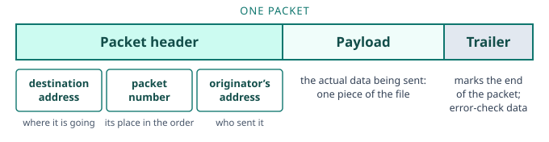
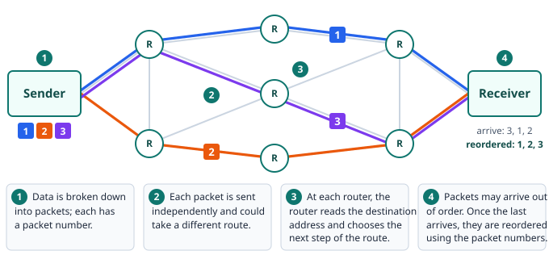
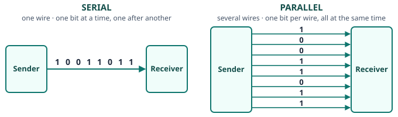
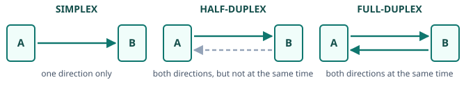
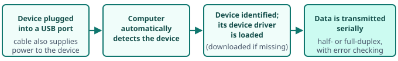

# Types and methods of data transmission

## Specification coverage

| Point | Section |
| --- | --- |
| 2.1.1 (a) data broken into packets · (b) packet structure: header (destination address, packet number, originator's address), payload, trailer | 1 |
| 2.1.1 (c) packet switching: different routes, router controls route, out of order, reordered | 2 |
| 2.1.2 (a) serial, parallel, simplex, half-duplex, full-duplex | 3 |
| 2.1.2 (b) suitability for a scenario, advantages and disadvantages of each method | 4 |
| 2.1.3 USB interface, how it transmits data, benefits and drawbacks | 5 |

## 1. Packets (2.1.1)

::: definition
**Packet** — a small unit of data. Before transmission, data (a file or message) is broken down into
packets, which are sent separately and put back together at the destination.
:::

Small packets can each be sent by whichever route is free, and if one is lost or corrupted only that
packet has to be sent again, not the whole file.

*Figure 1. The structure of a packet.*

## 2. Packet switching (2.1.1)

::: definition
**Packet switching** — a method of transmission in which data is broken down into packets that are
sent independently, possibly by different routes, and reordered at the destination.
:::

*Figure 2. Packet switching. Because each packet is routed separately, routers can send packets
around a busy or broken route.*

## 3. Methods of data transmission (2.1.2)

Every connection is described in two ways: **how many bits are sent at once** (serial or parallel)
and **which direction data flows** (simplex, half-duplex or full-duplex). So a link can be, for
example, *serial full-duplex*.

::: definition
**Serial** — data is sent one bit at a time, one after another, down a single wire or channel.

**Parallel** — several bits (usually a byte) are sent at the same time, down several wires or
channels, one bit per wire.
:::

*Figure 3. Serial and parallel transmission of the byte 10011011.*

::: definition
**Simplex** — data is sent in one direction only.

**Half-duplex** — data can be sent in both directions, but only one direction at a time.

**Full-duplex** — data can be sent in both directions at the same time.
:::

*Figure 4. Direction of transmission.*

## 4. Choosing a method for a scenario (2.1.2)

| Method | Advantages | Disadvantages | Suitable when… |
| --- | --- | --- | --- |
| Serial | Bits cannot become skewed (they arrive in order on one wire), so it is reliable over long distances; fewer wires, so cheaper; less interference between wires | Slower: only one bit is sent at a time | Distance is more than a few metres, or cost matters, e.g. USB to a printer, network cables |
| Parallel | Faster: several bits are sent at once | Over longer distances the bits on different wires can arrive at slightly different times (**skew**), corrupting the data; more wires, so more expensive; wires close together can interfere with each other | Distance is very short and speed matters, e.g. inside a computer between components |
| Simplex | Simple and cheap: all the bandwidth is used in one direction | The receiver cannot send anything back (no replies or error reports) | Data only ever flows one way, e.g. a sensor sending readings to a computer |
| Half-duplex | Two-way communication over one channel, so cheaper than full-duplex | Slower: devices must take turns and wait for the channel to be free | Both need to send, but not at once, e.g. a walkie-talkie |
| Full-duplex | Fastest two-way: no waiting, both send and receive at once | More complex and expensive hardware (needs a channel for each direction) | Both must send at the same time, e.g. a phone or video call, a broadband internet connection |

::: exam
*Explain the suitability* for a scenario: name the method, then give a reason tied to the scenario —
the **distance**, the need for **speed**, and whether the receiver must **reply**, and **when**.
For example: "Serial, because the cable is 3 m long and parallel bits could become skewed."
:::

## 5. Universal serial bus (USB) (2.1.3)

::: definition
**USB (universal serial bus)** — an industry-standard interface (port, cable and protocol) for
connecting devices to a computer. It uses **serial** transmission.
:::

*Figure 5. How a USB device connects and transmits data.*

:::: grid
::: advantages | Benefits
- Devices are detected automatically and the correct driver is loaded (no set-up by the user).
- The connector only fits one way (USB-C fits either way), so it cannot be connected wrongly.
- Industry standard, so almost all devices and computers support it.
- Supplies power, so small devices can be powered or charged from the computer.
- Backward compatible: newer ports still work with older USB devices.
:::
::: disadvantages | Drawbacks
- Maximum cable length is about 5 m; a longer link needs a USB hub or another connection type.
- Slower than some other connections, e.g. Ethernet.
- Very old USB devices may not be supported by the newest computers.
:::
::::

## Common traps

- Parallel is only faster over **short** distances; over long distances skew makes it unreliable.
- Serial/parallel and simplex/half-/full-duplex are separate choices — do not describe half-duplex
  as "half the bits".
