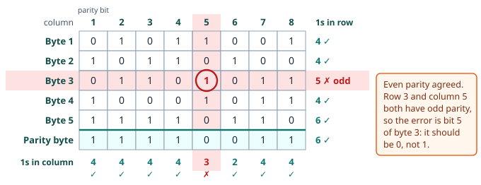
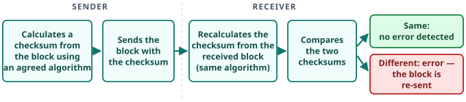
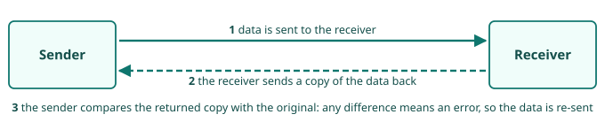
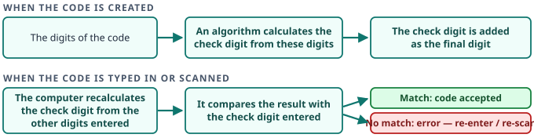

# Methods of error detection

## Specification coverage

| Point | Section |
| --- | --- |
| 2.2.1 need to check for errors; interference → data loss, data gain, data change | 1 |
| 2.2.2 parity check (odd and even), parity byte and parity block check | 2 |
| 2.2.2 checksum | 3 |
| 2.2.2 echo check | 4 |
| 2.2.3 check digit for data-entry errors; examples ISBN and bar codes | 5 |
| 2.2.4 ARQ: positive/negative acknowledgements, timeout | 6 |

## 1. Why errors must be checked for (2.2.1)

Data can be corrupted during transmission, mainly by **interference** (for example electrical
interference on a cable). Corrupted data is useless or, worse, gives wrong results, so the
receiver must check it and get it re-sent if it is wrong.

Interference can cause (byte sent: 10110011):

- **data loss** — bits go missing: 1011001
- **data gain** — extra bits appear: 101100111
- **data change** — bits are flipped: 101**0**0011

## 2. Parity check (2.2.2)

::: definition
**Parity bit** — an extra bit (usually the left-most bit of the byte) set so that the byte has the
agreed parity: an **even** or an **odd** number of 1s.
:::

**Process.** Sender and receiver agree on even or odd parity. The sender counts the 1s in the data
and sets the parity bit to make the total even (or odd). The receiver counts the 1s in each byte it
receives; if the parity is wrong, an error has occurred.

::: note | Worked example
Data 1101000 has three 1s.

- Even parity → parity bit **1** → sent as **1**1101000 (four 1s).
- Odd parity → parity bit **0** → sent as **0**1101000 (three 1s).

Even parity: 11001000 arrives with three 1s — odd, so an error is detected.
:::

A single-byte check has two weaknesses: it **cannot show which bit** is wrong, and if **two bits**
change, the parity stays correct and the error is **not detected**.

### Parity byte and parity block check

Several bytes are sent as a **block**, each with its own parity bit. A **parity byte** is added at
the end: each of its bits is the parity bit for its **column**. The receiver checks the parity of
every row and every column. The faulty bit is where the **wrong row** and **wrong column** cross,
so it can be found and corrected.

*Figure 1. A parity block check (even parity).*

## 3. Checksum (2.2.2)

*Figure 2. The checksum process.*

## 4. Echo check (2.2.2)

*Figure 3. The echo check process.*

A difference shows an error, but not whether it happened on the way **there** or on the way
**back**.

## 5. Check digit (2.2.3)

::: definition
**Check digit** — an extra digit at the end of a number (a code), calculated from all the other
digits. It detects errors in **data entry** (typing or scanning), not in transmission.
:::

*Figure 4. How a check digit is used.*

It detects: **a wrong digit** (e.g. 5327 for 5307), **two digits swapped** (transposition, e.g.
5037 for 5307), and **a digit missed out or added** (e.g. 537 or 53107 for 5307).

**Examples:** the **ISBN** of a book, and the **bar code** on a product (the last digit of the
number under the bars). The scanner or computer recalculates it on every scan.

::: note | Worked example — ISBN-13 (the algorithm is given in the question)
ISBN without its check digit: 9 7 8 0 3 4 0 9 8 3 8 2

1. Add the digits in odd positions (1st, 3rd, …): 9 + 8 + 3 + 0 + 8 + 8 = **36**
2. Add the digits in even positions and multiply by 3: 3 × (7 + 0 + 4 + 9 + 3 + 2) = 3 × 25 = **75**
3. Add the results and divide by 10: 36 + 75 = 111 → 111 ÷ 10 = 11 remainder **1**
4. If the remainder is 0, the check digit is 0; otherwise subtract it from 10: 10 − 1 = **9**

Full ISBN: 978034098382**9**.
:::

## 6. Automatic repeat query (ARQ) (2.2.4)

::: definition
**ARQ** — a method that uses **acknowledgements** and a **timeout** to make sure data is received
without error.

**Positive acknowledgement** — a message from the receiver telling the sender the data arrived
without error.

**Negative acknowledgement** — a message from the receiver telling the sender the data arrived with
an error, requesting it is re-sent.

**Timeout** — the set time the sender waits for an acknowledgement before re-sending the data.
:::

*Figure 5. ARQ. The receiver checks each block with an error-detection method (e.g. a checksum).
Re-sending continues until a positive acknowledgement arrives (or a set number of attempts is
reached).*
