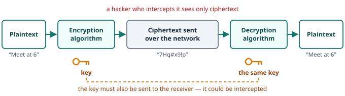
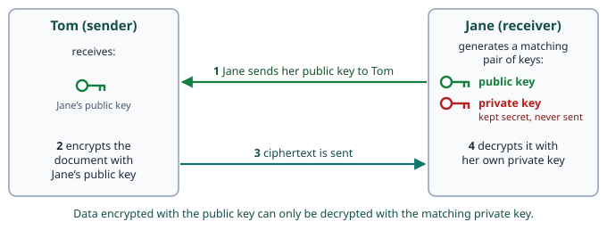

# Encryption

## Specification coverage

| Point | Section |
| --- | --- |
| 2.3.1 need for and purpose of encryption when transmitting data | 1 |
| 2.3.2 symmetric encryption | 2 |
| 2.3.2 asymmetric encryption, public and private keys | 3 |

## 1. Why data is encrypted (2.3.1)

Data sent over a network, especially the internet or a wireless link, can be **intercepted** by a
hacker (an eavesdropper). Encryption cannot stop the interception; its **purpose** is to make the
intercepted data **meaningless** to anyone without the key. This matters most for sensitive or
personal data such as passwords, bank details and medical records.

::: definition
**Encryption** — using an encryption algorithm and a key to scramble **plaintext** (the original,
readable data) into **ciphertext** (unreadable data). **Decryption** reverses this, using a key.
:::

## 2. Symmetric encryption (2.3.2)

::: definition
**Symmetric encryption** — the **same key** is used to encrypt and to decrypt the data.
:::

*Figure 1. Symmetric encryption.*

The weakness: if the key is intercepted while it is being sent to the receiver, the hacker can
decrypt everything encrypted with it.

## 3. Asymmetric encryption (2.3.2)

::: definition
**Asymmetric encryption** — uses a matching pair of keys: a **public key**, which can be given to
anyone and is used to encrypt, and a **private key**, which only its owner has and is used to
decrypt.
:::

*Figure 2. Asymmetric encryption: Tom sends Jane a confidential document.*

This overcomes the weakness of symmetric encryption: the **private key is never transmitted**, and
intercepting the public key is no help because it cannot decrypt. For Jane to reply securely, Tom
needs his own key pair and sends Jane **his** public key.

## Common traps

- The sender encrypts with the **receiver's** public key, not their own.
