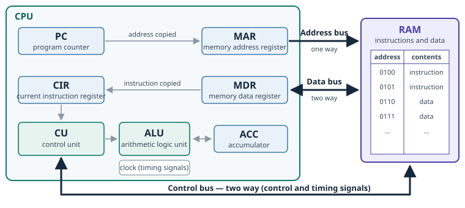
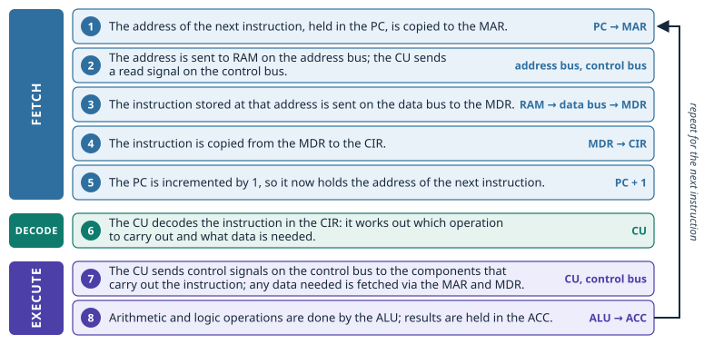

# Computer architecture

## Specification coverage

| Point | Section |
| --- | --- |
| 3.1.1 (a) role of the CPU · (b) microprocessor | §1 |
| 3.1.2 (a) Von Neumann components: ALU, CU; PC, MAR, MDR, CIR, ACC; address, data, control bus | §2 |
| 3.1.2 (b) the FDE cycle and the role of each component | §3 |
| 3.1.3 core, cache, clock and CPU performance | §4 |
| 3.1.4 instruction set | §5 |
| 3.1.5 embedded systems and the devices that use them | §6 |

## 1. The CPU and the microprocessor

::: definition
**Central processing unit (CPU)** — the part of the computer that **processes the instructions and
data** that are input into the computer, so that the result can be output.

**Microprocessor** — a type of **integrated circuit on a single chip**. A CPU is normally built as
a microprocessor.
:::

## 2. Components of a Von Neumann CPU

In a **Von Neumann** computer, the program's instructions and its data are **stored together in
the same memory (RAM)** and are fetched into the CPU along the same buses.

*Figure 1. The units and registers inside the CPU, and the three buses that connect it to RAM.*

A **register** is a very small, very fast storage location inside the CPU that holds one item: an
address, an instruction or a piece of data.

| Component | Purpose |
| --- | --- |
| Control unit (CU) | Controls the FDE cycle: decodes each instruction and sends **control signals** to the other components |
| Arithmetic logic unit (ALU) | Carries out **arithmetic** (e.g. add, subtract) and **logic** operations (e.g. AND, OR, comparisons) |
| Program counter (PC) | Holds the **address of the next instruction** to be fetched |
| Memory address register (MAR) | Holds the **address** of the memory location about to be read from or written to |
| Memory data register (MDR) | Holds the **data or instruction** just read from memory, or about to be written to memory |
| Current instruction register (CIR) | Holds the **instruction currently being decoded and executed** |
| Accumulator (ACC) | Holds the **result of calculations** carried out by the ALU, temporarily |
| Address bus | Carries **addresses** from the CPU (MAR) to memory — **one way** only |
| Data bus | Carries **data and instructions** between the CPU (MDR) and memory — **two way** |
| Control bus | Carries **control signals** (e.g. read, write) and timing signals from the CU — **two way** |

## 3. The fetch–decode–execute (FDE) cycle

The CPU runs a program by repeating the FDE cycle for every instruction: **fetch** the instruction
from RAM into the CPU, **decode** it, then **execute** it.

*Figure 2. The FDE cycle. The right-hand column names the registers, buses and units used at each step.*

## 4. Cores, cache and clock — CPU performance

| Feature | What it is | How it affects performance |
| --- | --- | --- |
| **Core** | One complete processing unit (its own CU, ALU and registers) in the CPU | More cores → **more instructions processed at the same time**. Not always faster in proportion: the task must be divisible between cores, and the cores must communicate with each other |
| **Cache** | Small, very fast memory in or next to the CPU that holds **frequently used instructions and data** | The CPU checks cache before RAM. A larger cache → more items found in cache → **fewer slower fetches from RAM**. |
| **Clock** | Produces **timing signals**; clock speed = number of cycles per second (e.g. 3.5 GHz) | Faster clock → **more FDE cycles per second** → more instructions processed per second. Too high a speed causes overheating and instability |

## 5. Instruction set

::: definition
**Instruction set** — the list of **all the commands that a CPU can process**. The commands are
**machine code** (binary).
:::

Every program must be in the CPU's own machine code before it can run, so the instruction set
fixes the only operations the CPU can carry out, and different types of CPU can have different
instruction sets.

## 6. Embedded systems

::: definition
**Embedded system** — a small computer system, built into a larger device, that performs a
**dedicated function** (one task, or a small set of tasks).
:::

:::: grid
::: card | Embedded system
- **Dedicated** function; the user cannot install new software to change the task
- Controlled by a **microprocessor** (often a single chip); program usually stored in **ROM**
- Small, low power, cheap to make in large numbers
- Often reacts to **sensor** input in **real time**
- Devices: **domestic appliances** (washing machine, microwave oven), **cars** (engine management,
  anti-lock brakes, sat nav), **security systems**, **lighting systems**, **vending machines**
:::
::: card | General purpose computer
- Performs **many different functions**
- Runs an operating system and whatever software the user installs
- Larger, uses more power, costs more
- Devices: **personal computer (PC)**, **laptop**
:::
::::

## Common misunderstandings

| Wrong | Right |
| --- | --- |
| The PC holds the current instruction. | The PC holds the **address** of the **next** instruction; the CIR holds the current instruction. |
| The address bus is two way. | Only the **data** and **control** buses are two way; addresses go one way, from CPU to memory. |
| Doubling the cores doubles the speed. | Cores must share and coordinate work, so the gain is less than double. |
