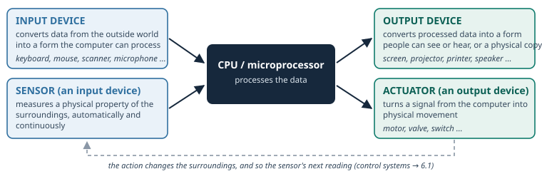
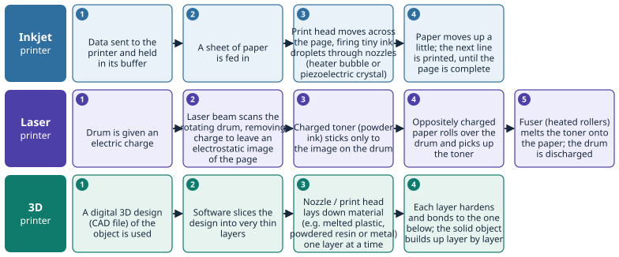

# Input and output devices

## Specification coverage

| Point | Section |
| --- | --- |
| 3.2.1 input devices: barcode scanner, digital camera, keyboard, microphone, optical mouse, QR code scanner, touch screens (resistive, capacitive, infra-red), 2D and 3D scanners | §1, §2 |
| 3.2.2 output devices: actuator, DLP projector, inkjet printer, laser printer, LED screen, LCD projector, LCD screen, speaker, 3D printer | §1, §3 |
| 3.2.3 (a) sensors and their purposes · (b) data captured, when used, choosing a sensor | §4 |

## 1. Input and output

*Figure 1. Input devices and sensors supply the data; output devices and actuators deliver the result.*

::: definition
**Input device** — hardware that **captures data or instructions from outside the computer and
converts them into a form the computer can process**. Without one, no data could be entered.

**Output device** — hardware that **converts processed data from the computer into a form people
can see or hear, a physical copy, or a physical action**. Without one, the results of processing
could not be used.
:::

## 2. Input devices

| Device | How it captures data | Typical use |
| --- | --- | --- |
| Barcode scanner | Red laser or LED light shines on the barcode; dark bars reflect less light than white spaces; a sensor turns the pattern of reflected light into a number (e.g. the product code) | Shop checkouts, library books, stock control |
| QR code scanner | A camera captures the QR code (a 2D grid of dark and light squares) and software decodes it; it holds far more data than a barcode, e.g. a web address | Phones reading adverts, tickets, boarding passes |
| Digital camera | The lens focuses light onto a sensor of millions of light-sensitive pixels; each pixel's brightness and colour is stored as a digital value | Photographs and video |
| Keyboard | Pressing a key completes a circuit; the key's position is converted into that character's code | Typing text and commands |
| Microphone | Sound waves make a diaphragm vibrate, creating a varying electrical signal that is converted into digital data | Voice input, recording, video calls |
| Optical mouse | An LED lights the surface; a tiny camera takes many images a second; the change between images gives the direction and speed of movement, which moves the pointer | Pointing and selecting on screen |
| 2D scanner | A light moves across a flat document; sensors capture the reflected light to make a digital image | Documents, photographs, passports |
| 3D scanner | Scans a solid object from many angles (e.g. with lasers, or light and cameras) to record the coordinates of its surface, making a 3D digital model | Copying an object to edit in CAD or 3D print |

### Touch screens

| | Resistive | Capacitive | Infra-red |
| --- | --- | --- | --- |
| How a touch is detected | Two layers with resistive coatings are separated by a small gap; pressing pushes them into contact, completing a circuit; the change in voltage gives the position | A transparent conductive layer under the glass holds an electrostatic field; a finger (a conductor) changes the field at that point, which gives the position | Infra-red beams cross the screen in a grid from LEDs to sensors at the edges; a touch breaks beams, and the broken horizontal and vertical beams give the position |
| Works with | Anything that presses: finger, gloved finger, any stylus | Bare finger or special stylus; allows multi-touch | Anything that breaks the beam, including gloves |
| Key point | Cheap, but the outer layer scratches and the image is less clear | Clear, durable glass; used in smartphones and tablets | Works on large screens; beams can be blocked by dirt |

## 3. Output devices

| Device | How it produces output | Typical use |
| --- | --- | --- |
| Actuator | Converts an electrical signal from the computer into **physical movement**, e.g. a motor turns or a valve opens | Motors, valves, windows and pumps in control systems |
| LCD screen | Each pixel has liquid crystals that twist to block or let through light from a **backlight** (LEDs); red, green and blue filters make the colours | Monitors, TVs, laptops |
| LED screen | Each pixel is made of tiny red, green and blue **LEDs that give out their own light** — no backlight | Large outdoor displays, advertising boards |
| DLP projector | White light passes through a colour filter onto a chip of **millions of tiny mirrors**, one per pixel; each mirror tilts towards the light (on) or away (off); a lens projects the image | Presentations, classrooms, home cinema |
| LCD projector | White light is split by mirrors into red, green and blue beams; each passes through its own **LCD panel**, whose pixels block or let light through; a prism recombines them and a lens projects the image | Presentations, classrooms |
| Speaker | Digital sound data is converted to an analogue electrical signal and amplified; the current in a coil makes a cone vibrate, producing sound waves | Music, alerts, voice output |

*Figure 2. Inkjet and laser printers produce a paper copy; a 3D printer builds a solid object by
adding layers (additive manufacturing).*

- **Inkjet** — small numbers of high-quality colour prints, e.g. photographs.
- **Laser** — fast, high-volume printing of many copies; large toner cartridges and paper trays.
- **3D** — solid, working objects: prototypes, custom-made parts, models.

## 4. Sensors

::: definition
**Sensor** — an input device that **measures a physical property of its surroundings** and sends
the data to a computer or microprocessor.
:::

Purpose: sensors let a computer **monitor** or **control** a process **automatically**. They take
readings **continuously** (day and night), more **accurately** and **reliably** than a person, and
can work in places that are **dangerous or difficult** for people.

| Sensor | Data captured | Used when… |
| --- | --- | --- |
| Acoustic | Sound level | Detecting footsteps or breaking glass in a security system |
| Accelerometer | Acceleration — change in speed, direction or tilt | Rotating a phone screen; triggering a car airbag in a crash |
| Flow | Rate of flow of a liquid or gas | Measuring water or gas moving along a pipe; hospital breathing equipment |
| Gas | Level of a particular gas (e.g. oxygen, carbon dioxide) | Air-pollution monitoring; carbon dioxide in a greenhouse |
| Humidity | Water vapour in the **air** | Greenhouses; buildings or factories that need dry air |
| Infra-red | Infra-red radiation — body heat, or a broken infra-red beam | Intruder alarms; automatic doors |
| Level | How high a liquid (or powder) is in a container | Fuel tanks; water tanks |
| Light | Light intensity (brightness) | Street lights or car headlights switching on when dark |
| Magnetic field | Changes in a magnetic field | Anti-lock braking (wheel speed); detecting a door or window opening |
| Moisture | Water content of a **material**, e.g. soil | Automatic watering of plants |
| pH | Acidity or alkalinity | Soil in a greenhouse; chemical processes; aquariums |
| Pressure | Pressure or weight applied | Pressure mats in intruder alarms; weighing lorries |
| Proximity | Whether an object is **near**, without touching | Turning a phone screen off at the ear; parking sensors |
| Temperature | Temperature | Central heating, ovens, greenhouses, fridges |

To select a sensor, identify the **physical property that changes** in the scenario, then pick
the sensor that measures that property. If several would work, choose the one that measures the
property most directly.

## Common misunderstandings

| Wrong | Right |
| --- | --- |
| Humidity and moisture sensors are the same. | **Humidity** = water vapour in the air; **moisture** = water in a material such as soil. |
| Level and flow sensors measure the same thing. | **Level** = how full a container is; **flow** = how fast liquid or gas is moving. |
| A proximity sensor needs contact. | Proximity detects a nearby object **without** contact; a **pressure** sensor needs contact or weight. |
| A sensor decides what action to take. | The sensor only sends readings; the **microprocessor** decides and an **actuator** acts. |
