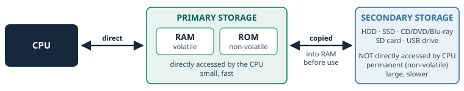
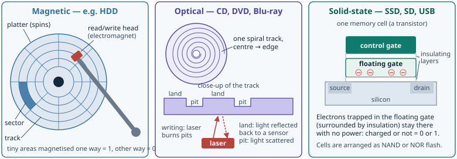
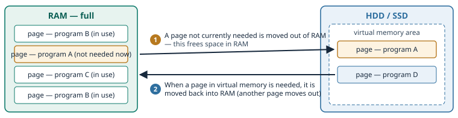

# Data storage

## Specification coverage

| Point | Section |
| --- | --- |
| 3.3.1 primary storage; role of RAM and ROM; why both are needed; differences | §1 |
| 3.3.2 secondary storage | §1 |
| 3.3.3 operation of magnetic, optical and solid-state storage, with examples | §2 |
| 3.3.4 virtual memory: what, how created and used, why necessary | §3 |
| 3.3.5 cloud storage | §4 |
| 3.3.6 advantages and disadvantages of cloud compared with local storage | §4 |

## 1. Primary and secondary storage

*Figure 1. Only primary storage is accessed directly by the CPU.*

::: definition
**Primary storage** — storage that is **directly accessed by the CPU**: RAM and ROM.

**Secondary storage** — storage that is **not directly accessed by the CPU**; it is needed for
**more permanent (non-volatile) storage** of data and programs.
:::

| | RAM — random access memory | ROM — read only memory |
| --- | --- | --- |
| Power off | **Volatile** — contents are lost | **Non-volatile** — contents are kept |
| Read / write | Read **and** write; contents change all the time | **Read only**; contents cannot be changed |
| Role | Holds the data and instructions **currently in use** (the OS, open programs and files) | Holds the **start-up instructions** (e.g. the BIOS) needed to boot the computer |

**Why a computer needs both:** RAM is fast, changeable working memory for whatever is running now,
but it is empty when the computer is switched on. The start-up instructions therefore have to be
kept in ROM, which keeps its contents without power and cannot be changed by accident.

## 2. How secondary storage works

**Magnetic (e.g. hard disk drive, HDD)**

- Data is stored on **platters** coated in magnetic material, which spin at high speed.
- Each platter surface is divided into circular **tracks**, and each track into **sectors**.
- A **read/write head** on an arm moves to the correct track and waits for the sector to pass
  under it. The head is an **electromagnet**: it writes by magnetising tiny areas in one of two
  directions (1 or 0) and reads by detecting that direction.
- Moving parts make access slower than solid-state, and a knock can damage the drive.

**Optical (CD, DVD, Blu-ray)**

- The disc spins and a **laser** follows a **single spiral track**.
- **Writing:** the laser burns **pits** into the track; unburnt areas are **lands**.
- **Reading:** the laser shines on the track; lands reflect light back to a sensor and pits
  scatter it. The pattern of reflections is converted into binary.

**Solid-state / flash memory (SSD, SD card, USB drive)**

- **No moving parts.** Data is stored in millions of **transistors** arranged as **NAND** or
  **NOR** flash.
- Each transistor has a **control gate** and a **floating gate**, separated by insulating layers.
- **Writing:** a voltage on the control gate forces **electrons into the floating gate**, where the
  insulation traps them. A cell with or without trapped electrons stores 1 or 0, and keeps it
  without power.
- **Reading:** the cell is tested for whether its floating gate is charged.
- With no moving parts, data is accessed faster and the device is more robust than an HDD.

*Figure 2. The three secondary storage technologies.*

## 3. Virtual memory

::: definition
**Virtual memory** — an area of **secondary storage (HDD or SSD)** that is used **as if it were
extra RAM** when RAM is full.
:::

- **Created:** the operating system sets aside part of the HDD or SSD as virtual memory.
- **Used:** data is divided into **pages**, which are transferred between RAM and virtual memory
  when needed (Figure 3).
- **Why necessary:** without it, once RAM is full no more programs or data could be loaded, and
  the computer could crash. With it, more programs can be open than RAM alone could hold.
- Virtual memory is much **slower** than RAM, so heavy use slows the computer down.

*Figure 3. Pages are swapped between RAM and virtual memory on the HDD or SSD.*

## 4. Cloud storage

::: definition
**Cloud storage** — storing data on **remote physical servers**, owned and run by a cloud
provider, that are **accessed over the internet**. **Local storage** is storage in or attached
to the user's own device.
:::

**Physical servers and storage devices are still needed** — in the provider's data centres,
usually with copies of the data kept in more than one place.

Cloud compared with storing data locally:

:::: grid
::: advantages
- **Access from anywhere**, on any device with an internet connection, so files are easy to share
  and work on together.
- **No storage hardware to buy or maintain**; more space can be bought as needed.
- The provider keeps **backup copies** on several servers, so data survives if the user's own
  device is lost or damaged.
:::
::: disadvantages
- **Needs an internet connection**; without one the data cannot be reached, and large files are
  slow to upload and download.
- **Security and privacy risk**: a third party holds the data, and its servers can be hacked.
- **Ongoing cost** (subscription) for large amounts of space.
- If the provider has an outage or closes, the data may be **unavailable or lost**.
:::
::::

## Common misunderstandings

| Wrong | Right |
| --- | --- |
| ROM is a type of secondary storage. | ROM is **primary** storage — accessed directly by the CPU. |
| Virtual memory is extra RAM. | It is part of the **HDD/SSD** used as if it were RAM, and is much slower. |
