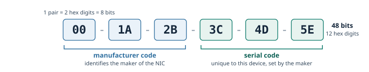
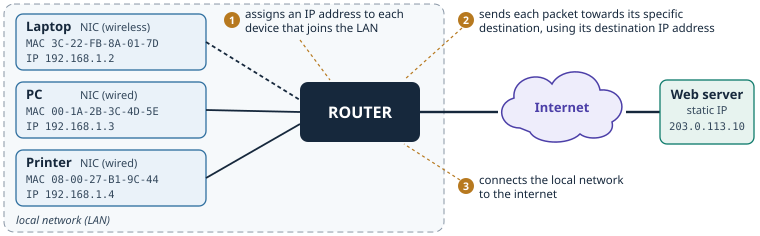

# Network hardware

## Specification coverage

| Point | Section |
| --- | --- |
| 3.4.1 a computer needs a NIC to access a network | §1 |
| 3.4.2 MAC address: meaning, purpose, structure (hexadecimal; manufacturer code + serial code; set at manufacture) | §2 |
| 3.4.3 (a) IP address: meaning, purpose, allocated by the network, static or dynamic · (b) IPv4 and IPv6 | §3 |
| 3.4.4 role of a router | §4 |

## 1. Network interface card (NIC)

::: definition
**Network interface card (NIC)** — the hardware a computer **needs in order to access a network**.
It can be wired or wireless.
:::

## 2. MAC address

::: definition
**Media access control (MAC) address** — a **unique** address **given to a NIC by its
manufacturer**, at the point of manufacture. Its purpose is to **identify a specific device** on a
network, so that data can be delivered to the right device.
:::

*Figure 1. A MAC address is 48 bits, usually written as 12 hexadecimal digits in six pairs,
separated by hyphens or colons.*

It is written in **hexadecimal** because 12 hex digits are far shorter and easier for people to
read than 48 binary digits.

## 3. IP address

::: definition
**Internet protocol (IP) address** — an address **allocated to a device by the network** it
connects to. Its purpose is to **identify the device on the network and the internet**, so that
data can be sent to it and replies returned.
:::

A device keeps the same MAC address wherever it is, but gets a new IP address when it joins a
different network.

| | MAC address | IP address |
| --- | --- | --- |
| Given by | Manufacturer, at manufacture | The network, when the device connects |
| Changes? | No — fixed to the NIC | Can change (dynamic) or stay the same (static) |

### Static and dynamic IP addresses

| | Static | Dynamic |
| --- | --- | --- |
| Allocation | Assigned to the device permanently; does not change | Assigned by the network (e.g. the router) each time the device connects; can change |
| Suited to | Devices that must always be found at the same address, e.g. a web server | Most user devices, e.g. laptops and phones |
| Trade-off | Reliable to find, but set up manually and keeps an address even when not in use | Set up automatically and addresses are reused, but the address may change |

### IPv4 and IPv6

| | IPv4 | IPv6 |
| --- | --- | --- |
| Size | **32 bits** | **128 bits** |
| Written as | **4 groups** of **denary** numbers 0–255, separated by **full stops** | **8 groups** of **4 hexadecimal digits**, separated by **colons** |
| Example | `192.168.1.3` | `2001:0db8:85a3:0000:0000:8a2e:0370:7334` |
| Number of addresses | About 4.3 billion — not enough for every device now online | Vastly more, so it will not run out |

In IPv6, leading zeros in a group may be left out, and one run of all-zero groups may be written
as `::` — so `2001:db8:85a3::8a2e:370:7334` is the same address as the example.

## 4. Router

::: definition
**Router** — a device that **sends data to a specific destination on a network**, **can assign IP
addresses** to the devices on it, and **connects a local network to the internet**.
:::

*Figure 2. The router's three roles. It reads the destination IP address in each data packet
(→ 2.1) to decide where to send it.*
