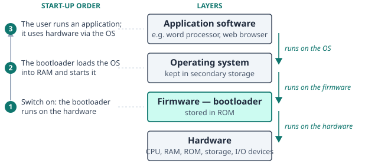
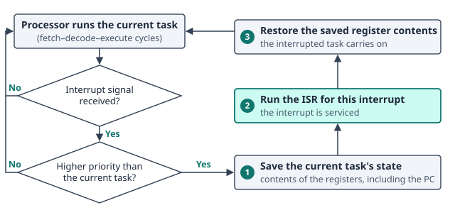

# Types of software and interrupts

## Specification coverage

| Point | Section |
| --- | --- |
| 4.1.1 System software and application software, with examples | 1 |
| 4.1.2 Role and basic functions of an operating system | 2 |
| 4.1.3 Hardware, firmware and OS needed to run applications | 3 |
| 4.1.4 Role and operation of interrupts | 4 |

## 1. System software and application software (4.1.1)

::: definition
**System software** — software that provides the services the **computer** requires, including the
operating system and utility software.

**Application software** — software that provides the services the **user** requires, i.e. it lets
the user carry out a task.
:::

|  | System software | Application software |
| --- | --- | --- |
| Purpose | runs and manages the hardware; gives other software a platform to run on | does a job the user wants done |
| Examples | operating system (Windows, macOS, Android); **utility software** — anti-virus, defragmentation, back-up, file compression; device drivers; compilers | word processor, spreadsheet, database, web browser, photo or video editor, game |

**Utility software** is system software that carries out one specific task to maintain or look
after the computer.

## 2. The operating system (4.1.2)

::: definition
**Operating system (OS)** — system software that manages the computer's hardware and software, provides
a platform on which applications run, and provides an interface between the user and the computer.
:::

Its basic functions:

- **Managing files** — creates, opens, saves, copies, moves, renames and deletes files; organises
  them into folders; controls who may access each file.
- **Handling interrupts** — receives interrupt signals and makes sure each is serviced in order of
  priority (section 4).
- **Providing an interface** — lets the user communicate with the computer, e.g. a graphical user
  interface (GUI: windows, icons, menus, pointer) or a command line interface (CLI: typed commands).
- **Managing peripherals and drivers** — communicates with input and output devices through
  **device drivers** (software that translates data into a form a particular device understands);
  loads the right driver when a device is connected; manages queues and buffers, e.g. a print queue.
- **Managing memory** — allocates RAM to each program and frees it when the program ends; moves data
  between RAM and secondary storage; stops two programs using the same memory locations.
- **Managing multitasking** — lets several programs (processes) run at the same time by sharing the
  CPU and other resources between them, switching rapidly according to priority.
- **Providing a platform for running applications** — loads applications into memory and lets them use
  the hardware (e.g. save a file, print) through the OS, so an application never controls hardware
  directly.
- **Providing system security** — requires a user ID and password to log on, enforces access rights,
  works with the firewall and anti-virus software, and installs security updates.
- **Managing user accounts** — gives each user an account with their own username, password, files
  and settings; an administrator can create, delete and restrict accounts.

## 3. Hardware, firmware and the operating system (4.1.3)

::: definition
**Firmware** — a program stored in ROM that provides low-level control of the hardware.
The **bootloader** is firmware: when the computer is switched on it loads the operating system into RAM.
:::

*Figure 1. Each layer runs on the one below it. The start-up order (1–3) builds the stack from the bottom.*

All three are needed because RAM is volatile: at switch-on it holds no OS. The bootloader is
permanently stored in ROM, so it is always available to load the OS from secondary storage into
RAM. Only once the OS is running can an application be run, and the application reaches the
hardware only through the OS.

## 4. Interrupts (4.1.4)

::: definition
**Interrupt** — a signal sent from a hardware device or from software to the processor, requesting
its attention; it makes the processor temporarily stop its current task so the interrupt can be serviced.

**Interrupt service routine (ISR)** — the program that handles one particular type of interrupt.
:::

**Role.** Interrupts let the processor respond at once to events that need attention, without
constantly checking every device and program. It gets on with other work until something needs it,
which makes multitasking possible (e.g. a printer interrupts only when it is ready for more data).

**How an interrupt is handled:**

*Figure 2. The processor checks for interrupts at the end of each fetch–decode–execute cycle (→ 3.1).
An interrupt of lower priority than the current task waits until it can be serviced.*

| Interrupt generated by | Type | Result of servicing it |
| --- | --- | --- |
| a key pressed on the keyboard | hardware | the ISR reads which key was pressed; the character appears on screen |
| the mouse moved | hardware | the ISR reads the movement; the pointer moves on screen |
| division by zero | software | an error message is output; the program may be stopped |
| two processes trying to access the same memory location | software | one process is stopped or made to wait, so data is not corrupted |

## Common traps

- An interrupt **pauses** the current task; it does not end it (unless it reports a fatal error).
- Utility software and device drivers are **system** software, not application software.
- The bootloader is not the OS. The OS is stored in secondary storage and loaded into RAM **by** the
  bootloader.
