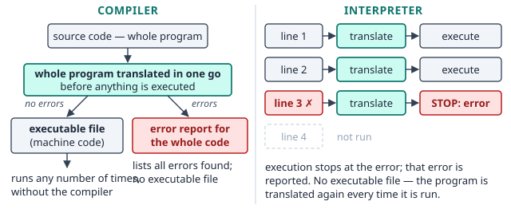
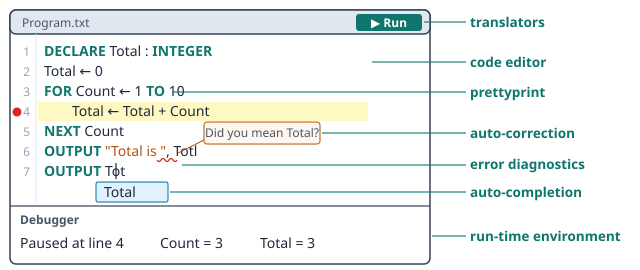

# Types of programming language, translators and IDEs

## Specification coverage

| Point | Section |
| --- | --- |
| 4.2.1 High-level and low-level languages, advantages and disadvantages | 1 |
| 4.2.2 Assembly language, mnemonics and the assembler | 2 |
| 4.2.3 Operation of a compiler and an interpreter, error reporting | 3 |
| 4.2.4 Advantages and disadvantages of a compiler and an interpreter | 4 |
| 4.2.5 Role of an IDE and its common functions | 5 |

## 1. High-level and low-level languages (4.2.1)

::: definition
**High-level language** — a programming language that uses English-like statements and is
independent of the computer's hardware, e.g. Python, Java, Visual Basic. It must be translated into
machine code before it can run.

**Low-level language** — a programming language that relates to the hardware of one particular type
of processor: **machine code** (binary instructions the processor runs directly) or **assembly
language**.
:::

The same task written at each level:

| Level | Code |
| --- | --- |
| High-level | `Sum ← FirstNumber + SecondNumber` |
| Assembly language | `LDA FirstNumber` · `ADD SecondNumber` · `STO Sum` |
| Machine code | `0001 00010010` · `0100 00010011` · `0000 00011010` |

One high-level statement usually becomes several machine code instructions (the binary shown is
illustrative).

|  | High-level language | Low-level language |
| --- | --- | --- |
| Ease of reading and writing code | **+** English-like, so easy to read and quick to write | **–** mnemonics or binary are hard to read; programs take longer to write |
| Ease of debugging code | **+** errors are easier to find and correct | **–** errors are hard to spot and correct |
| Machine independence | **+** the same program can be translated to run on different types of computer | **–** machine dependent: written for one type of processor |
| Direct manipulation of hardware | **–** cannot directly control registers, memory addresses or devices | **+** can directly control the hardware |
| Efficiency | **–** translated code may be larger and run more slowly | **+** can be written to run very fast and use little memory |

A programmer chooses a low-level language only when the program must directly manipulate the
hardware or be as fast and small as possible (e.g. a device driver or an embedded system);
otherwise a high-level language is used.

## 2. Assembly language and the assembler (4.2.2)

::: definition
**Assembly language** — a low-level language that uses **mnemonics** (short codes such as `LDA`,
`ADD`, `STO`) in place of binary machine code instructions.

**Assembler** — the translator that converts an assembly language program into machine code.
:::

In the example above, `LDA FirstNumber` loads the value of FirstNumber into the accumulator,
`ADD SecondNumber` adds the value of SecondNumber to it and `STO Sum` stores the result in Sum.
Each assembly instruction usually matches one machine code instruction. The processor can only run
machine code, so an assembly program must be assembled before it can run.

## 3. Compilers and interpreters (4.2.3)

A high-level program (the **source code**) is translated into machine code by a **compiler** or an
**interpreter**.

::: definition
**Compiler** — translates the whole high-level program at once, before it is executed, producing an
executable file of machine code.

**Interpreter** — translates and executes a high-level program line by line; no executable file is
produced.
:::

*Figure 1. How each translator works and how it reports errors.*

## 4. Advantages and disadvantages of compilers and interpreters (4.2.4)

|  | Compiler | Interpreter |
| --- | --- | --- |
| Speed of execution | **+** the executable runs fast: it is already fully translated | **–** slower: each line is translated every time it is run |
| Running the program | **+** the executable runs without the compiler, so it can be distributed without the source code | **–** the interpreter is needed every time the program runs, and users must be given the source code |
| Finding errors | **–** errors are only reported after the whole program has been translated | **+** stops at the line with the error, so it is easy to find; an unfinished program can be tested |
| After each change | **–** the whole program must be recompiled before it can be tested again | **+** the change can be run straight away |

So an **interpreter** is mostly used **while developing** a program (quick testing and debugging),
and a **compiler** is used to **translate the final program** for users.

## 5. Integrated development environments (4.2.5)

::: definition
**Integrated development environment (IDE)** — one piece of software that provides the tools a
programmer needs to write, translate, run and debug program code.
:::

*Figure 2. The common functions of an IDE.*

- **Code editor** — where code is typed and edited, so no separate text editor is needed.
- **Translators** — a built-in compiler and/or interpreter, so code can be translated without
  leaving the IDE.
- **Run-time environment** — runs the program inside the IDE so it can be tested, and shows its
  output; usually with a debugger to run one line at a time or stop at a set point and view
  variable values.
- **Error diagnostics** — highlights errors and reports what and where they are, so they can be found
  and fixed quickly.
- **Auto-completion** — suggests the rest of a keyword or identifier as it is typed, saving time and
  preventing spelling mistakes.
- **Auto-correction** — automatically corrects common mistakes, such as a misspelt keyword.
- **Prettyprint** — colour-codes keywords, strings and comments and indents the code, making it easier
  to read.

## Common traps

- Machine code needs no translation. Only high-level and assembly language programs are translated.
- An interpreter produces **no** executable file; a compiler does.
- A compiler reports **all** the errors found; an interpreter stops at the **first** error it meets.
- Machine **independence** is an advantage of **high-level** languages; low-level languages are
  machine **dependent**.
