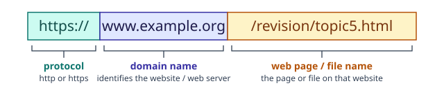
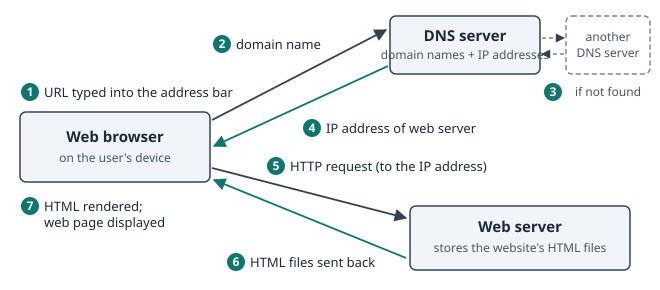

# The internet and the world wide web

## Specification coverage

| Point | Section |
| --- | --- |
| 5.1.1 Difference between the internet and the world wide web | 1 |
| 5.1.2 Uniform resource locator (URL) | 2 |
| 5.1.3 Purpose and operation of HTTP and HTTPS | 3 |
| 5.1.4 Purpose and functions of a web browser | 4 |
| 5.1.5 How a web page is located, retrieved and displayed | 5 |
| 5.1.6 Cookies: session and persistent, and their uses | 6 |

## 1. The internet and the world wide web (5.1.1)

::: definition
**Internet** — the infrastructure: a worldwide collection of interconnected networks and devices,
and the connections between them.

**World wide web (WWW)** — the collection of websites and web pages that are accessed using the
internet.
:::

The web is one service that runs *on* the internet. Email and online chat also use the internet but
are not part of the web.

## 2. Uniform resource locator (URL) (5.1.2)

::: definition
**URL** — a text-based address for a web page. It can contain the protocol, the domain name and
the web page / file name.
:::

*Figure 1. The parts of a URL.*

People use URLs because text is far easier to remember than the numeric IP address of the web
server. The browser gets that IP address from the DNS (section 5).

## 3. HTTP and HTTPS (5.1.3)

::: definition
**Hypertext transfer protocol (HTTP)** — the set of rules used to transfer web pages and other files
between a web browser and a web server.

**HTTPS** — HTTP made secure: the data sent is encrypted using the SSL security protocol.
:::

**Operation of HTTP.** The browser sends an HTTP **request** to the web server for a resource (for
example a web page). The web server sends back an HTTP **response** containing the requested file,
or an error message if it cannot supply it.

**Operation of HTTPS.** Before any data is sent, the web server proves its identity with its SSL
certificate and an encrypted connection is set up (the SSL process is in 5.3). Every request and
response is then encrypted, so data intercepted on the way cannot be understood. The browser shows
`https://` and a padlock. HTTPS is used whenever personal or payment data is sent: logging in,
online banking, online shopping.

## 4. Web browsers (5.1.4)

::: definition
**Web browser** — software whose main purpose is to **render HTML** and display web pages.
:::

*Render* means the browser interprets the HTML sent by the web server and turns it into the page
you see: text, images, video and links.

Functions of a web browser:

- **Address bar** — where the user types a URL; shows the URL of the current page.
- **Navigation tools** — back, forward, reload and home buttons, and following hyperlinks.
- **Multiple tabs** — several web pages open at once in one window.
- **Bookmarks and favourites** — stores the URLs of pages the user wants to return to, so they do not
  have to be retyped.
- **User history** — records the pages visited, so they can be found again.
- **Storing cookies** — keeps the cookies that websites send (section 6).

## 5. Locating, retrieving and displaying a web page (5.1.5)

The website is stored as HTML files on a **web server**, which has its own **IP address**. The
browser needs that IP address before it can request the page.

*Figure 2. What happens when a URL is entered. Numbers match the steps below.*

1. The user types the URL into the browser's address bar.
2. The browser sends the domain name to a **domain name server (DNS)**.
3. The DNS searches its database of domain names and matching IP addresses. If the domain name is
   not there, the request is passed to another DNS server.
4. The DNS returns the **IP address** of the web server to the browser.
5. The browser uses the IP address to send an HTTP request to the **web server**.
6. The web server sends the web page back to the browser as **HTML** files (plus any images and
   other files the page uses).
7. The **browser** renders the HTML and displays the web page.

## 6. Cookies (5.1.6)

::: definition
**Cookie** — a small file that a web server sends to the user's web browser, which stores it on the
user's device. It holds data about the user or their visit and is sent back to the website on later
requests, so the website can recognise the user.
:::

| | **Session cookie** | **Persistent cookie** |
| --- | --- | --- |
| Stored | In temporary memory (RAM) | On the device's storage (e.g. hard disk or SSD) |
| Deleted | When the browser is closed / the session ends | When its expiry date is reached, or the user deletes it |
| Remembers the user between visits | No | Yes |

Uses of cookies:

- **Holding items in an online shopping cart** — a session cookie keeps the cart as the user moves
  between pages during one visit.
- **Storing login details** — a persistent cookie keeps the user logged in, so they do not have to
  enter a username and password on every visit.
- **Saving personal details** — such as name, address or card details, so they need not be re-entered.
- **Tracking user preferences** — such as language, currency and pages viewed, so the site can be
  customised and show targeted adverts.

## Common misunderstandings

- The internet and the web are **not** the same: the web is web pages *accessed via* the internet.
- The DNS only supplies the **IP address**; the **web server** sends the web page.
- The **browser** renders the HTML; the web server stores it and sends it.
- HTTPS does not stop data being intercepted; it makes intercepted data **unreadable**.
- Cookies are stored on the **user's device**, not on the web server.
