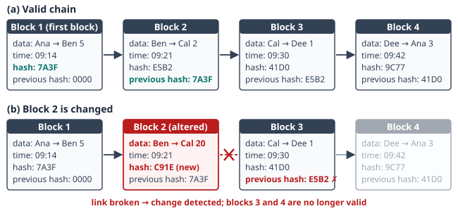

# Digital currency

## Specification coverage

| Point | Section |
| --- | --- |
| 5.2.1 Concept of a digital currency and how digital currencies are used | 1 |
| 5.2.2 Process of blockchain and how it tracks digital currency transactions | 2 |

## 1. Digital currency (5.2.1)

::: definition
**Digital currency** — a currency that only exists electronically. It has no physical form: no
notes or coins.
:::

How digital currencies are used:

- to **pay for goods and services**, online or in shops, by transferring the value electronically
  from the payer's account or digital wallet to the payee's;
- to **send money** to other people electronically, anywhere in the world.

A **cryptocurrency** (for example Bitcoin) is a digital currency that is **decentralised**: no bank
or government controls it. Its transactions are recorded on a blockchain.

## 2. Blockchain (5.2.2)

::: definition
**Blockchain** — in its basic form, a digital ledger: a time-stamped series of records that cannot
be altered.
:::

The ledger is **decentralised**: there is no central server. Every computer in the network holds a
copy of the whole blockchain.

Each transaction is stored as a **block** containing:

- the **transaction data** — e.g. sender, recipient, amount;
- a **timestamp** — when the transaction took place;
- a **hash** — a unique value calculated from the block's contents, which acts as its fingerprint;
- the **previous hash** — the hash of the block before it, which links the blocks into a chain.

**How a transaction is tracked**

1. A new transaction creates a new block, holding the previous block's hash, and its own hash is
   calculated.
2. The block is sent to every computer in the network, and each one checks that it is valid.
3. The block is added to the end of every copy of the chain. The transaction is now permanently
   recorded, and anyone on the network can trace it back through the chain.

**Why the records cannot be altered.** Changing any data in a block changes that block's hash. The
next block's *previous hash* then no longer matches, so the chain is broken from that point and the
change is detected. To alter a record without being noticed, an attacker would have to change that
block and every later block on the copies held by the computers in the network, all at the same time.

*Figure 1. Each block stores the previous block's hash. Changing block 2 changes its hash, so the
link to block 3 breaks.*

## Common misunderstandings

- A blockchain is **not** stored on one central server — every computer in the network has a copy.
- A hash is **not** encryption: it is a fingerprint of the block's contents, used to detect changes.
- A block does not hold its own hash only — it also holds the **previous** block's hash, which is
  what links the chain.
