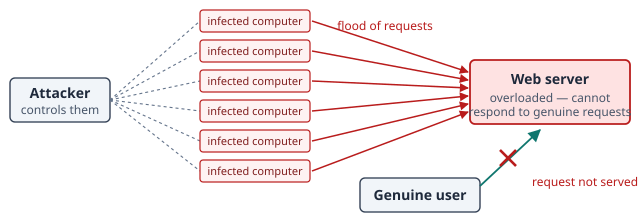
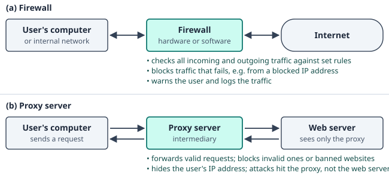
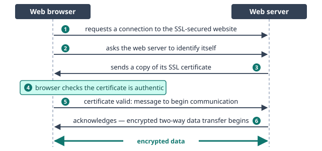

# Cyber security

## Specification coverage

| Point | Section |
| --- | --- |
| 5.3.1 Processes and aims of cyber security threats: brute-force attack, data interception, DDoS, hacking, malware (virus, worm, Trojan horse, spyware, adware, ransomware), pharming, phishing, social engineering | 1 |
| 5.3.2 Solutions: access levels, anti-malware (anti-virus, anti-spyware), authentication (username and password, biometrics, two-step verification), automating software updates, checking spelling and tone of communications, checking the URL attached to a link, firewalls, privacy settings, proxy servers, SSL | 2 |

## 1. Cyber security threats (5.3.1)

For each threat you must be able to describe **the process** (how it is carried out) and **the aim**
(what the attacker wants).

| Threat | Process | Aim |
| --- | --- | --- |
| **Brute-force attack** | Software tries every possible combination of characters, often starting with common passwords and words from a list, until the correct password is found. | To find the password and gain unauthorised access to an account or system. |
| **Data interception** | Data is intercepted while it is being transmitted, e.g. a **packet sniffer** examines and copies the packets travelling over a network, or wireless signals are picked up from outside a building. | To steal the data, e.g. passwords or bank details. |
| **Distributed denial of service (DDoS) attack** | The attacker makes many computers (often ones infected with malware) send huge numbers of requests to a web server at the same time. The server is overloaded and cannot respond to genuine requests (Figure 1). | To make a website or online service unavailable to its users. |
| **Hacking** | Gaining unauthorised access to a computer system, e.g. by exploiting weaknesses in its security or using stolen passwords. | To steal, delete, change or corrupt data, or to damage the system. |
| **Phishing** | A legitimate-looking email or message, apparently from a trusted organisation, is sent to the user. It contains a link to a fake website, or asks the user to reply with personal details. The user has to act (click or reply) for it to work. | To obtain personal data such as login or bank details, for fraud or identity theft. |
| **Pharming** | Malicious code is installed on the user's computer or on a DNS server. It changes the IP address a domain name leads to, so the browser is redirected to a fake website even when the user types the correct URL. No click is needed. | To obtain personal data that the user enters on the fake website. |
| **Social engineering** | The attacker manipulates people into breaking normal security procedures by exploiting fear, curiosity or trust — e.g. a phone call pretending to be IT support, a fake "virus detected" pop-up, or an infected USB stick left to be found. | To get the victim to reveal confidential information, install malware or give access to a system. |

*Figure 1. A DDoS attack: requests come from many computers, which also makes the attack hard to
block.*

### Malware

::: definition
**Malware** — malicious software installed on a computer without the user's knowledge or consent,
designed to cause harm.
:::

| Type | Process | Aim |
| --- | --- | --- |
| **Virus** | Replicates (copies itself) into other files and programs. Needs a **host** program and must be run by the user (e.g. opening an infected attachment). | To delete or corrupt files, or make the computer malfunction. |
| **Worm** | A **stand-alone** program that replicates and spreads across a network **by itself**, using weaknesses in network security — no host or user action needed. | To spread to as many computers as possible, using up network bandwidth and corrupting networks. |
| **Trojan horse** | Disguised as legitimate software, so the user installs it. Once run, it carries out harmful actions, e.g. installing spyware or ransomware, or giving the attacker access. | To give the attacker access to the computer and its data. |
| **Spyware** | Secretly monitors the user's activity, e.g. recording key presses (a key logger), and sends the data back to the attacker. | To steal personal data such as passwords and bank details. |
| **Adware** | Floods the user with unwanted adverts, e.g. pop-ups, or redirects the browser to advertising websites. | To make money for its creator from advertising. |
| **Ransomware** | Encrypts the user's data (or locks the computer) and demands a payment for the decryption key. | To extort money from the victim. |

## 2. Keeping data safe (5.3.2)

### Access levels

Each user account is given permissions — e.g. no access, read-only, or read and write — for each
area of data. Users can reach only the data they need for their role (a hospital receptionist
cannot open medical records that a doctor can). This limits what can be seen, changed or stolen
through any one account.

### Anti-malware (anti-virus and anti-spyware)

- **Scans** files and programs before they are opened and runs in the background.
- **Compares** them with a database of known malware.
- Uses **heuristic checking**: looks for behaviour typical of malware, so new malware not yet in the
  database can be found.
- **Quarantines** or deletes infected files so they cannot run.
- Must be **updated regularly** so the database includes the newest malware.

Anti-virus targets viruses and similar malware; **anti-spyware** detects and removes spyware,
e.g. key loggers, so data being typed cannot be sent to the attacker.

### Authentication

Authentication is proving that a user is who they claim to be.

- **Username and password** — access is given only if the password matches the username. A **strong
  password** (long, with upper- and lower-case letters, digits and symbols, not a name or date)
  takes far longer to find by brute force. Limiting the number of attempts before the account is
  locked also defeats brute-force attacks.
- **Biometrics** — a unique physical characteristic of the user (fingerprint, face, retina or voice)
  is scanned and compared with the stored data. It cannot be forgotten, guessed or easily copied.
- **Two-step verification** — two different methods are used. For example, after entering the
  password, a one-time code is sent to the user's registered phone and must be entered too. A
  criminal who has stolen the password (e.g. by phishing) still cannot log in without the phone.

### Automating software updates

Updates contain **patches** that fix security weaknesses which hackers and malware could exploit.
Installing them automatically, as soon as they are released, means the user cannot forget or delay
them, so the weakness is not left open.

### Checking the spelling and tone of communications

Phishing and social-engineering messages often contain **spelling and grammar mistakes**, a generic
greeting ("Dear customer") and an **urgent or threatening tone** that pressures the user to act at
once. Recognising these signs means the user does not click the link, open the attachment or reply
with personal details.

### Checking the URL attached to a link

Before clicking, the user checks where the link really leads (e.g. by hovering over it). A URL that
is misspelled (`amaz0n.com`), uses a different domain from the real organisation, or does not use
`https` suggests a fake website, so the user does not follow it and enter data there.

### Firewalls and proxy servers

*Figure 2. Where a firewall and a proxy server sit, and what each does.*

**Firewall.** Because every piece of traffic in and out is checked, hackers and malware from outside
are blocked, and software inside cannot send data out without the user's permission.

**Proxy server.** Users never connect to the web server directly, so their IP addresses stay hidden,
harmful websites can be blocked, and attacks such as DDoS hit the proxy instead of the web server. A
proxy server can also act as a firewall.

### Privacy settings

Controls on social media, websites, browsers and apps that limit **who can see a user's personal
data** — e.g. making a profile visible only to friends, turning off location sharing, "do not
track". Less personal data on view means less that criminals can collect for social engineering,
phishing or identity theft.

### Secure socket layer (SSL)

::: definition
**SSL** — a security protocol that encrypts the data sent between a web browser and a web server, so
that only those two can understand it. It is in use when a URL begins `https` and a padlock is
shown.
:::

*Figure 3. Setting up an SSL connection.*

The **SSL certificate** is a digital certificate that authenticates the website, so the user knows
the site is genuine; the encryption means any data intercepted is unreadable.

## Common misunderstandings

- **Phishing** needs the user to click a link or reply. **Pharming** redirects the user to a fake
  website even when they type the correct URL.
- A **virus** needs a host program and a user to run it; a **worm** spreads through a network by
  itself.
- Encryption and SSL do not **stop** data being intercepted — they make intercepted data unreadable.
- A firewall filters traffic; it does not remove malware already on the computer — anti-malware does.
- Two-step verification means two **different** methods, not two passwords.
