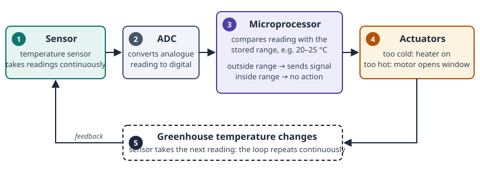

# Automated systems

## Specification coverage

| Point | Section |
| --- | --- |
| 6.1.1 Sensors, microprocessors and actuators working together in an automated system | 1, 3 |
| 6.1.2 Advantages and disadvantages of an automated system in a given scenario: industry, transport, agriculture, weather, gaming, lighting, science | 2, 3 |

## 1. How an automated system works (6.1.1)

::: definition
**Automated system** — a combination of hardware (sensors, a microprocessor and actuators) and
software that carries out a task **without human intervention**. A person may still monitor it.
:::

Each part has one job *(sensors and actuators → 3.2)*:

- **sensor** — measures a physical property and sends the reading;
- **microprocessor** — stores the preset values, compares each reading with them and decides what
  to do;
- **actuator** — turns the microprocessor's signal into physical movement (motor, valve, pump,
  switch).

*Figure 1. An automated greenhouse.*

::: exam
Every "describe how this automated system works" answer follows these five steps, using the
scenario's own sensors, stored values and actuators.
:::

## 2. Advantages and disadvantages (6.1.2)

These apply to every scenario. In the exam, word each point for the scenario given.

:::: grid
::: advantages
- **Faster** response than a human to any change.
- **Safer**: people are kept away from dangerous environments.
- Works **24/7** without breaks.
- More **consistent** and accurate; the process stays at its **optimum** conditions, so less
  waste of materials and energy.
- **Lower running costs** in the long term: fewer staff to pay.
:::
::: disadvantages
- **Expensive to set up** and test.
- **Expensive maintenance**, often by specialist technicians.
- Cannot cope with situations it was **not programmed** for; a faulty sensor makes it act on
  wrong data.
- Can be **hacked** (cyberattack).
- **Job losses** and **over-reliance** on the system (people lose skills).
:::
::::

## 3. The seven scenarios (6.1.1, 6.1.2)

The extra points are specific to that scenario, on top of Section 2.

| Scenario (example) | Sensors → microprocessor → actuators | Extra advantage | Extra disadvantage |
| --- | --- | --- | --- |
| **Industry** (chemical plant) | Temperature, pressure, flow, level, gas sensors → compares with safe limits → actuators open/close valves, run pumps, trigger emergency shut-down | Keeps workers away from a hazardous process; reacts to danger faster | A situation not foreseen in testing could be unsafe, so a supervisor is still needed |
| **Transport** (adaptive cruise control) | Proximity sensors in the bumper → calculates distance to the car in front and compares with the safe distance → actuators apply brakes or change the throttle | Fewer accidents caused by human error | A dirty or faulty sensor gives false data; drivers rely on it and lose skill |
| **Agriculture** (crop irrigation) | Moisture and level sensors → compares with required level for that crop → actuators switch water pumps on/off | Saves water; one supervisor can manage huge, remote fields | Faults it cannot sense (e.g. a blocked channel) go unnoticed; specialist repairs in remote areas |
| **Weather** (automated weather station) | Temperature, humidity, pressure, light and level (rainfall) sensors → processes, stores and transmits readings; an actuator empties the rain gauge | Readings at fixed intervals, 24/7, from remote or dangerous places | A faulty sensor can send wrong data for a long time before anyone notices |
| **Gaming** (motion controller) | Accelerometer and proximity sensors → updates the game from the player's movement → actuator (vibration motor) gives feedback | More realistic, immersive play | Devices cost more; movements can be misread |
| **Lighting** (office or garden) | Light and infra-red (movement) sensors → decides if it is dark or someone is present → switches or dims the lights | Lights only on when needed: less energy, longer bulb life | A person sitting still may not be detected and the lights go off |
| **Science** (laboratory experiment) | Level, pH, temperature or light sensors → decides when to add a chemical → actuator opens/closes a tap or valve | Consistent, repeatable results; readings logged automatically; safe with hazardous chemicals | Less flexible than a technician if something unexpected happens |

::: traps
- The sensor does **not** decide or control anything; it only sends readings.
- The microprocessor does **not** move anything; it sends a **signal** to an actuator.
:::
