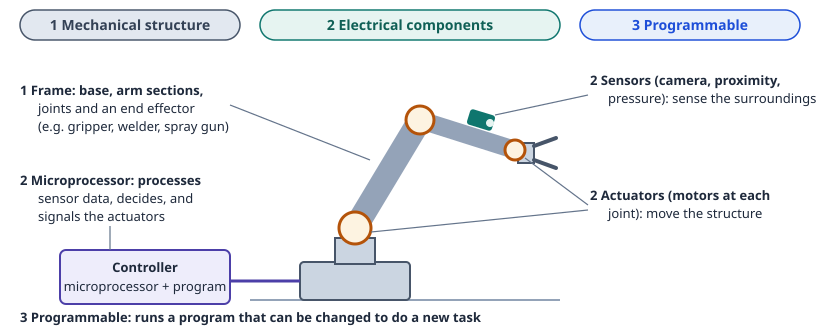

# Robotics

## Specification coverage

| Point | Section |
| --- | --- |
| 6.2.1 What is meant by robotics; examples: factory equipment, domestic robots, drones | 1 |
| 6.2.2 Characteristics of a robot: mechanical structure or framework; electrical components (sensors, microprocessors, actuators); programmable | 2 |
| 6.2.3 Roles of robots in industry, transport, agriculture, medicine, domestic settings, entertainment; advantages and disadvantages | 3, 4 |

## 1. What robotics is (6.2.1)

::: definition
**Robotics** — a branch of computer science that incorporates the **design, construction and
operation** of robots.
:::

Examples:

- **factory equipment** — robot arms that weld or paint car bodies;
- **domestic robots** — robot vacuum cleaners and lawn mowers;
- **drones** — unmanned flying robots, remote-controlled or autonomous, used for aerial photographs
  and deliveries.

## 2. Characteristics of a robot (6.2.2)

A robot has **all three** characteristics.

*Figure 1. The three characteristics of a robot. The sensors, microprocessor and actuators work
together exactly as in any automated system (6.1).*

::: traps
- A chatbot or search-engine "bot" is **not** a robot: it has no mechanical structure.
- A robot does **not** have to be artificially intelligent: most repeat programmed tasks
  without learning.
:::

## 3. Advantages and disadvantages of robots (6.2.3)

:::: grid
::: advantages
- Work **24/7** without breaks, so **higher productivity**.
- **Consistent** and accurate: every task is done identically.
- Can work in conditions **hazardous** to humans.
- Better at **boring, repetitive** tasks than people, who make mistakes.
- **Cheaper in the long run**: no wages.
:::
::: disadvantages
- **Expensive** to buy, set up and maintain.
- Find **non-standard** tasks or unexpected situations difficult.
- **Unemployment** in manual jobs they take over.
- **Deskilling**: people lose skills the robot now uses.
:::
::::

## 4. Roles robots perform (6.2.3)

The extra points are specific to that area, on top of Section 3.

| Area | Roles | Extra advantage | Extra disadvantage |
| --- | --- | --- | --- |
| **Industry** | Welding and paint-spraying car bodies, assembling products, fitting windscreens, packing, fetching items in automated warehouses | The general points in Section 3 | The general points in Section 3 |
| **Transport** | Autonomous cars, buses and trains; delivery drones | Fewer accidents caused by human error; smoother traffic and better punctuality | Control system could be hacked; a software fault could be catastrophic; passengers reluctant to trust them |
| **Agriculture** | Harvesting and picking only ripe crops, weeding, planting seeds, drones spraying fertiliser, monitoring crop health | Faster, with less waste; fertiliser and water only where needed | Very expensive for a farm; may struggle with uneven ground or bad weather |
| **Medicine** | Assisting in surgery, taking blood samples, disinfecting rooms and operating theatres, robotic prosthetic limbs | More precise surgery; staff not exposed to infectious patients; frees staff for skilled work | A malfunction could harm a patient; very high cost |
| **Domestic settings** | Vacuum cleaning, mowing lawns, cleaning windows or pools, personal-assistant robots | Saves the owner time; works while the owner is out | Can get stuck or miss areas; cameras and microphones raise privacy concerns |
| **Entertainment** | Theme-park robots that interact with visitors, controlling cameras and lighting, special effects and stunts in films | Dangerous stunts with no risk to people; effects synchronised precisely | Expensive; less natural than human performers |
