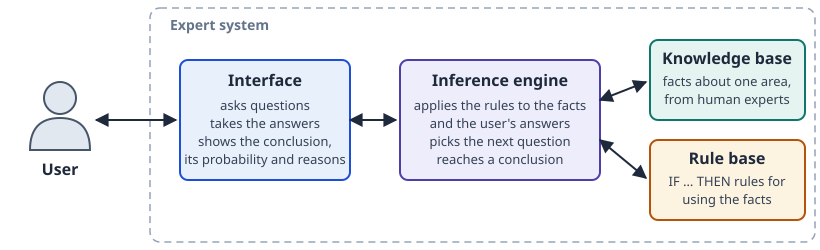
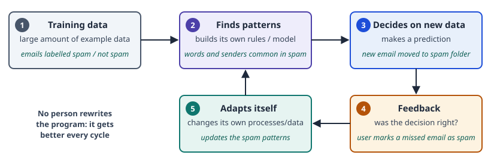

# Artificial intelligence

## Specification coverage

| Point | Section |
| --- | --- |
| 6.3.1 What is meant by artificial intelligence (AI) | 1 |
| 6.3.2 Main characteristics: data and rules for using it; ability to reason; can include ability to learn and adapt | 2 |
| 6.3.3 Basic operation and components of AI systems, limited to expert systems (knowledge base, rule base, inference engine, interface) and machine learning | 3, 4, 5 |

## 1. What AI is (6.3.1)

::: definition
**Artificial intelligence (AI)** — a branch of computer science dealing with the **simulation of
intelligent behaviours** by computers.
:::

Intelligent behaviours are things that normally need a human mind: reasoning, solving problems,
understanding speech, recognising faces or objects, learning. Examples: voice assistants, chatbots,
facial recognition, autonomous cars.

## 2. Main characteristics of AI (6.3.2)

- **A collection of data and the rules for using that data** — it stores facts about its area and
  rules that say how to use them.
- **The ability to reason** — it applies the rules to the data to **draw conclusions** or make
  decisions, including in situations it has not met before.
- **It can include the ability to learn and adapt** — it **changes its own rules or data** from new
  data or experience, so its performance improves.

"**Can** include": every AI system has data, rules and reasoning, but not every one learns. An
expert system does not learn by itself; machine learning does (Section 5).

## 3. Expert systems (6.3.3)

::: definition
**Expert system** — an AI system that simulates the knowledge and decision-making of a **human
expert** in one specialist area, e.g. medical diagnosis, fault-finding in cars or computers,
finding oil or minerals, chess.
:::

*Figure 1. The four components of an expert system and how they connect.*

How it works:

1. The **interface** asks the user a question, often with a yes/no or multiple-choice answer.
2. The **inference engine** applies the rules in the **rule base** to the user's answer and the
   facts in the **knowledge base**.
3. It chooses the **next question** from the previous answers; steps 1–3 repeat.
4. When a match is found, the interface shows the **conclusion** or advice, with the
   **probability** that it is correct and the reasons for it.

Example (computer fault-finding):

- knowledge base fact: *faulty power supply: power light off, fan silent*;
- rule base rule: `IF power light = off AND fan = silent THEN fault = power supply`;
- answers "power light off?" → yes, "fan silent?" → yes, so the conclusion is *power supply fault*.

## 4. Machine learning (6.3.3)

::: definition
**Machine learning** — when a program has the ability to **automatically adapt its own processes
and/or data**.
:::

*Figure 2. How machine learning works, with a spam filter as the example (in italics).*

## 5. Expert systems and machine learning compared (6.3.3)

| | Expert system | Machine learning |
| --- | --- | --- |
| Where the knowledge comes from | Facts and rules **entered by people** from human experts | **Patterns it finds itself** in large amounts of data |
| Does it change itself? | **No**: people must update the knowledge base and rule base | **Yes**: adapts its own processes and data from new data and feedback |

::: traps
- The **knowledge base** holds the **facts**; the **rule base** holds the **rules**; the
  **inference engine** does the reasoning. Do not swap them.
:::
