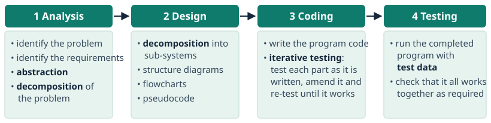
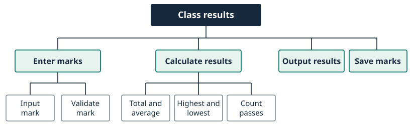
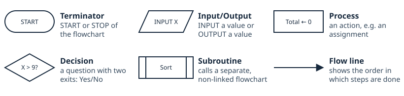
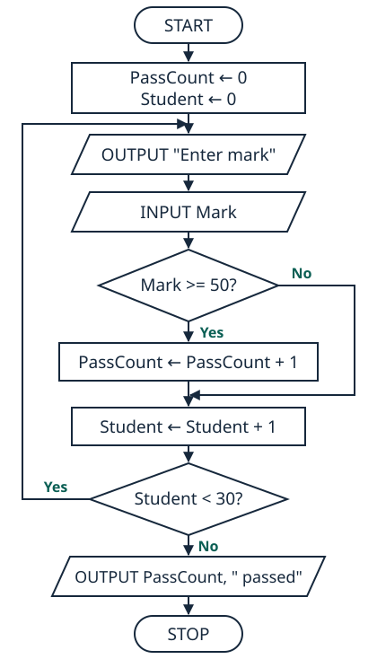
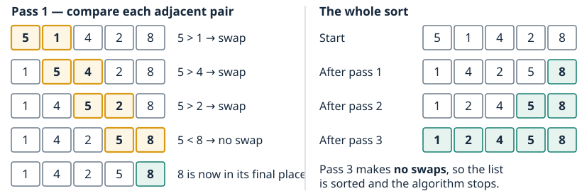
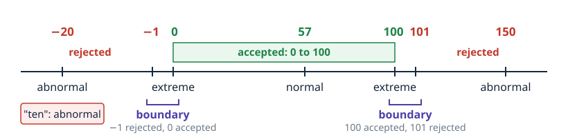

# Algorithm design and problem-solving

## Specification coverage

| Point | Section |
| --- | --- |
| 7.1 Program development life cycle: analysis (abstraction, decomposition, identification of the problem and requirements), design (decomposition, structure diagrams, flowcharts, pseudocode), coding (writing program code, iterative testing), testing (test data) | 1 |
| 7.2 (a) systems made of sub-systems; (b) decomposition into inputs, processes, outputs, storage; (c) design using structure diagrams, flowcharts, pseudocode | 2, 3 |
| 7.3 Explain the purpose of a given algorithm: state the purpose, describe the processes | 4 |
| 7.4 Standard methods: linear search, bubble sort, totalling, counting, maximum, minimum, average | 5 |
| 7.5 (a) need for validation; range, length, type, presence, format checks, check digit (b) need for verification; visual check, double entry check | 6 |
| 7.6 Test data: normal, abnormal, extreme, boundary | 7 |
| 7.7 Trace tables: variables, outputs and user prompts at each step | 8 |
| 7.8 Identify and correct errors in given algorithms | 9 |
| 7.9 Write and amend algorithms using pseudocode, program code and flowcharts; precision | 3, 10 |

## 1. The program development life cycle (7.1)

A program is developed in four stages.



*Figure 1. The program development life cycle.*

- **Identify the problem and the requirements** — state exactly what the program must do (the
  requirements specification used in every later stage).
- **Abstraction** — keeping only the details needed to solve the problem and discarding the rest.
- **Decomposition** — breaking a complex problem into smaller parts that are easier to solve.
- **Iterative testing** — each part (module) is tested as soon as it is coded, then amended and
  re-tested, repeatedly, until it works.

## 2. Systems, sub-systems and decomposition (7.2)

Every computer system is made up of **sub-systems**, and each sub-system is made up of further
sub-systems, until each one performs a single task. Designing like this is **top-down design**:
each small sub-system is easier to write and test, can become one module (subroutine), and
different programmers can develop different sub-systems at the same time.

To decompose a problem, identify its four component parts:

| Component | What it is | Example: class results system |
| --- | --- | --- |
| **Inputs** | data entered into the system | each student's mark |
| **Processes** | tasks performed on the inputs and stored data | validate each mark; total, average, highest, lowest; count passes |
| **Outputs** | information displayed or printed | average, highest and lowest marks, number of passes |
| **Storage** | data kept for future use | marks saved to a file |

## 3. Designing a solution: three methods (7.2, 7.9)

### Structure diagrams



*Figure 2. A structure diagram shows top-down design as a hierarchy: the whole system at the top,
each level below breaking a sub-system into smaller sub-systems.*

### Flowcharts

A flowchart shows the steps of an algorithm and their order using the standard symbols below.
Every decision has two exits, each labelled Yes/No; a loop is a flow line going back to an earlier
step.



*Figure 3. The standard flowchart symbols (syllabus section 4).*

### Pseudocode

Pseudocode writes an algorithm with keywords in UPPER CASE and identifiers in PascalCase
(`PassCount`). Paper 2 algorithms are built from these statements (each construct is taught
fully in Topic 8):

::: note | Pseudocode statements used in Paper 2
```
Total ← 0                          // assignment
INPUT Mark                         // input into a variable
OUTPUT "Total is ", Total          // commas join the values output
IF Mark >= 50                      // selection
  THEN
    OUTPUT "Pass"
  ELSE
    OUTPUT "Fail"
ENDIF
FOR Index ← 1 TO 30                // count-controlled loop
    Total ← Total + Mark[Index]    // Mark[Index]: item Index of a list (array)
NEXT Index
REPEAT                             // post-condition loop: runs at least once
    INPUT Mark
UNTIL Mark >= 0
WHILE Mark <> -1 DO                // pre-condition loop: may run zero times
    INPUT Mark
ENDWHILE
```
:::

Operators: arithmetic `+ - * / ^`; comparison `= < <= > >= <>`; logical `AND OR NOT`.
Indent statements inside a structure by four spaces (`THEN`/`ELSE` by two).

The same algorithm as pseudocode and as a flowchart — it inputs 30 marks and outputs how many
are 50 or more:

:::: grid
::: note | Pseudocode
```
PassCount ← 0
FOR Student ← 1 TO 30
    OUTPUT "Enter mark"
    INPUT Mark
    IF Mark >= 50
      THEN
        PassCount ← PassCount + 1
    ENDIF
NEXT Student
OUTPUT PassCount, " passed"
```
The flowchart has no FOR statement, so it sets its own counter (`Student ← 0`), adds 1 each
time round and uses a decision to loop back.
:::



*Figure 4. The same algorithm as a flowchart.*
::::

## 4. Explaining the purpose of an algorithm (7.3)

Dry-run it with a few values if needed (section 8), then give two things:

1. **the purpose** — one sentence saying what the algorithm does overall;
2. **the processes** — the steps it uses, in order, in words.

::: note | Pseudocode
```
C ← 0
FOR X ← 1 TO 20
    INPUT N
    IF N < 0
      THEN
        C ← C + 1
    ENDIF
NEXT X
OUTPUT C
```
:::

**Purpose:** counts how many of 20 numbers input are negative and outputs that count.
**Processes:** sets a counter to 0; inputs 20 numbers using a loop; checks whether each number is
less than 0 and, if so, adds 1 to the counter; outputs the counter after the loop.

## 5. Standard methods of solution (7.4)

In these examples `Mark[1]` to `Mark[30]` hold 30 marks and `Name[1]` to `Name[30]` hold 30 names.

### Totalling, counting, maximum, minimum and average

- **Totalling** keeps a running total by adding each **value**; **counting** adds **1** each time
  something happens. Both variables start at 0.
- **Maximum and minimum** start at the **first value**; every other value is compared with them.
  (If the range is known, e.g. 0 to 100, the maximum can instead start at the lowest possible
  value, 0, and the minimum at the highest, 100.)
- **Average (mean)** — the total divided by the number of values, calculated **after the loop**:
  `Average ← Total / 30`.

:::: grid
::: note | Totalling and counting
```
Total ← 0
PassCount ← 0
FOR Index ← 1 TO 30
    Total ← Total + Mark[Index]
    IF Mark[Index] >= 50
      THEN
        PassCount ← PassCount + 1
    ENDIF
NEXT Index
```
:::
::: note | Maximum and minimum
```
Highest ← Mark[1]
Lowest ← Mark[1]
FOR Index ← 2 TO 30
    IF Mark[Index] > Highest
      THEN
        Highest ← Mark[Index]
    ENDIF
    IF Mark[Index] < Lowest
      THEN
        Lowest ← Mark[Index]
    ENDIF
NEXT Index
```
:::
::::

### Linear search

Checks each item in the list **in turn**, from the first, until the item is found or the end of
the list is reached. A Boolean **flag** (`Found`) records whether it was found.

::: note | Linear search
```
OUTPUT "Enter the name to find"
INPUT SearchName
Found ← FALSE
Index ← 1
REPEAT
    IF Name[Index] = SearchName
      THEN
        Found ← TRUE
      ELSE
        Index ← Index + 1
    ENDIF
UNTIL Found = TRUE OR Index > 30
IF Found = TRUE
  THEN
    OUTPUT SearchName, " found at position ", Index
  ELSE
    OUTPUT SearchName, " not found"
ENDIF
```
:::

### Bubble sort

Sorts a list by comparing each pair of **adjacent** items and **swapping** them if they are in the
wrong order. One pass through the list moves the largest remaining item to the end, so each pass
can stop one place earlier. Passes repeat until a pass makes **no swaps**.



*Figure 5. Sorting 5, 1, 4, 2, 8 into ascending order. Amber: the pair being compared. Teal:
items already in their final place.*

::: note | Bubble sort (ascending)
```
Last ← 30
REPEAT
    Swapped ← FALSE
    FOR Index ← 1 TO Last - 1
        IF Mark[Index] > Mark[Index + 1]
          THEN
            Temp ← Mark[Index]          // swap, using Temp
            Mark[Index] ← Mark[Index + 1]
            Mark[Index + 1] ← Temp
            Swapped ← TRUE
        ENDIF
    NEXT Index
    Last ← Last - 1
UNTIL Swapped = FALSE OR Last = 1
```
:::

For descending order, change `>` to `<` in the comparison.

## 6. Validation and verification (7.5)

::: definition
**Validation** — automatic checking by the program that input data is **reasonable** (sensible)
before it is accepted. Rejected data produces an error message and must be re-entered.
:::

Validation is needed because unreasonable data (a mark of 150, a blank name) would make the
program produce wrong results or fail.

| Check | What it checks | Example: rejected if… |
| --- | --- | --- |
| **Range check** | a value lies between a lower and an upper limit | `Mark < 0 OR Mark > 100` |
| **Length check** | the number of characters is exact, or within limits | `LENGTH(Password) <> 8` |
| **Type check** | the data is of the required data type | `ten` is entered for a whole number |
| **Presence check** | data has been entered, not left blank | `Email = ""` |
| **Format check** | the characters follow a set pattern | a code that must be two letters then four digits is entered as `12AB34` |
| **Check digit** | the final digit of a code, calculated from the other digits, is recalculated and compared (→ Topic 2) | a barcode or ISBN digit is mistyped or two digits are swapped |

::: note | A range check written as a validation loop (repeats until the data is acceptable)
```
REPEAT
    OUTPUT "Enter a mark from 0 to 100"
    INPUT Mark
    IF Mark < 0 OR Mark > 100
      THEN
        OUTPUT "Invalid mark, please re-enter"
    ENDIF
UNTIL Mark >= 0 AND Mark <= 100
```
:::

::: definition
**Verification** — checking that data has been **entered accurately**, i.e. it matches the
original.
:::

Verification is needed because validation only checks that data is reasonable: a mark of 65 typed
as 56 passes a range check but is wrong.

- **Visual check** — the user reads the data shown on the screen, compares it with the original
  (e.g. the paper form) and confirms it is correct.
- **Double entry check** — the data is entered twice; the computer compares the two entries and,
  if they differ, outputs an error and asks for the data again (e.g. "re-enter your password").

## 7. Test data (7.6)

- **Normal data** — data the program should accept and process.
- **Abnormal data** — data the program should reject (outside the limits, or the wrong type).
- **Extreme data** — the largest and smallest acceptable values.
- **Boundary data** — the largest/smallest acceptable value **and** the corresponding
  smallest/largest rejected value, i.e. a pair at each end of the range.



*Figure 6. Test data for a whole-number mark from 0 to 100.*

To suggest test data, give the value, its type and the expected result (accepted or rejected).

## 8. Trace tables (7.7)

A **dry run** is working through an algorithm by hand, step by step, with test data. A **trace
table** records it: one column for each variable and one for output.

- Work through the algorithm one statement at a time.
- Write a variable's new value each time it **changes** (leave the cell blank if it does not).
- Every output, **including user prompts**, goes in the OUTPUT column, in order.
- Start a new row when a column that already has a value in the current row changes again.

:::: grid
::: note | Algorithm — test data 35, 72, 50, 64
```
Highest ← -1
Count ← 0
FOR Index ← 1 TO 4
    OUTPUT "Enter score"
    INPUT Score
    IF Score > Highest
      THEN
        Highest ← Score
    ENDIF
    IF Score >= 50
      THEN
        Count ← Count + 1
    ENDIF
NEXT Index
OUTPUT "Highest ", Highest
OUTPUT "Passes ", Count
```
:::

| Index | Score | Highest | Count | OUTPUT |
| --- | --- | --- | --- | --- |
|  |  | -1 | 0 |  |
| 1 | 35 | 35 |  | Enter score |
| 2 | 72 | 72 | 1 | Enter score |
| 3 | 50 |  | 2 | Enter score |
| 4 | 64 |  | 3 | Enter score |
|  |  |  |  | Highest 72 |
|  |  |  |  | Passes 3 |
::::

## 9. Finding and correcting errors (7.8)

Dry-run the algorithm with test data whose correct result you know; where the trace table differs
from the expected result, look for:

- wrong **starting values** (a total not set to 0; a maximum/minimum started at the wrong value);
- wrong **loop limits or conditions** (`<` instead of `<=`, `TO 9` instead of `TO 10`);
- a reversed comparison (`<` instead of `>`) or the wrong variable;
- totalling or counting written as a plain assignment (`Total ← Mark`);
- a statement inside the loop that belongs outside it, or the reverse.

Example — this algorithm should input 10 numbers from 1 to 1000 and output their average and the
largest:

::: note | Algorithm with errors
```
01  Total ← 0
02  Largest ← 1000
03  FOR Count ← 1 TO 10
04      INPUT Number
05      Total ← Number
06      IF Number < Largest
07        THEN
08          Largest ← Number
09      ENDIF
10  NEXT Count
11  Average ← Total / 9
12  OUTPUT Average, " ", Largest
```
:::

| Line | Error | Correction |
| --- | --- | --- |
| 02 | the largest starts at the highest possible value, so no number is ever bigger | `Largest ← 0` |
| 05 | the number replaces the total instead of being added to it | `Total ← Total + Number` |
| 06 | the comparison finds the smallest, not the largest | `IF Number > Largest` |
| 11 | divides by the wrong number of values | `Average ← Total / 10` |

## 10. Writing and amending algorithms (7.9)

**Precision** is required: write conditions and statements exactly, with operators and
identifiers — `Mark > 50`, never "mark is more than 50". Use the identifiers the question gives.

**Program code** earns marks only in the 15-mark scenario question (pseudocode, Python, Visual Basic
or Java). Everywhere else in Paper 2, solutions in program code score nothing — write pseudocode.

**Writing an algorithm from a scenario:**

1. List the inputs, processes, outputs and storage (section 2).
2. Initialise every total and counter.
3. Use a loop for repeated inputs or for working through a list.
4. Validate each input as it is entered (section 6).
5. Process with the standard methods (section 5).
6. Output the results with a message.

**Amending** means changing only what the new requirement needs and keeping the rest. The
algorithm from Figure 4, amended so that each mark must be 0 to 100 and the average is also
output:

::: note | Amended algorithm
```
PassCount ← 0
Total ← 0                                       // added
FOR Student ← 1 TO 30
    REPEAT                                      // added: range check
        OUTPUT "Enter mark (0 to 100)"
        INPUT Mark
    UNTIL Mark >= 0 AND Mark <= 100
    Total ← Total + Mark                        // added
    IF Mark >= 50
      THEN
        PassCount ← PassCount + 1
    ENDIF
NEXT Student
OUTPUT PassCount, " passed"
OUTPUT "Average mark: ", Total / 30             // added
```
:::

## Common traps

- **Extreme vs boundary:** extreme data is only the largest/smallest *accepted* value; boundary
  data is that value **plus** the rejected value just beyond it.
- **Validation vs verification:** validation checks data is *reasonable*; verification checks it
  was *entered correctly*.
- **Counting adds 1, totalling adds the value.** An average is calculated once, after the loop.
- A maximum started at 0 fails if every value is negative; starting at the first value always works.
