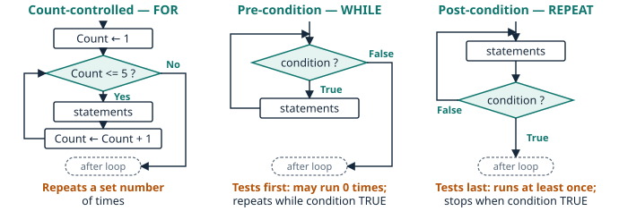
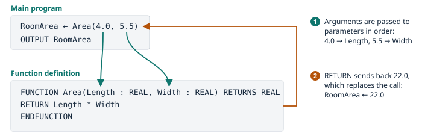
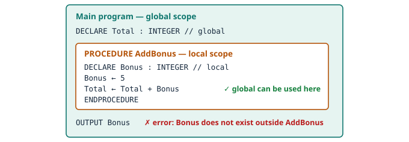

# Programming concepts

## Specification coverage

| Point | Section |
| --- | --- |
| 8.1.1 | §1 |
| 8.1.2 | §1 |
| 8.1.3 | §2 |
| 8.1.4 (f) | §3 |
| 8.1.4 (a) | §4 |
| 8.1.4 (b) | §5 |
| 8.1.4 (c) | §6 |
| 8.1.4 (d) | §7 |
| 8.1.4 (e) | §8 |
| 8.1.5 | §9 |
| 8.1.6 (a), (b) | §10 |
| 8.1.6 (c) | §11 |
| 8.1.7 | §12 (MOD, DIV also §3) |
| 8.1.8 | §13 |

## 1. Variables, constants and data types

::: definition
**Variable** — a named data store whose value **can change** while the program runs.

**Constant** — a named data store whose value **cannot change** while the program runs.
:::

```
DECLARE Counter : INTEGER      // variable: identifier and data type
CONSTANT TaxRate ← 0.2         // constant: identifier and a literal value
Counter ← 0                    // ← assigns the value on the right
Counter ← Counter + 1          //   to the variable on the left
```

- A constant is given its value once, when it is declared, and only a **literal** may be used
  (not a variable or an expression). Use constants for fixed values: the program is easier to
  read, and if the value changes it is edited in **one place**, so no copy is missed.
- Identifiers use Pascal case (`TotalPrice`): letters and digits only, starting with a capital
  letter; no spaces, underscores or keywords.

| Data type | Stores | Literals |
| --- | --- | --- |
| `INTEGER` | a whole number | `5`, `-3` |
| `REAL` | a number with a fractional part | `4.7`, `-4.0` — always a digit on each side of the point |
| `CHAR` | a single character | `'x'`, `'@'` — single quotes |
| `STRING` | a sequence of zero or more characters | `"Hello"`, `""` — double quotes |
| `BOOLEAN` | one of two logical values | `TRUE`, `FALSE` |

Data made of digits that is never calculated with, such as a phone number `"07700 900123"`, is
stored as a `STRING` (it keeps the leading 0 and the space).

## 2. Input and output

```
OUTPUT "Enter your age"                 // prompt: tells the user what to type
INPUT Age                               // stores the value typed in variable Age
OUTPUT "You are ", Age, " years old"    // several values separated by commas
```

`INPUT` stores the value in a variable or in one element of an array.

## 3. Operators

| Type | Operators | Result |
| --- | --- | --- |
| Arithmetic | `+`  `-`  `*`  `/`  `^` (raised to the power of), `MOD`, `DIV` | a number |
| Relational | `=`  `<`  `<=`  `>`  `>=`  `<>` (not equal to) | `TRUE` / `FALSE` |
| Logical | `AND` (both true), `OR` (at least one true), `NOT` (reverses) | `TRUE` / `FALSE` |

- `/` gives a real result: `7 / 2` is `3.5`. `DIV(7, 2)` is `3` (whole-number quotient) and
  `MOD(7, 2)` is `1` (remainder) — both work on integers.
- `*` and `/` are done before `+` and `-`. Use brackets to make the order explicit:
  `Average ← (Mark1 + Mark2) / 2`.
- Each part of a combined condition must be complete: `Mark >= 0 AND Mark <= 100`.

## 4. Sequence

::: definition
**Sequence** — statements are executed one after another, in the order in which they are written.
:::

Order matters: a value must be input or calculated **before** it is used — `Area ← Length * Width`
must come after `INPUT Length` and `INPUT Width`.

## 5. Selection

::: definition
**Selection** — a condition is tested and its result decides which statements are executed.
:::

:::: grid
::: card | IF … THEN … ELSE … ENDIF
```
IF Mark >= 50
  THEN
    OUTPUT "Pass"
  ELSE
    OUTPUT "Fail"
ENDIF
```
`ELSE` is optional: without it, nothing happens when the condition is `FALSE`.
:::
::: card | CASE OF … OTHERWISE … ENDCASE
```
CASE OF Grade
  'A' : Points ← 3
  'B' : Points ← 2
  'C' : Points ← 1
  OTHERWISE Points ← 0
ENDCASE
```
Cases are tested in order; the first match runs and the rest are skipped. `OTHERWISE` (optional,
always last) runs if no case matches.
:::
::::

Use **IF** for any condition — ranges, `AND`/`OR`, comparing two variables. Use **CASE** to choose
between several single values of one variable: it is neater than a chain of IFs.

## 6. Iteration

::: definition
**Iteration** — a set of statements is repeated (a loop).
:::



*Figure 1. The three types of loop. The position of the condition test is the difference.*

- **Count-controlled** — `FOR Count ← 1 TO 5` … `NEXT Count` — when the number of repetitions is
  known, e.g. 30 students. The loop variable is an `INTEGER` that takes every value from the first
  to the last inclusive; `STEP` sets a different increment, which can be negative:
  `FOR Count ← 10 TO 0 STEP -2`.
- **Pre-condition** — `WHILE <condition> DO` … `ENDWHILE` — when the loop may not need to run at
  all.
- **Post-condition** — `REPEAT` … `UNTIL <condition>` — when the statements must run at least
  once, e.g. input validation: keep asking **until** the input is valid.

:::: grid
::: card | WHILE example
```
WHILE Number > 9 DO
    Number ← Number - 9
ENDWHILE
```
:::
::: card | REPEAT example
```
REPEAT
    OUTPUT "Enter the password"
    INPUT Password
UNTIL Password = "Secret"
```
:::
::::

## 7. Totalling and counting

::: definition
**Totalling** — keeping a running total by adding each new value: `Total ← Total + Value`.

**Counting** — adding 1 each time something happens: `Count ← Count + 1`.
:::

The total and the counter must be **initialised** (usually to 0) **before** the loop.

```
Total ← 0
PassCount ← 0
FOR Student ← 1 TO 30
    INPUT Mark
    Total ← Total + Mark                // totalling
    IF Mark >= 50
      THEN
        PassCount ← PassCount + 1       // counting
    ENDIF
NEXT Student
OUTPUT "Average mark: ", Total / 30
OUTPUT "Number of passes: ", PassCount
```

Finding the maximum, minimum and average are standard methods *(→ Topic 7)*.

## 8. String handling

| Function | Returns | Example |
| --- | --- | --- |
| `LENGTH(Text)` | the number of characters | `LENGTH("Happy Days")` → `10` |
| `SUBSTRING(Text, Start, Length)` | `Length` characters starting at position `Start` | `SUBSTRING("Happy Days", 1, 5)` → `"Happy"` |
| `UCASE(Text)` | the string or character in upper case | `UCASE("Happy")` → `"HAPPY"` |
| `LCASE(Text)` | the string or character in lower case | `LCASE('W')` → `'w'` |


*Figure 2. Character positions. Cambridge pseudocode normally starts at position 1.*

Two common uses:

```
FOR Position ← 1 TO LENGTH(Word)            // process one character at a time
    OUTPUT SUBSTRING(Word, Position, 1)
NEXT Position

IF UCASE(Answer) = "YES"                    // accepts "yes", "Yes", "YES" …
  THEN
    OUTPUT "Confirmed"
ENDIF
```

## 9. Nested statements

::: definition
**Nested statement** — a selection or iteration statement placed inside another selection or
iteration statement.
:::

The loop in §7 has an IF nested inside a FOR; nested loops are used for 2D arrays *(→ 8.2)*. Nested
IFs test one condition only when another is already known:

```
IF Mark >= 70
  THEN
    Grade ← 'A'
  ELSE
    IF Mark >= 50                // only reached when Mark < 70
      THEN
        Grade ← 'B'
      ELSE
        Grade ← 'C'
    ENDIF
ENDIF
```

Indentation shows which `ENDIF`, `NEXT` or `ENDWHILE` closes which statement. You will not be asked
to write more than **three levels** of nesting.

## 10. Procedures, functions and parameters

::: definition
**Procedure** — a named set of statements, defined once, that performs a task and can be called
from any point in the program.

**Function** — like a procedure, but it **returns a single value** to the point where it was
called.

**Parameter** — a variable in the procedure or function header that receives a value (an
**argument**) passed to it when it is called.
:::

Writing a task once and calling it many times makes programs shorter, avoids repeated code, lets
each subroutine be tested on its own, and makes the program easier to maintain.

| | Procedure | Function |
| --- | --- | --- |
| Returns a value | no | yes — one value, sent back with `RETURN` |
| Header | `PROCEDURE Name(Param : TYPE)` … `ENDPROCEDURE` | `FUNCTION Name(Param : TYPE) RETURNS TYPE` … `ENDFUNCTION` |
| Called by | `CALL Name(Argument)` — a complete statement | its name inside an expression, e.g. `X ← Name(Argument)`; never `CALL` |

::: card | Procedure example
```
PROCEDURE Stars(Number : INTEGER)       // defined at the start of the code
    DECLARE Count : INTEGER
    FOR Count ← 1 TO Number
        OUTPUT '*'
    NEXT Count
ENDPROCEDURE

CALL Stars(7)                           // outputs 7 stars
```
:::



*Figure 3. Calling a function: arguments go in, one value comes back.*

- Up to **three** parameters, each with its data type. The arguments in the call must match the
  parameters in number, order and data type.
- Without parameters: `PROCEDURE Line` … `CALL Line`, or `FUNCTION GetMark RETURNS INTEGER`.

## 11. Local and global variables



*Figure 4. Scope: where in the program a variable can be used.*

::: definition
**Global variable** — declared in the main program; it can be used in any part of the program.

**Local variable** — declared inside a procedure or function; it can be used only within that
subroutine.
:::

Prefer local variables: they cannot be changed by mistake elsewhere in the program, the same name
can be reused in different subroutines, and each subroutine is self-contained, so it is easier to
test and reuse. Parameters behave as local variables.

## 12. Library routines

::: definition
**Library routine** — a pre-written, pre-tested procedure or function supplied with the programming
language, ready to be called in any program. It saves writing and testing that code again.
:::

| Routine | Returns | Example |
| --- | --- | --- |
| `MOD(A, B)` | the remainder of A ÷ B | `MOD(10, 3)` → `1` |
| `DIV(A, B)` | the whole-number quotient of A ÷ B | `DIV(10, 3)` → `3` |
| `ROUND(Value, Places)` | `Value` rounded to `Places` decimal places | `ROUND(6.97354, 2)` → `6.97` |
| `RANDOM()` | a random real number from 0 to 1 inclusive | e.g. `0.4271` |

- `MOD(Number, 2) = 0` is `TRUE` when `Number` is even.
- `Dice ← ROUND(RANDOM() * 5, 0) + 1` gives a whole number from 1 to 6.

## 13. Maintainable programs

A **maintainable** program is one that another programmer — or you, later — can easily understand,
correct and update. Make it maintainable with:

- **meaningful identifiers** for variables, constants, arrays, procedures and functions — the name
  says what it stores or does (`TotalPrice`, `CalculateTax`, not `X`, `P1`);
- **comments** (`//` in pseudocode; the language's own commenting feature in code) explaining the
  purpose of the program, of each procedure and function, and of any statement whose purpose is
  not obvious;
- **procedures and functions**, so each task is a separate, named module.

## Common traps

- `CALL` is only for procedures. A function is used inside an expression: `Tax ← CalcTax(Price)`.
- `REPEAT … UNTIL` **stops** when the condition becomes `TRUE`; `WHILE` **continues** while it is
  `TRUE`.
- Initialise totals and counters **before** the loop — resetting them inside it loses the total.
- `=` compares (in a condition); `←` assigns: `Count ← Count + 1`, never `Count = Count + 1`.
- A number stored as a `STRING` (`"25"`) cannot be used in arithmetic.
- Every structure needs its closing keyword: `ENDIF`, `ENDCASE`, `NEXT <variable>`, `ENDWHILE`,
  `UNTIL`, `ENDPROCEDURE`, `ENDFUNCTION`.

## Exam relevance

In Paper 2, any answer that involves code must be written in **pseudocode** — program code scores
nothing — except the 15-mark scenario question, which also accepts Python, Visual Basic or Java.
Logic matters more than exact syntax, but conditions must be precise: `Mark > 50`, not "mark is
more than 50".
