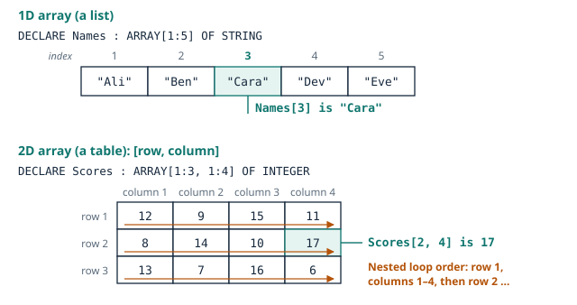

# Arrays

## Specification coverage

| Point | Section |
| --- | --- |
| 8.2.1 | §1, §2 |
| 8.2.2 | §1, §2 |
| 8.2.3 | §3 |

## 1. What an array is and why it is used

::: definition
**Array** — a fixed-length data structure that stores elements of the **same data type** under
**one identifier**; each element is accessed by its **index** (its position).
:::

Why use an array instead of separate variables (`Name1`, `Name2` … `Name30`):

- one identifier holds a whole list or table of related data;
- a **variable can be used as the index**, so one loop processes every element in a few lines of
  code, however many elements there are;
- the data can then be searched, sorted or totalled *(→ Topic 7)*.

All elements have the same data type, so different data about the same items goes in separate
arrays that share an index: `Names[3]` and `Marks[3]` belong to the same student.



*Figure 1. A 1D array has one index; a 2D array has two, always [row, column].*

## 2. Declaring and using arrays

```
DECLARE Names : ARRAY[1:30] OF STRING           // 1D: 30 elements
DECLARE Scores : ARRAY[1:3, 1:4] OF INTEGER     // 2D: 3 rows × 4 columns = 12 elements
Names[1] ← "Ali"                                // write one element
Scores[2, 4] ← 17                               // row 2, column 4
OUTPUT Names[Position]                          // variable as the index
Names[N + 1] ← Names[N]                         // expression as the index
```

- The declaration gives the identifier, the **lower and upper bound** of each index, and the data
  type.
- The first index can be 0 or 1 (`ARRAY[0:9]` also has 10 elements). Cambridge normally uses 1 —
  always read the bounds in the declaration and make loops match them.
- Each statement uses one element. A whole array is filled or processed with a loop.

## 3. Writing to and reading from arrays with iteration

A **1D array** needs one loop; the loop variable is the index.

```
FOR Index ← 1 TO 30
    OUTPUT "Enter name ", Index
    INPUT Names[Index]                  // write a value into the array
NEXT Index

FOR Index ← 1 TO 30
    OUTPUT Names[Index]                 // read a value from the array
NEXT Index
```

A **2D array** needs **nested** loops: the outer loop chooses the row, the inner loop visits every
column of that row (the order shown by the arrows in Figure 1).

```
FOR Row ← 1 TO 3
    RowTotal ← 0
    FOR Column ← 1 TO 4
        INPUT Scores[Row, Column]                   // write
        RowTotal ← RowTotal + Scores[Row, Column]   // read
    NEXT Column
    OUTPUT "Total for row ", Row, " is ", RowTotal
NEXT Row
```

To initialise an array, assign a starting value to every element in the same kind of loop, e.g.
`Scores[Row, Column] ← 0`.

## Common traps

- An index outside the declared bounds (e.g. `Names[31]` or `Names[0]` for `ARRAY[1:30]`) is an
  error — check loop start and end values against the bounds.
- 2D indexes are always `[row, column]`; the inner loop's variable goes second.
- Reset a row total **inside** the outer loop but **outside** the inner loop, as above.
