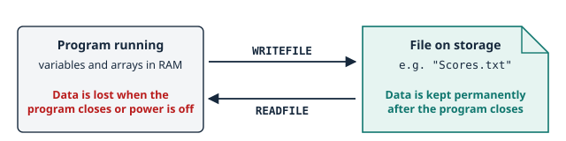

# File handling

## Specification coverage

| Point | Section |
| --- | --- |
| 8.3.1 | §1 |
| 8.3.2 | §2, §3 |

## 1. Why store data in a file



*Figure 1. Variables only exist while the program runs; a file keeps the data.*

Storing data in a file keeps it **permanently**, so it does not have to be entered again each time
the program runs (e.g. a saved high score or a list of names). The file can be used later by the
same program, by another program, or on another computer.

## 2. Opening, using and closing a file

| Step | Pseudocode | What it does |
| --- | --- | --- |
| Open to read | `OPENFILE "Scores.txt" FOR READ` | opens the file so data can be read from it |
| Open to write | `OPENFILE "Scores.txt" FOR WRITE` | creates a **new** file for writing — any data already in it is **lost** |
| Read | `READFILE "Scores.txt", Score` | reads the next data item or line from the file into the variable |
| Write | `WRITEFILE "Scores.txt", Score` | writes the value of the variable into the file |
| Close | `CLOSEFILE "Scores.txt"` | closes the file when it is no longer needed |

- Always open a file, stating the mode, before using it, and close it afterwards.
- A file is open in **one mode at a time**. To read back data you have just written, close the
  file and open it again `FOR READ`.
- The file identifier is the file name, a string. Each `READFILE` reads the **next** item or line
  in order; a line of text is read into a `STRING` variable.

## 3. Reading and writing single items and lines of text

A **single item of data** — save a high score and load it next time:

```
OPENFILE "HighScore.txt" FOR WRITE
WRITEFILE "HighScore.txt", HighScore
CLOSEFILE "HighScore.txt"

OPENFILE "HighScore.txt" FOR READ
READFILE "HighScore.txt", HighScore
CLOSEFILE "HighScore.txt"
```

**Lines of text** — write 30 names from an array, one per line, then read them back:

```
DECLARE LineOfText : STRING
OPENFILE "Names.txt" FOR WRITE
FOR Index ← 1 TO 30
    WRITEFILE "Names.txt", Names[Index]
NEXT Index
CLOSEFILE "Names.txt"

OPENFILE "Names.txt" FOR READ
FOR Index ← 1 TO 30
    READFILE "Names.txt", LineOfText
    OUTPUT LineOfText
NEXT Index
CLOSEFILE "Names.txt"
```

Two files can be open at once in different modes — e.g. copy a line from one file to another:
open `"FileA.txt" FOR READ` and `"FileB.txt" FOR WRITE`, `READFILE` from A into a variable,
`WRITEFILE` that variable to B, then close both.

## Common traps

- Opening an existing file `FOR WRITE` erases its contents.
- `READFILE` and `WRITEFILE` name the **file**, then the **variable**: `READFILE "Names.txt", Name`.
- Do not read from a file opened `FOR WRITE` (or write to one opened `FOR READ`).
