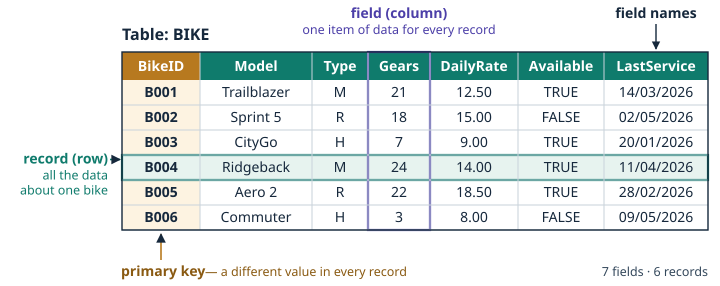
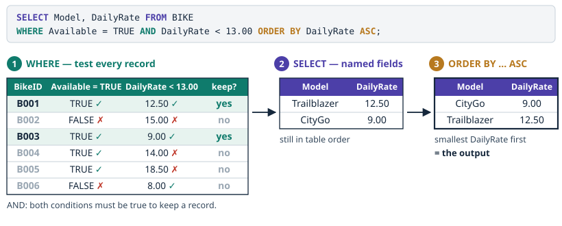

# Databases

<style>
pre { background: #f3f5f7; border: 0.6pt solid #c9d3dc; border-radius: 3pt; padding: 5pt 8pt;
      margin: 3pt 0 7pt; break-inside: avoid; }
pre code { background: none; padding: 0; font-size: 8.6pt; line-height: 1.45; }
</style>

## Specification coverage

| Point | Section |
| --- | --- |
| 9.1 fields, records | §1 |
| 9.1 validation; defining a table from requirements | §4 |
| 9.2 | §2 |
| 9.3 | §3 |
| 9.4 SELECT, FROM, WHERE, ORDER BY ASC/DESC, SUM, COUNT, AND, OR; output of a query | §5 |

## 1. Single-table databases

::: definition
**Database** — a structured collection of data, stored so that it can be searched and queried.
A **single-table database** stores all its data in one **table**.

**Record** — one row of the table: all the data about **one** item, person or event.

**Field** — one column of the table: **one item of data** stored for every record. Every record
has the same fields.
:::



*Figure 1. The BIKE table of a bike-hire shop, used in every example in this topic.*

- The table and each field get a **meaningful name**. Field names are one word with **no spaces**
  (`DailyRate`, not `Daily rate`).
- The row of field names is **not** a record: BIKE has **7 fields and 6 records**.

## 2. Data types

Each field is given the data type that suits the data it will hold.

| Data type | Holds | Field in BIKE |
| --- | --- | --- |
| **Text / alphanumeric** | any mix of letters, digits and symbols | `Model`, `BikeID` (e.g. `B004`) |
| **Character** | exactly **one** character | `Type` (`M`, `R` or `H`) |
| **Boolean** | one of **two** values: TRUE / FALSE | `Available` |
| **Integer** | a whole number | `Gears` |
| **Real** | a number with a decimal part | `DailyRate` |
| **Date/time** | a date and/or a time | `LastService` |

Choose by what the data **is**, not by how it looks: a value made of digits that is never used
in a calculation — phone number, ID code, postcode — is **text** (it may start with 0 or contain
`+`, spaces or letters). Money is **real**.

## 3. Primary key

::: definition
**Primary key** — a field that **uniquely identifies each record** in a table: no two records can
ever have the same value in it.
:::

**Purpose:** every record can be found and referred to without confusion; a duplicate record
cannot be stored, because the database rejects a repeated primary-key value.

**Choosing one:** pick the field whose values are **guaranteed to be different for every record,
including records added later** — usually an ID or code field. In BIKE that is `BikeID`.
`Model` is unique in these six records, but a second bike of the same model could be bought.
Names, dates, prices and counts can all repeat. If no field is guaranteed unique, **add** an ID
field (e.g. `MemberID`) and make it the primary key.

## 4. Defining a table from data storage requirements

A 9.1 question describes what must be stored; you answer with the **table name**, a **field** for
each item of data, a **data type** for each field, the **primary key** and suitable
**validation**.

**Validation** is an automatic check that data entered into a field is **reasonable** and follows
set rules; data that fails is rejected. It cannot tell whether data is *correct*. The checks are
the ones from 7.5: range, length, type, presence, format, check digit.

**Requirement:** *A bike-hire shop needs to store, for each bike: a code of B followed by three
digits, the model name, the type (M = mountain, R = road, H = hybrid), the number of gears (1–30),
the price per day, whether it is available and the date of its last service.*

| Field | Data type | Validation |
| --- | --- | --- |
| `BikeID` **(primary key)** | text | presence check; format check: `B` then 3 digits |
| `Model` | text | presence check; length check: at most 20 characters |
| `Type` | character | length check: exactly 1 character |
| `Gears` | integer | range check: 1 to 30 |
| `DailyRate` | real | range check: greater than 0 |
| `Available` | Boolean | none needed — only TRUE or FALSE can be stored |
| `LastService` | date/time | type check: a valid date; range check: not in the future |

Table name: `BIKE`.

## 5. SQL queries

**SQL (structured query language)** is used to write **scripts** that query a database: they
fetch only the data asked for. An SQL script is one or more SQL statements; each query statement
ends with `;`.

```
SELECT <field>, <field>     -- or SELECT * for every field
FROM <table>
WHERE <condition>           -- optional
ORDER BY <field> ASC;       -- optional; DESC for descending
```

| Keyword | What it does | Question wording that signals it |
| --- | --- | --- |
| `SELECT` | chooses the fields to show, in that order; `*` = all fields | "show / display / list the …" |
| `FROM` | names the table | — |
| `WHERE` | keeps only the records that meet the condition | "only those …", "every bike that …" |
| `AND` | both conditions must be true | "… and …" |
| `OR` | at least one condition must be true | "either … or …" |
| `ORDER BY … ASC` | sorts ascending: A → Z, smallest first | "in alphabetical order", "lowest first" |
| `ORDER BY … DESC` | sorts descending: Z → A, largest first | "reverse order", "highest first" |
| `SUM(field)` | adds up a numeric field over the selected records | "total …" |
| `COUNT(*)` | counts the selected records (`COUNT(field)` is also used) | "how many …" |

**Conditions** compare a field with a value using `=  <>  <  >  <=  >=`. Write the value to match
the field's data type: text, character and dates in quotes (`'M'`, `'Sprint 5'`); integers and
reals as plain numbers (`24`, `13.00`); Boolean as `TRUE` or `FALSE`.

### Working out the output of a query



*Figure 2. Apply WHERE to every record, then keep the SELECT fields, then sort.*

### More examples on BIKE

`OR` and descending order:

```
SELECT BikeID, Model, Gears
FROM BIKE
WHERE Type = 'R' OR Gears > 22
ORDER BY Model DESC;
```

| BikeID | Model | Gears |
| --- | --- | --- |
| B002 | Sprint 5 | 18 |
| B004 | Ridgeback | 24 |
| B005 | Aero 2 | 22 |

B002 and B005 are road bikes; B004 has more than 22 gears. Sorted Z → A by `Model`.

`SUM` and `COUNT` return **one value**, not a list of records:

:::: grid
::: card | Total daily rate of mountain bikes
```
SELECT SUM(DailyRate)
FROM BIKE
WHERE Type = 'M';
```
Output: **26.50** (12.50 + 14.00)
:::
::: card | Number of available bikes
```
SELECT COUNT(*)
FROM BIKE
WHERE Available = TRUE;
```
Output: **4** (B001, B003, B004, B005)
:::
::::

## Common traps

- **Repeat the field in OR/AND:** `WHERE Type = 'R' OR Type = 'H'`, never `WHERE Type = 'R' OR 'H'`.
- **Output fields:** only the SELECT fields appear, in the SELECT order — even if WHERE or
  ORDER BY uses another field.
- **Quotes** go round text, character and date values only — never round numbers or TRUE/FALSE.
