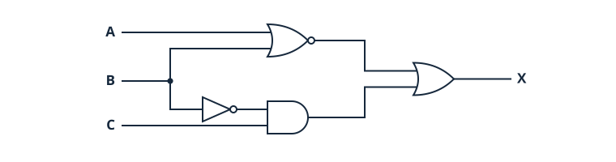
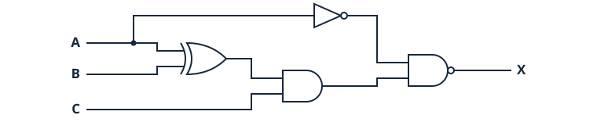

# Boolean logic — Questions

## Specification coverage

| Field | Value |
| --- | --- |
| Specification points | 10.1–10.3 |
| Paper | Paper 2 — Algorithms, Programming and Logic |

No past papers are stored in `me/papers/Computer_Science_0984/` yet. Marking guidance below is
**not official**; it follows the style of Cambridge mark schemes. Truth tables are marked on the
output column only (suggested: 8 correct = 4 marks, 6–7 = 3, 4–5 = 2, 2–3 = 1).

## Questions

**1.** (10.1, 10.2) Identify the gate described. **[4]**

(a) The output is 1 only when both inputs are 0.
(b) The output is 0 only when both inputs are 1.
(c) The output is 1 when the two inputs are different.
(d) The gate has only one input.

**2.** (10.2) Draw the standard symbols for a NAND gate and an XOR gate. **[2]**

**3.** (10.3 b(iii), c(ii)) Look at this logic circuit.

(a) Complete the truth table for the circuit (A, B, C in the order 000 … 111). **[4]**
(b) Write the logic expression for the circuit. Do not attempt to simplify it. **[3]**

**4.** (10.3 b(iii), c(ii)) Look at this logic circuit.

(a) Write the logic expression for the circuit. Do not attempt to simplify it. **[3]**
(b) Complete the truth table for the circuit. **[4]**

**5.** (10.3 a(ii), b(ii)) X = (A AND NOT B) NOR (B OR C)

(a) Draw the logic circuit. Each gate must have no more than two inputs. Do not simplify. **[4]**
(b) Complete the truth table. **[4]**

**6.** (10.3 a(i), b(i), c(i)) A water pump runs (X = 1) when the tank is **not** full and
**either** the manual switch is on **or** the timer is on, **but not both**.

| Input | 1 means | 0 means |
| --- | --- | --- |
| F | tank full | tank not full |
| S | switch on | switch off |
| T | timer on | timer off |

(a) Write the logic expression. **[2]**
(b) Draw the logic circuit. **[3]**
(c) Complete the truth table (F, S, T in the order 000 … 111). **[4]**

**7.** (10.3 c(iii), a(iii)) The output X of a circuit is 1 only for these inputs:
A B C = 000, 101 and 111; it is 0 for every other row.

(a) Write a logic expression for X. **[3]**
(b) Draw a logic circuit for X using gates with no more than two inputs. **[4]**

**8.** (10.2) A student says NOT (A AND B) always gives the same output as NOT A AND NOT B.
Use a truth table to show the student is wrong. **[3]**

## Answers and marking guidance

**1.** (a) NOR (b) NAND (c) XOR / EOR (d) NOT — 1 mark each.

**2.** NAND: AND shape (flat back, round front) with a bubble on the output. XOR: OR shape with a
second curved line behind the input side. 1 mark each; symbols must match syllabus section 4.

**3.** (a) Working: P = A NOR B, Q = NOT B AND C, X = P OR Q.

| A | B | C | P | Q | X |
| --- | --- | --- | --- | --- | --- |
| 0 | 0 | 0 | 1 | 0 | 1 |
| 0 | 0 | 1 | 1 | 1 | 1 |
| 0 | 1 | 0 | 0 | 0 | 0 |
| 0 | 1 | 1 | 0 | 0 | 0 |
| 1 | 0 | 0 | 0 | 0 | 0 |
| 1 | 0 | 1 | 0 | 1 | 1 |
| 1 | 1 | 0 | 0 | 0 | 0 |
| 1 | 1 | 1 | 0 | 0 | 0 |

(b) X = (A NOR B) OR (NOT B AND C) — 1 mark for (A NOR B), 1 for (NOT B AND C), 1 for joining
with OR.

**4.** (a) X = (NOT A) NAND ((A XOR B) AND C) — 1 for (A XOR B), 1 for … AND C, 1 for NOT A
joined by NAND. Either order of the NAND inputs is correct.

(b) Working: P = A XOR B, Q = P AND C, R = NOT A, X = R NAND Q.

| A | B | C | P | Q | R | X |
| --- | --- | --- | --- | --- | --- | --- |
| 0 | 0 | 0 | 0 | 0 | 1 | 1 |
| 0 | 0 | 1 | 0 | 0 | 1 | 1 |
| 0 | 1 | 0 | 1 | 0 | 1 | 1 |
| 0 | 1 | 1 | 1 | 1 | 1 | 0 |
| 1 | 0 | 0 | 1 | 0 | 0 | 1 |
| 1 | 0 | 1 | 1 | 1 | 0 | 1 |
| 1 | 1 | 0 | 0 | 0 | 0 | 1 |
| 1 | 1 | 1 | 0 | 0 | 0 | 1 |

**5.** (a) Four gates: NOT gate on B; AND gate with inputs A and NOT B; OR gate with inputs B and
C; NOR gate taking the AND and OR outputs, giving X. 1 mark each for: NOT B into AND with A;
B OR C; NOR as the final gate; all connections correct.

(b) Working: P = A AND NOT B, Q = B OR C, X = P NOR Q.

| A | B | C | P | Q | X |
| --- | --- | --- | --- | --- | --- |
| 0 | 0 | 0 | 0 | 0 | 1 |
| 0 | 0 | 1 | 0 | 1 | 0 |
| 0 | 1 | 0 | 0 | 1 | 0 |
| 0 | 1 | 1 | 0 | 1 | 0 |
| 1 | 0 | 0 | 1 | 0 | 0 |
| 1 | 0 | 1 | 1 | 1 | 0 |
| 1 | 1 | 0 | 0 | 1 | 0 |
| 1 | 1 | 1 | 0 | 1 | 0 |

**6.** (a) X = NOT F AND (S XOR T) — 1 for NOT F, 1 for (S XOR T) joined by AND.
(b) NOT gate on F; XOR gate with inputs S and T; AND gate with inputs NOT F and the XOR output,
giving X — 1 mark per gate correctly connected.
(c)

| F | S | T | S XOR T | X |
| --- | --- | --- | --- | --- |
| 0 | 0 | 0 | 0 | 0 |
| 0 | 0 | 1 | 1 | 1 |
| 0 | 1 | 0 | 1 | 1 |
| 0 | 1 | 1 | 0 | 0 |
| 1 | 0 | 0 | 0 | 0 |
| 1 | 0 | 1 | 1 | 0 |
| 1 | 1 | 0 | 1 | 0 |
| 1 | 1 | 1 | 0 | 0 |

**7.** (a) X = (NOT A AND NOT B AND NOT C) OR (A AND NOT B AND C) OR (A AND B AND C) — 1 mark
per correct term joined by OR. Any expression giving the same truth table can be accepted.
(b) NOT gates on A, B and C; each three-input term built from two chained AND gates; the three
terms joined by two chained OR gates. 1 mark per correct term, 1 for the OR stage.

**8.** Complete both columns for AB = 00, 01, 10, 11:
NOT (A AND B) = 1, 1, 1, 0; NOT A AND NOT B = 1, 0, 0, 0.
They differ for AB = 01 and 10, so the statement is wrong — 1 for each column, 1 for identifying
a row where they differ.
