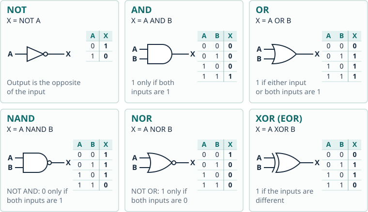
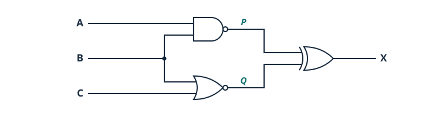
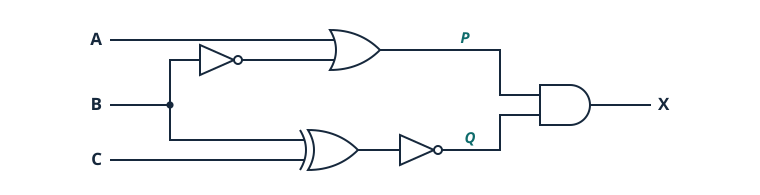
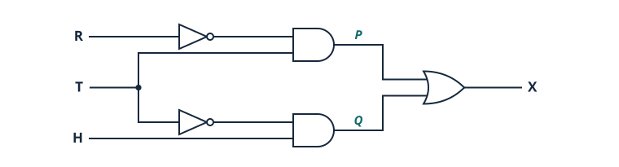
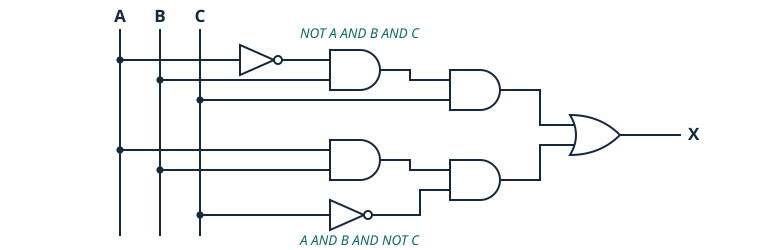

# Boolean logic

## Specification coverage

| Point | Section |
| --- | --- |
| 10.1 standard symbols for NOT, AND, OR, NAND, NOR, XOR (section 4 of the syllabus) | §1 |
| 10.2 function of each gate; output for all possible binary inputs; NOT single input, others two inputs | §1 |
| 10.3 (b)(iii) truth table from a logic circuit · (c)(ii) logic expression from a logic circuit | §2 |
| 10.3 (a)(ii) circuit from a logic expression · (b)(ii) truth table from a logic expression | §3 |
| 10.3 (a)(i) circuit, (b)(i) truth table, (c)(i) logic expression from a problem statement | §4 |
| 10.3 (c)(iii) logic expression from a truth table · (a)(iii) circuit from a truth table | §5 |
| Notes: circuits drawn as stated, without simplification; max three inputs, one output; row order 000–111 | §1, §3, §5 |

## 1. Logic gates and truth tables

::: definition
**Logic gate** — a component that takes binary inputs (0 or 1) and produces one binary output
according to a fixed rule.

**Truth table** — a table showing the output for every possible combination of binary inputs.

**Logic circuit** — logic gates connected together; the output of one gate becomes an input of
the next.

**Logic expression** — a circuit written with the gate names and brackets, e.g.
X = (A AND B) OR NOT C.
:::

*Figure 1. The six gates: standard symbol, logic expression, truth table and rule. NOT is the only
single-input gate; every other gate has exactly two inputs. A small circle (bubble) on the output
means NOT.*

**Building a truth table.** *n* inputs give 2*n* rows: 2 inputs → 4 rows,
3 inputs → 8 rows (exam circuits have at most three inputs and one output). List the rows in binary
counting order, 000, 001, 010 … 111: the right-hand input column alternates 0 1 0 1, the middle one
goes in pairs, the left-hand one in fours.

## 2. From a logic circuit: truth table and expression

*Figure 2. B feeds two gates: the dot marks a junction. Wires that cross without a dot are not
connected.*

:::: grid
::: card | Truth table
Label the output of every gate except the last (P, Q …). Fill a working column for each, row by
row, using the rules in Figure 1; then use those columns as the inputs of the final gate.

P = A NAND B · Q = B NOR C · X = P XOR Q
:::
| A | B | C | P | Q | X |
| --- | --- | --- | --- | --- | --- |
| 0 | 0 | 0 | 1 | 1 | **0** |
| 0 | 0 | 1 | 1 | 0 | **1** |
| 0 | 1 | 0 | 1 | 0 | **1** |
| 0 | 1 | 1 | 1 | 0 | **1** |
| 1 | 0 | 0 | 1 | 1 | **0** |
| 1 | 0 | 1 | 1 | 0 | **1** |
| 1 | 1 | 0 | 0 | 0 | **0** |
| 1 | 1 | 1 | 0 | 0 | **0** |
::::

**Logic expression.** Work from the inputs towards the output. Write each gate as
*(input GATE input)*; where an input comes from another gate, put that gate's bracket in its
place: P = (A NAND B), Q = (B NOR C), so **X = (A NAND B) XOR (B NOR C)**.

## 3. From a logic expression: circuit and truth table

1. **Find the final gate:** the operator outside all the brackets produces X.
2. **Build the brackets first:** each bracketed part is a gate (or small group of gates) whose
   output feeds the next gate out.
3. **Every NOT is its own NOT gate.** Draw exactly what is written, without simplification:
   NOT (B XOR C) is an XOR gate followed by a NOT gate.

Example: **X = (A OR NOT B) AND NOT (B XOR C)** — the final gate is the AND.

*Figure 3. P = A OR NOT B and Q = NOT (B XOR C) are the two inputs of the final AND gate.*

The truth table can be filled straight from the expression, one working column per part — which
is also how to check a circuit you have drawn:

:::: grid
| A | B | C | NOT B | P = A OR NOT B | B XOR C | Q = NOT (B XOR C) | X = P AND Q |
| --- | --- | --- | --- | --- | --- | --- | --- |
| 0 | 0 | 0 | 1 | 1 | 0 | 1 | **1** |
| 0 | 0 | 1 | 1 | 1 | 1 | 0 | **0** |
| 0 | 1 | 0 | 0 | 0 | 1 | 0 | **0** |
| 0 | 1 | 1 | 0 | 0 | 0 | 1 | **0** |
| 1 | 0 | 0 | 1 | 1 | 0 | 1 | **1** |
| 1 | 0 | 1 | 1 | 1 | 1 | 0 | **0** |
| 1 | 1 | 0 | 0 | 1 | 1 | 0 | **0** |
| 1 | 1 | 1 | 0 | 1 | 0 | 1 | **1** |
::::

## 4. From a problem statement: expression, circuit and truth table

:::: grid
::: card | Reading the statement
Each input has a meaning for 1 and for 0. Turn each condition into a bracket, then join the
brackets with the linking word.

| Wording | Gate |
| --- | --- |
| "and", "both" | AND |
| "or", "either … or both" | OR |
| "not", or the 0 meaning of an input | NOT |
| "either … or … but not both", "only one of" | XOR |
| "neither … nor" | NOR |
| "not both" | NAND |
:::
::: card | Example
A greenhouse window opens (X = 1) when **either** the temperature is above 30 °C and it is not
raining, **or** the humidity is high and the temperature is not above 30 °C.

| Input | 1 means | 0 means |
| --- | --- | --- |
| T | > 30 °C | ≤ 30 °C |
| H | humidity high | not high |
| R | raining | not raining |
:::
::::

*Figure 4. T feeds the first AND gate directly and the second AND gate through a NOT gate.*

:::: grid
::: card | Method
1. Conditions: P = (T AND NOT R) and Q = (H AND NOT T).
2. Linking word "or": **X = (T AND NOT R) OR (H AND NOT T)**.
3. Circuit: draw the expression with the §3 method (Figure 4).
4. Truth table: inputs in the order the question gives them (T, H, R).
:::
| T | H | R | P | Q | X |
| --- | --- | --- | --- | --- | --- |
| 0 | 0 | 0 | 0 | 0 | **0** |
| 0 | 0 | 1 | 0 | 0 | **0** |
| 0 | 1 | 0 | 0 | 1 | **1** |
| 0 | 1 | 1 | 0 | 1 | **1** |
| 1 | 0 | 0 | 1 | 0 | **1** |
| 1 | 0 | 1 | 0 | 0 | **0** |
| 1 | 1 | 0 | 1 | 0 | **1** |
| 1 | 1 | 1 | 0 | 0 | **0** |
::::

## 5. From a truth table: expression and circuit

:::: grid
::: card | Method
1. Pick out every row where **X = 1**.
2. For each of those rows write one AND term: the input name if it is 1, NOT + the input name
   if it is 0.
3. Join the terms with **OR**.

**X = (NOT A AND B AND C) OR (A AND B AND NOT C)**

A gate has at most two inputs, so each three-input term needs **two AND gates in a chain**.
:::
| A | B | C | X | Term |
| --- | --- | --- | --- | --- |
| 0 | 0 | 0 | 0 | |
| 0 | 0 | 1 | 0 | |
| 0 | 1 | 0 | 0 | |
| 0 | 1 | 1 | **1** | NOT A AND B AND C |
| 1 | 0 | 0 | 0 | |
| 1 | 0 | 1 | 0 | |
| 1 | 1 | 0 | **1** | A AND B AND NOT C |
| 1 | 1 | 1 | 0 | |
::::

*Figure 5. One chain of two AND gates per row where X = 1; an OR gate joins the chains. With
three rows giving X = 1, use two OR gates in a chain.*

## Common traps

- **OR vs XOR:** they differ only when both inputs are 1 — OR gives 1, XOR gives 0.
- **NAND and NOR** give the exact opposite of AND and OR on every row. NOT (A AND B) is a NAND,
  not NOT A AND NOT B.

## Exam relevance

- *"Do not attempt to simplify"*: one gate per operator in the statement or expression, in the
  order given — including every NOT.
- Write a logic expression with the gate names and brackets around each gate's inputs, starting
  with the output: X = (A NAND B) XOR (B NOR C).
