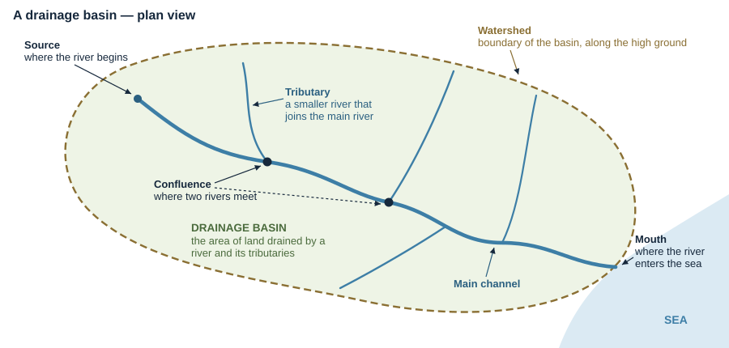
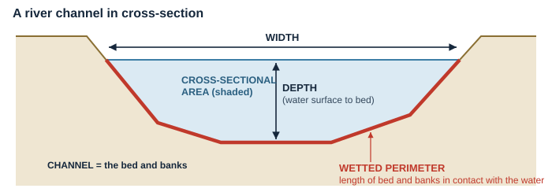
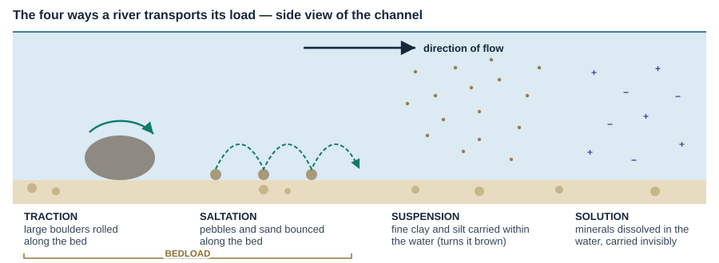

# Rivers and drainage basins: characteristics and processes

## Specification coverage

| Point | Section |
| --- | --- |
| 1.1.1 characteristics of rivers and drainage basins — long profile, width, depth, speed of flow/velocity, discharge, wetted perimeter, channel, watershed, tributary, confluence, source, mouth | §1, §2 |
| 1.1.2 the Bradshaw model | §2 |
| 1.1.3 how the drainage basin operates within the water cycle | §3 |
| 1.1.4 drainage-basin processes — precipitation, interception, infiltration, percolation, overland flow, channel flow, throughflow, groundwater flow, transpiration, evaporation, evapotranspiration | §3 |
| 1.1.5 processes within a river — erosion (hydraulic action, abrasion, attrition, solution); transportation (traction, suspension, saltation, solution); deposition | §4 |

## 1. The drainage basin and the river channel (1.1.1)

*Figure 1. The parts of a drainage basin.*

*Figure 2. Measuring the channel.*

::: definition
**Velocity (speed of flow)** — how fast the water is moving, in metres per second (m/s).

**Discharge** — the volume of water passing a point in the river per second, in cubic metres per
second (m³/s, *cumecs*).

**Discharge = cross-sectional area × velocity** — e.g. a channel with a cross-sectional area of
12 m² flowing at 0.5 m/s has a discharge of 12 × 0.5 = **6 cumecs**.
:::

## 2. The long profile and the Bradshaw model (1.1.1, 1.1.2)

*Figure 3. The Bradshaw model describes how a river's characteristics change from source to mouth.*

**Why each characteristic changes downstream:**

- **Discharge rises** — tributaries join, and more of the basin's water has reached the channel.
- **Width and depth rise** — the larger volume of water erodes a larger channel.
- **Velocity rises, although the gradient falls** — in a wide, deep, smooth channel a smaller share
  of the water touches the wetted perimeter, so proportionally less is slowed by friction.
- **Load quantity rises** — material eroded upstream and brought in by tributaries accumulates.
- **Particle size and bed roughness fall** — attrition and abrasion break the load into smaller,
  rounder pieces, leaving a smoother bed.
- **Gradient falls** — the river approaches base level (sea level), so the long profile flattens.

The model is a generalisation: a band of hard rock, a large tributary, a dam or a straightened
channel can break it locally.

## 3. The drainage basin in the water cycle (1.1.3, 1.1.4)

The **global water cycle** is a **closed system**: the total amount of water on Earth stays the
same, circulating between oceans, atmosphere and land. A **drainage basin** is an **open system**
within it. Water enters as **precipitation** (the input), is held in **stores**, moves between them
by **flows** (transfers), and leaves as **evapotranspiration** and **river discharge to the sea**
(the outputs), which carry it on round the global cycle.

*Figure 4. Inputs, flows, stores and outputs in a drainage basin.*

::: definition
**Precipitation** — moisture falling from the atmosphere to the ground as rain, snow, sleet or hail.

**Interception** — precipitation caught and held by vegetation before it reaches the ground.

**Infiltration** — water soaking into the soil from the ground surface.

**Percolation** — water moving downwards from the soil into the rock beneath.

**Overland flow** — water flowing over the ground surface, when rain falls faster than it can
infiltrate or the soil is already saturated.

**Throughflow** — water moving downslope through the soil towards the river.

**Groundwater flow** — the slow movement of water through saturated rock towards the river.

**Channel flow** — water flowing along the river channel.

**Evaporation** — liquid water changing into water vapour, from water surfaces, wet ground and wet
leaves.

**Transpiration** — water vapour lost from plants, mainly through pores in their leaves.

**Evapotranspiration** — the total loss of water by evaporation and transpiration together.
:::

Overland flow reaches the channel fastest and groundwater flow slowest (it can take months): the more
water that takes the fast route, the faster and higher the river rises (flooding, 1.3).

## 4. Processes within a river (1.1.5)

### Erosion

::: definition
**Hydraulic action** — the force of the water against the bed and banks, which forces air into
cracks; the pressure weakens the rock until pieces break away.

**Abrasion** — the load carried by the river scrapes and rubs against the bed and banks, wearing
them away.

**Attrition** — pieces of load knock against each other, becoming smaller, smoother and rounder.

**Solution** — slightly acidic river water dissolves soluble rock such as limestone and chalk.
:::

Near the source the river is far above base level and erodes **vertically**, deepening the
channel. Further downstream it erodes increasingly **laterally** (sideways), widening the channel
and the valley floor. All erosion is greatest when velocity and discharge are high, as in a flood.

### Transportation

*Figure 5. Which method moves a particle depends on its size and on the river's velocity.*

### Deposition

::: definition
**Deposition** — the dropping of the load when the river no longer has enough energy (velocity) to
carry it.
:::

The river slows, and deposits, when **discharge falls** after a flood or in a dry spell; when
**flood water spreads over the floodplain**; on the **inside of a meander bend**; where the river
**enters the sea or a lake**; and where the **load increases** (e.g. a landslide into the channel).
The largest, heaviest particles are dropped first; fine clay travels furthest.

## Common traps

- **Attrition** wears down the load; **abrasion** wears down the bed and banks.
- **Infiltration** is into the soil; **percolation** is from the soil into the rock.
- **Solution** appears twice: an erosion process (rock dissolved) and a transport process
  (dissolved minerals carried).
- **Discharge** is a volume per second (m³/s), not a speed.
