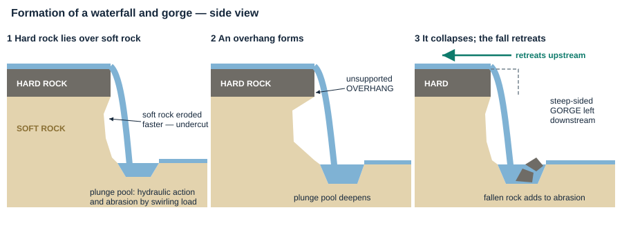
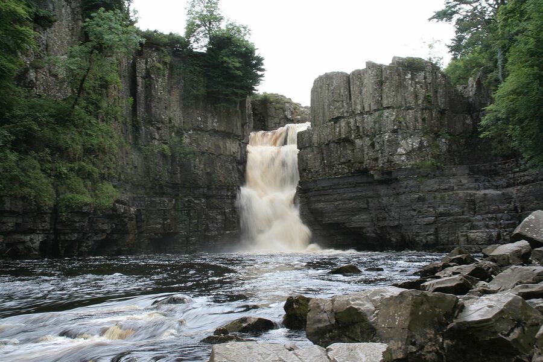
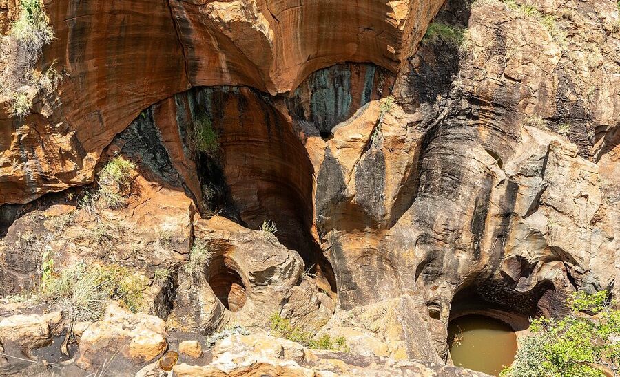
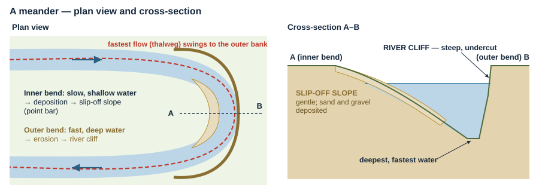
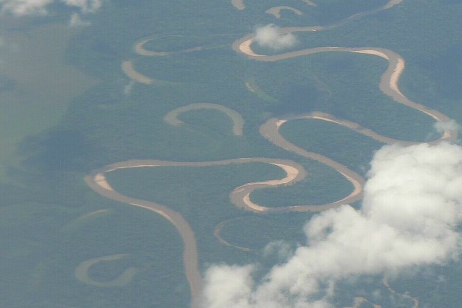
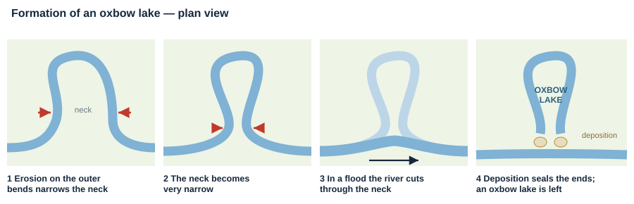
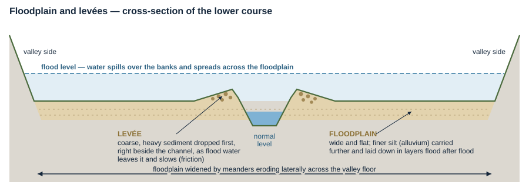
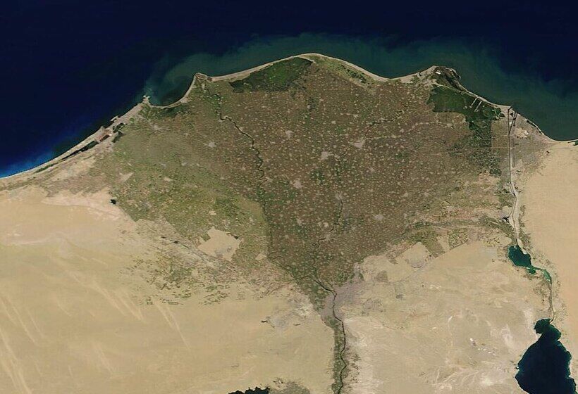

# The main landforms associated with river processes

## Specification coverage

| Point | Section |
| --- | --- |
| 1.2.1 characteristics and formation — V-shaped valleys, interlocking spurs, waterfalls, gorges, rapids, potholes | §1 |
| 1.2.1 characteristics and formation — meanders, oxbow lakes, floodplains, levées, deltas | §2 |

## 1. Upper-course landforms (1.2.1)

### V-shaped valleys and interlocking spurs

*Figure 1. A V-shaped valley is cut down by the river and widened at the top by weathering and mass
movement; interlocking spurs are the ridges the river winds around.*

A **V-shaped valley** has steep sides and a narrow floor filled by the river. The river erodes
**vertically**, while **weathering** loosens the valley sides and **mass movement** carries the
debris down into the river, which transports it away. **Interlocking spurs** are ridges of higher
land projecting alternately from each side of the valley. The river lacks the energy to erode
sideways through them, so it winds around them as it cuts down; looking upstream, they overlap like
the teeth of a zip.

### Waterfalls, gorges and rapids

A **waterfall** is a steep drop in the river's course where it flows over a band of hard rock lying
on top of softer rock. A **gorge** is the narrow, steep-sided valley left downstream as the
waterfall retreats.

*Figure 2. Formation of a waterfall and gorge.*

::: grid
::: card | The sequence to write
1. The river flows over hard, resistant rock lying on softer, less resistant rock.
2. The soft rock is eroded faster by **hydraulic action** and **abrasion**, **undercutting** the
   hard rock.
3. Swirling water and load deepen a **plunge pool** at the foot of the fall.
4. The hard rock is left as an unsupported **overhang**, which eventually **collapses**; the fallen
   blocks add to abrasion in the plunge pool.
5. Repeated, the waterfall **retreats upstream**, leaving a steep-sided **gorge**.
:::

*Figure 3. High Force, England: a hard dolerite band over softer rock, with its plunge pool and
fallen blocks. Photo: Tony Hisgett, CC BY 2.0.*
:::

**Rapids** are stretches of fast, turbulent, shallow water over a steep, uneven bed. They form where
the river crosses **alternating bands of hard and soft rock**: the soft bands are eroded faster,
leaving a series of small steps.

### Potholes

::: grid
::: card | Potholes
**Characteristics:** circular, smooth-sided hollows drilled into a rocky river bed, from a few
centimetres to several metres deep; common in the upper course.

**Formation:** pebbles are trapped in small hollows or cracks in the bed. Eddies in fast, turbulent
water swirl them round, and **abrasion** drills the hollow deeper and wider. Neighbouring potholes
can join up, lowering the bed.
:::

*Figure 4. Potholes at Bourke's Luck, Blyde River, South Africa. Photo: Dietmar Rabich,
CC BY-SA 4.0 (cropped).*
:::

## 2. Middle- and lower-course landforms (1.2.1)

### Meanders

*Figure 5. Erosion on the outer bend and deposition on the inner bend give a meander its
asymmetric cross-section.*

::: grid
::: card | Meanders
A **meander** is a large bend in the river, with an asymmetric cross-section: a steep **river cliff**
on the outer bend and a gentle **slip-off slope** (point bar) on the inner bend.

The outer bank is eroded by **hydraulic action** and **abrasion**, so meanders migrate across the
valley floor and downstream.
:::

*Figure 6. Meanders and oxbow lakes on the Río Madidi, Bolivia. Photo: Grullab, CC BY-SA 4.0
(cropped).*
:::

### Oxbow lakes

*Figure 7. An oxbow lake is a horseshoe-shaped lake cut off from the main river.*

### Floodplains and levées

*Figure 8. Floodplain and levées are both built by deposition when the river floods.*

A **floodplain** is the wide, flat area either side of the river in the lower course, which floods
when the river overflows. Meanders migrating by **lateral erosion** widen the valley floor, and each
flood spreads a layer of **alluvium** (silt) across it. **Levées** are raised banks of coarse
sediment along the channel edges, built up flood after flood (Figure 8).

### Deltas

::: grid
::: card | Deltas
**Characteristics:** a flat, low-lying area of sediment at the river's mouth, where the channel
splits into many smaller channels called **distributaries**.

**Formation:**

1. The river enters the sea or a lake, and its **velocity falls sharply**, so it deposits its load.
2. In salt water, fine clay particles stick together (**flocculate**) and sink.
3. Sediment builds up faster than tides and currents can remove it, so deltas form where the sea is
   sheltered and the river's load is large.
4. The deposits rise above water level; the river splits into distributaries around them, and
   vegetation colonises and stabilises the land.
:::

*Figure 9. The Nile Delta, Egypt — a fan-shaped (arcuate) delta. Image: NASA MODIS, public domain.*
:::

## Common traps

- **Waterfalls need hard rock over soft rock.** Explain why the soft rock erodes faster — not just
  "the water erodes the rock".
- **Meander cross-sections are asymmetric:** river cliff (steep, outer, erosion) versus slip-off
  slope (gentle, inner, deposition). Do not swap them.
- **Oxbow lakes** need the neck to be cut through *during a flood*, then *deposition* to seal the
  ends — both steps earn marks.
