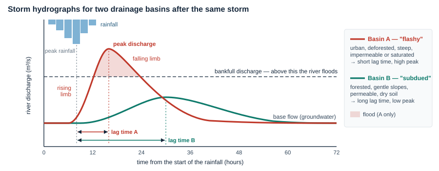
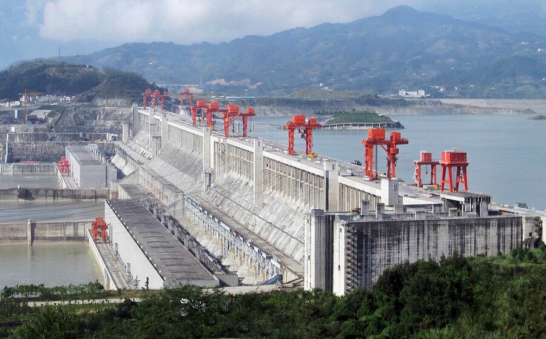
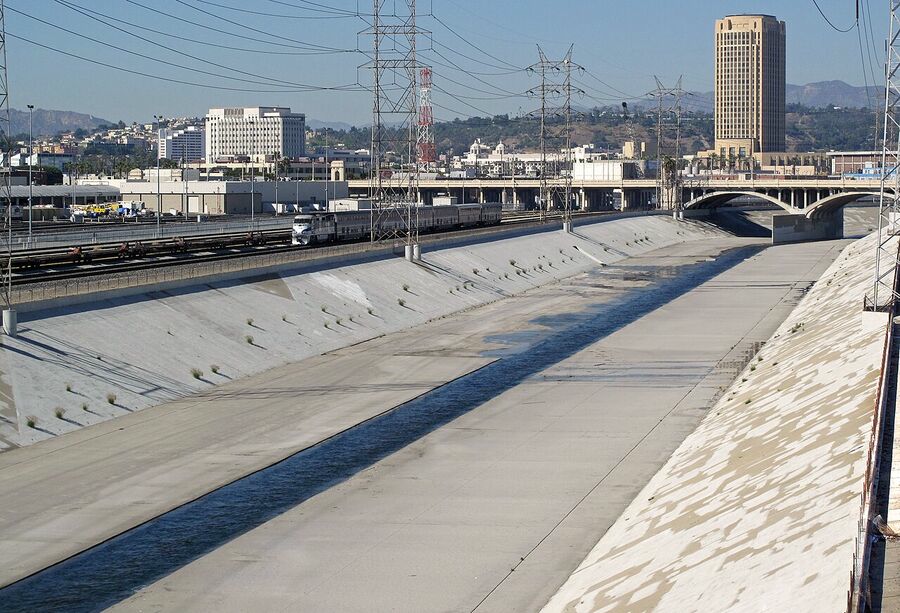
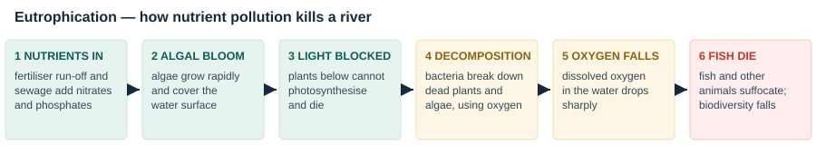
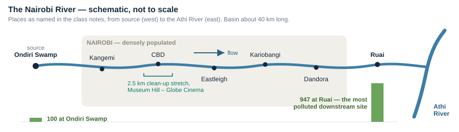

# Rivers present opportunities and hazards for people

## Specification coverage

| Point | Section |
| --- | --- |
| 1.3.1 opportunities and hazards of living near a river | §1 |
| 1.3.2 human and natural causes of river flooding | §2 |
| 1.3.3 impacts of river flooding | §3 |
| 1.3.4 evaluation of strategies and techniques to manage river flooding, incl. sustainable | §4 |
| 1.3.5 human causes of river pollution | §5 |
| 1.3.6 impacts of river pollution | §5 |
| 1.3.7 evaluation of strategies and techniques to manage river pollution, incl. sustainable | §6 |
| 1.3.8 detailed specific example: flood on a named river — causes, impacts, management incl. sustainable | §7 — **MISSING_SOURCE, placeholder** |
| 1.3.9 detailed specific example: pollution in a named river — causes, impacts, management incl. sustainable | §8 — Nairobi River: class source + authorised research (`source/RESEARCH_1.3.9_Nairobi_River_management.md`) |

## 1. Opportunities and hazards of living near a river (1.3.1)

::: grid
::: card | Opportunities
- **Water supply** — for drinking, irrigation and industry.
- **Fertile farmland** — floodplain alluvium is rich, flat and easy to irrigate.
- **Flat land for building** — floodplains suit settlements, roads and railways.
- **Transport and trade** — navigable rivers carry goods; crossing points and ports grow into towns.
- **Energy** — hydroelectric power; cooling water for power stations.
- **Food and leisure** — fishing, tourism and recreation.
:::
::: card | Hazards
- **Flooding** — loss of life, homes, crops and infrastructure (sections 2–4).
- **Pollution** — contaminated water spreads disease and kills wildlife (sections 5–6).
- **Bank erosion** — land and buildings lost as the channel migrates or banks collapse.
- **Water-related disease** — cholera and typhoid from dirty water; malaria from mosquitoes breeding
  in standing water.
:::
:::

## 2. Causes of river flooding (1.3.2)

::: definition
**River flood** — when discharge exceeds the capacity of the channel, so water overflows the banks
onto the surrounding land.

**Lag time** — the time between peak rainfall and peak discharge. A short lag time and a high peak
mean a high flood risk.
:::

*Figure 1. Every cause of flooding either adds more water or gets it to the channel faster — giving
the short lag time and high peak of basin A.*

::: grid
::: card | Natural causes
- **Prolonged rainfall** — the soil becomes saturated, so further rain runs off as overland flow.
- **Intense rainfall** (thunderstorms, monsoon, tropical storms) — rain falls faster than it can
  infiltrate.
- **Rapid snowmelt** — a large volume of water released at once, often onto frozen ground.
- **Impermeable rock, frozen or baked ground** — water cannot infiltrate.
- **Steep slopes** — water runs off quickly, with little time to infiltrate.
:::
::: card | Human causes
- **Urbanisation** — concrete and tarmac are impermeable; drains carry water straight to the river.
- **Deforestation** — less interception and transpiration; eroded soil washed into the river raises
  its bed and reduces channel capacity.
- **Farming** — ploughing and overgrazing compact the soil and increase run-off.
- **Channel straightening upstream** — speeds water to places lower down the river.
- **Building on the floodplain** — removes land that stored flood water and puts people in its path.
- **Climate change** — more frequent intense rainfall.
:::
:::

## 3. Impacts of river flooding (1.3.3)

::: grid
::: card | Negative
- **Social** — deaths and injuries by drowning; homes destroyed, people made homeless; drinking water
  contaminated, spreading cholera and other waterborne diseases; schools and services closed.
- **Economic** — damage to property, roads, bridges and power supplies; crops and livestock lost;
  businesses closed; cost of emergency response, repair and insurance.
- **Environmental** — soil erosion; sewage and chemicals spread across the land; habitats damaged.
:::
::: card | Positive
- **Economic** — fresh silt makes floodplain farmland more fertile; water stored in soils and
  groundwater for later use.
- **Environmental** — wetlands and floodplain habitats renewed; groundwater recharged.
:::
:::

Impacts operate at every scale: **local** (homes, farms), **regional** (roads and power cut off),
**national** (rebuilding costs, food prices) and sometimes **global** (disrupted trade). Deaths are
usually higher in **lower-income countries** (poorer housing, fewer warnings and less emergency
support); economic losses are usually higher in **higher-income countries** (more valuable property
and infrastructure).

## 4. Managing river flooding: an evaluation (1.3.4)

**Strategies** are the plans and agreements — a flood-management plan for the whole basin, land-use
zoning laws, a national flood-warning service, agreements between countries sharing a river.
**Techniques** are the methods used: **hard engineering** builds structures to control the river;
**soft engineering** works with natural processes or changes how people use the land.

::: grid

*Figure 2. Dam and reservoir — Three Gorges Dam, Yangtze River, China. Photo: Le Grand Portage (derivative: Rehman),
CC BY 2.0.*

*Figure 3. Channelisation — the concrete-lined Los Angeles River, USA. Photo: Downtowngal,
CC BY-SA 3.0.*
:::

| Technique | What it achieves | What it costs or fails to do | Sustainable? |
| --- | --- | --- | --- |
| **Dam and reservoir** — stores water upstream, releases it slowly | Cuts peak discharge downstream; also supplies water and HEP | Very expensive; floods valleys and displaces people; traps silt, so farmland below loses fertility; risk of failure | **Partly** — long-lasting and multipurpose, but high social and environmental cost |
| **Channelisation** — straightening, deepening or lining the channel | Carries flood water quickly past a town | Moves the flood downstream; destroys habitats; needs repeated dredging | **No** — passes the problem on |
| **Embankments and flood walls** — raise the banks | Protect a specific area; earth embankments are fairly cheap | Can be overtopped or breached, then water cannot drain back; encourage building behind them | **Partly** |
| **Flood relief channel** — diverts excess water around a settlement | Keeps flood water away from the town | Expensive; needs land; may pass water downstream | **Partly** |
| **Afforestation** — planting trees in the upper basin | More interception and infiltration, longer lag time; less soil erosion; cheap | Slow to take effect; takes land from farming | **Yes** — treats the cause |
| **Floodplain zoning** — no building on high-risk land, which is kept for parks, sport or farming | Cheap; reduces damage; the floodplain stores water naturally | Does not protect existing buildings; hard to enforce where land is scarce | **Yes** |
| **River restoration and wetlands** — restore meanders and let wetlands flood | Stores water and slows the flow; restores habitats; cheap to maintain | Uses land; little effect on the largest floods | **Yes** |
| **Prediction, warnings and preparation** — forecasts, warning systems, evacuation plans, flood-proofed buildings | Saves lives; people move belongings and evacuate; cheap | Does not stop the flood or protect land; depends on people receiving and acting on warnings | **Yes** |

::: card | Reaching a judgement
Judge on: the **value of what is protected** (a flood wall is justified in a city centre, not beside
farmland); whether it treats the **cause** (run-off) or only controls the river; whether it
**moves the flood downstream**; **cost over time**, including maintenance; and whether it still
works as **climate change** brings bigger floods. The usual conclusion: soft measures across the
basin, with hard defences only where valuable property is at risk, give the most effective and
sustainable protection.
:::

## 5. Human causes and impacts of river pollution (1.3.5, 1.3.6)

| Human cause | What enters the river | Main impact |
| --- | --- | --- |
| **Untreated sewage** — homes without sewers, overflowing drains | Human waste, bacteria, nutrients | Waterborne disease (cholera, typhoid, dysentery); eutrophication |
| **Farming** | Fertilisers (nitrates, phosphates), pesticides, animal waste, soil | Eutrophication; pesticides poison wildlife |
| **Industry** | Chemicals, heavy metals, hot water | Toxic to wildlife and people; metals build up in food chains; hot water holds less oxygen |
| **Mining** | Heavy metals, acidic water, sediment | Kills river life; contaminates drinking and irrigation water |
| **Solid waste dumping** | Plastics and household rubbish | Harms wildlife; blocks channels, worsening floods |
| **Urban run-off and transport** | Oil, fuel and litter from roads | Toxic to river life |

*Figure 4. Eutrophication — the main way sewage and fertiliser kill river life.*

The impacts reach well beyond the river:

- **Social** — disease and poisoning, worst where people drink, wash or irrigate with river water.
- **Economic** — higher water-treatment costs; fisheries and tourism lost; contaminated crops; health
  costs and lost working days.
- **Environmental** — loss of biodiversity, leaving only pollution-tolerant species.
- **Scale** — pollution travels downstream, affecting places, and even other countries, far from its
  source.

## 6. Managing river pollution: an evaluation (1.3.7)

**Strategies** include laws setting water-quality and discharge standards, permits and fines (the
**polluter pays** principle), environmental agencies that monitor water quality, and agreements
between countries sharing a river.

| Technique | What it achieves | What it costs or fails to do | Sustainable? |
| --- | --- | --- | --- |
| **Sewage treatment works and sewer connections** | Removes the largest cause at source; cuts disease sharply | Very expensive to build and run; hard to reach informal settlements; overflows in heavy rain | **Yes, if maintained** — treats the cause |
| **Effluent treatment, permits and fines** | Forces polluters to clean up and pay | Needs constant monitoring and enforcement; fines may be cheaper than compliance | **Yes, if enforced** |
| **Buffer strips and riverside planting** | Vegetation traps soil and absorbs fertiliser run-off; stabilises banks; cheap; habitat | Takes land from farming; filters run-off only | **Yes** |
| **Less fertiliser and pesticide** — rules on use and timing, organic farming | Cuts nutrients at source | Can lower yields or raise farmers' costs; hard to check many farms | **Yes** |
| **Waste collection, recycling and clean-ups** | Removes rubbish; visible results; involves communities | Clean-ups treat the symptom — rubbish returns unless collection improves | **Collection yes; one-off clean-ups no** |

::: card | Reaching a judgement
Prevention at source (sewers, treatment, less fertiliser) beats cleaning up afterwards. The weak link
is usually **enforcement and funding**, especially in fast-growing cities of lower-income countries,
where population outgrows sewer building. A sustainable scheme treats the cause, is affordable to
maintain, and gives local people a reason to protect the river.
:::

## 7. Detailed specific example: a river flood (1.3.8)

> ⚠ Case study source needed — Specification 1.3.8  
> Required detailed specific example not found in the supplied class sources.

## 8. Detailed specific example: pollution of the Nairobi River, Kenya (1.3.9)

> Location, causes and impacts come **only** from the class case-study document. The management
> section comes from research you authorised on 22 September 2026 and is marked as such.

**Location.** The **Nairobi River** flows through **Nairobi**, Kenya's capital. It starts near
**Ondiri Swamp**; its basin is about **40 km long**. It passes through densely populated areas —
**Kangemi, the CBD, Eastleigh, Kariobangi and Dandora** — then joins the **Athi River**.

*Figure 5. Schematic only — it shows the places and figures named in the class notes.*

### Causes of pollution

- **Untreated sewage** — many sewer lines and open drains discharge straight into the river; in 2024
  Kenya's Environment Cabinet Secretary said some of the water companies' sewer lines ended in it.
  *Evidence:* **E. coli up to 1,000,000 units per 100 ml**.
- **Industrial waste** — factories discharge effluent, chemicals and solid waste. In **October 2024**
  the Ministry of Environment identified **145 factories and slaughterhouses** polluting the river.
  *Evidence:* **lead, copper, chromium, zinc and manganese** above WHO and NEMA limits.
- **Solid waste dumping** — household, plastic and market waste from settlements. *Evidence:* a
  clean-up removed **6,000 tonnes** from a **2.5 km** stretch between **Museum Hill and Globe
  Cinema** alone.
- **Rapid urbanisation** — about **5.5 million** people in the urban area, at about **6,247 people
  per km²**, overload sanitation and waste systems.

### Impacts of pollution

- **Health (social)** — **cholera, typhoid and dysentery**, where people use the river for washing,
  cleaning or irrigation; safe drinking water should contain **no E. coli at all**.
- **Ecosystem damage (environmental)** — low diversity of river-bed organisms at **Naivasha,
  Kamukunji, Mwiki and Ruai**, dominated by pollution-tolerant groups (Diptera, Oligochaeta,
  Hirudinea).
- **Eutrophication (environmental)** — algal counts rise from **100 at Ondiri Swamp** to **947 at
  Ruai**, the most polluted downstream site.
- **Contaminated farming (economic and social)** — urban farmers irrigate with polluted river and
  sewage water, contaminating soil and crops and causing illness when the crops are eaten.

### Strategies and techniques used to manage pollution levels

::: note | Researched — not from your class notes
Sources: Nairobi Rivers Commission; Athi Water Works Development Agency; Business Daily Africa;
Urban Nature Atlas; Pambazuka News (retrieved 22 September 2026).
:::

| Strategy | What it is |
| --- | --- |
| **Nairobi Rivers Commission** | One body, formally created on **25 October 2024**, to coordinate every agency working on the basin — earlier efforts failed partly because responsibility was split |
| **Nairobi Rivers Basin Regeneration Programme** | The restoration plan for about **175 km** of river over **5–10 years**: sewerage, solid waste, riverbank protection, riverside redevelopment |
| **Climate WorX** (from **1 October 2024**) | Young people paid to collect rubbish, repair sewers, unclog drains and plant trees — about **39,400 a month by July 2025** |
| **Regulation and enforcement** | NEMA licenses effluent discharges; the **145** polluting factories and slaughterhouses were named and threatened with closure |
| **Relocation** | Households cleared from the riverbank reserve; about **30,000** affordable homes projected |

**Techniques.** The **Sewerage Improvement Project** (African Development Bank, **2019–2023**) laid
about **445 km** of sewers and made about **11,700** household connections plus **700** in informal
settlements, serving over **400,000** residents and raising Nairobi's sewer coverage from **48% to
55%**. The programme also includes twin trunk sewers along both banks, decontaminating the
**Dandora** dumpsite, and stabilising banks with **gabions** and tree planting. The **2.5 km Museum
Hill–Globe Cinema stretch** is now the **John Michuki Memorial Park** (from **2020**): **6,357**
indigenous trees, gabions built by over **120** young people, a **2.4 km** walkway, and a Community
Forest Association that manages the site.

**Evaluation and sustainability.** Sewer connections are the strongest measure: they remove the
largest cause at source. Michuki Park shows the techniques work where they are maintained, and
Climate WorX is socially sustainable because it pays the poorest residents to protect the river. But
the UNEP-backed **Nairobi River Basin Programme (1999–2008) failed** — recommendations not carried
out, weak enforcement, little community involvement, fading political will — and the same risks
remain: Climate WorX depends on an annual budget, demolitions displace people before new homes exist,
and the Dandora dumpsite is still there. **Judgement:** more likely to last than earlier attempts, because it builds works
rather than commissioning studies, but only with **sustained funding, maintained infrastructure and
enforcement that survives a change of government**.

## Common traps

- **"Evaluate"** needs a judgement with a reason, not just a list of advantages and disadvantages.
- **Case-study answers** need the place and figures: *Nairobi River, 145 factories, E. coli up to
  1,000,000 units per 100 ml, algae 100 → 947*.
