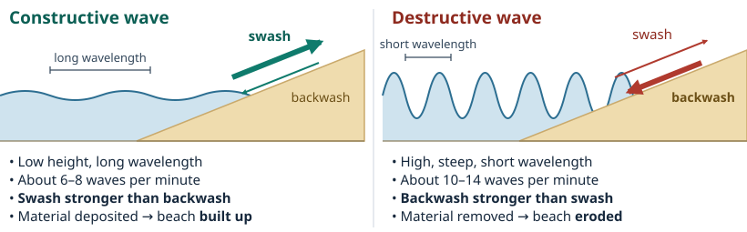
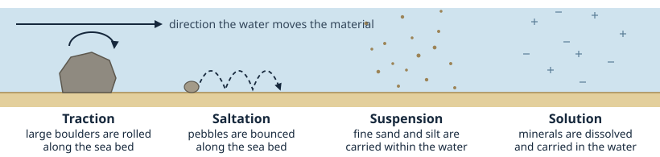
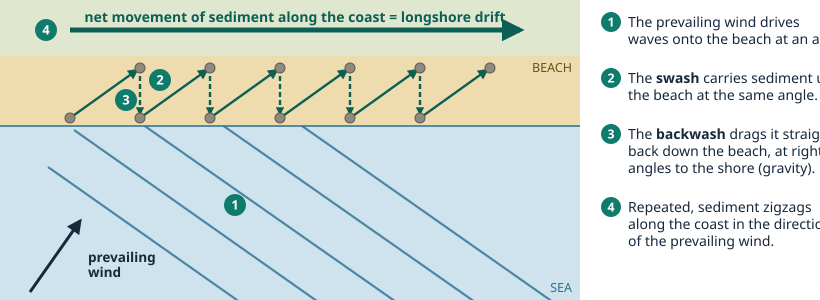
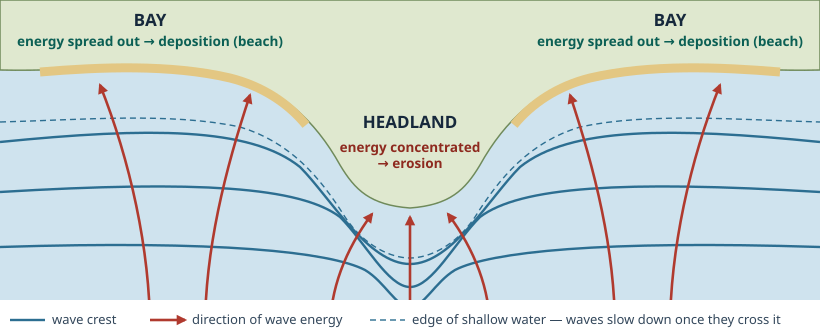

# Physical processes that shape the coast

## Specification coverage

| Point | Section |
| --- | --- |
| 2.1.1 Coastal erosion: hydraulic action, corrosion, corrasion, attrition | §2 |
| 2.1.1 Transportation | §3 |
| 2.1.1 Longshore drift | §4 |
| 2.1.1 Deposition | §5 |
| 2.1.2 Types of waves: constructive and destructive | §1 |
| 2.1.2 Wave refraction | §6 |

## 1. Constructive and destructive waves

Waves are made by wind blowing over the sea. The stronger the wind, the longer it blows and the
longer the **fetch** (the distance of open water it blows across), the bigger and more powerful
the waves.

::: definition
**Swash** — the water that rushes up the beach after a wave breaks.

**Backwash** — the water that flows back down the beach to the sea, under gravity.
:::

*Figure 1. Constructive and destructive waves.*

Destructive waves come with storms and strong local winds; constructive waves with calmer
weather.

## 2. Coastal erosion

Erosion by the sea is fastest when waves are destructive.

::: definition
**Hydraulic action** — the force of waves hitting the cliff. Water forces air into cracks; the
compressed air widens the cracks until pieces of rock break off.

**Corrasion** — waves throw sand and pebbles against the cliff, which chip and scrape it away.

**Attrition** — rocks carried by the waves knock against each other and become smaller and
rounder.

**Corrosion** — weak acids in seawater dissolve soluble rocks such as limestone and chalk.
:::

::: pagebreak
:::

## 3. Transportation

Eroded material (the **load**) is moved by waves and currents in four ways.

*Figure 2. The size of the material decides how it is carried.*

## 4. Longshore drift

::: definition
**Longshore drift** — the movement of sediment along the coast by waves that approach the beach
at an angle.
:::

*Figure 3. Longshore drift in plan view.*

## 5. Deposition

::: definition
**Deposition** — the sea drops the material it is carrying because it no longer has the energy
to move it.
:::

Deposition happens where:

- **constructive waves** dominate (swash stronger than backwash);
- water is **sheltered** and wave energy is low — bays, estuaries, behind spits;
- longshore drift reaches a place where the **coastline changes direction** (→ spits, 2.2);
- there is a **large supply of sediment**, e.g. from rivers or eroding cliffs.

## 6. Wave refraction

::: definition
**Wave refraction** — the bending of wave crests as they approach an uneven coastline, because
waves slow down in shallow water.
:::

*Figure 4. Wave refraction between a headland and bays.*

1. Water is shallower off a headland than in the bays beside it.
2. The part of each crest nearing the headland drags on the sea bed and slows; the parts in
   deeper water keep moving.
3. The crest bends until it is almost parallel to the coast.
4. Energy converges on the headland (erosion → cliffs, caves, arches, stacks) and spreads out
   in the bays (deposition → beaches).

## Common traps

| Wrong | Right |
| --- | --- |
| Corrasion and corrosion are the same | Corrasion = material *thrown* at the cliff; corrosion = rock *dissolved* |
| Attrition erodes the cliff | Attrition wears down the load (pebbles), not the cliff |
| Backwash returns at the same angle as the swash | Backwash runs straight down the beach, at right angles to the shore |
| Destructive waves just means big waves | Their **backwash is stronger than their swash**, so they remove material |
